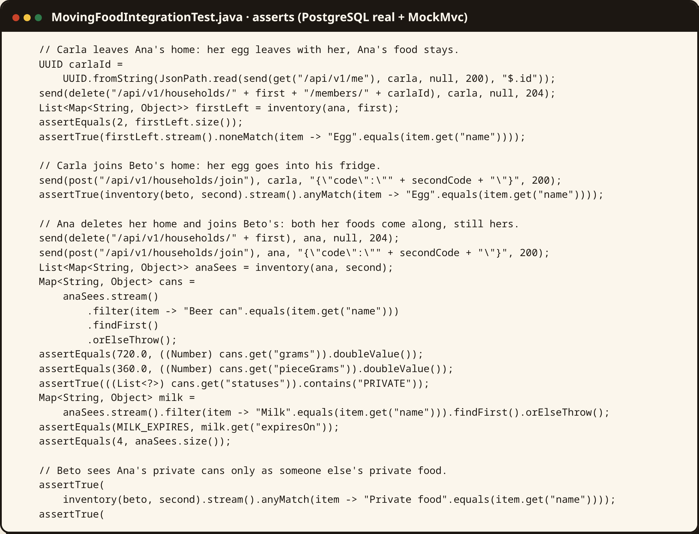
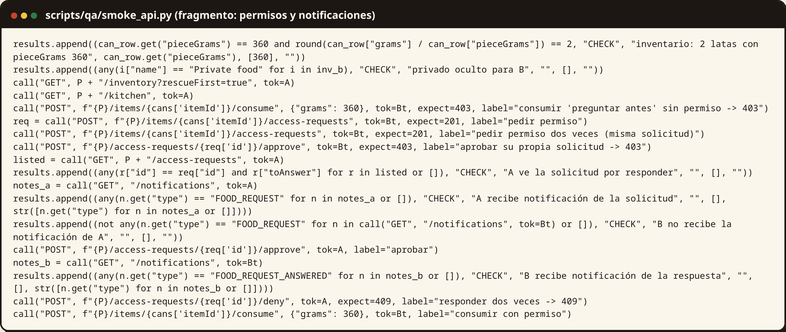
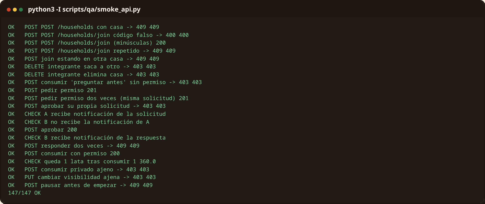
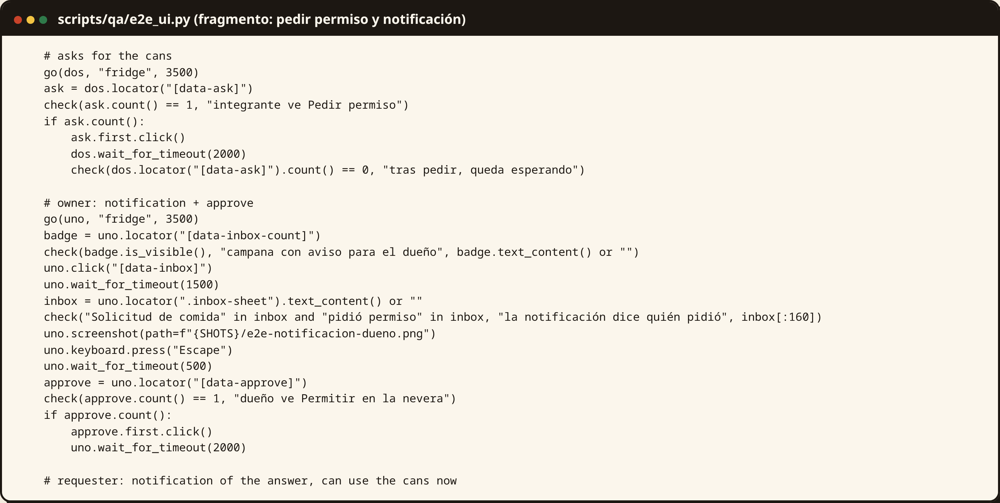
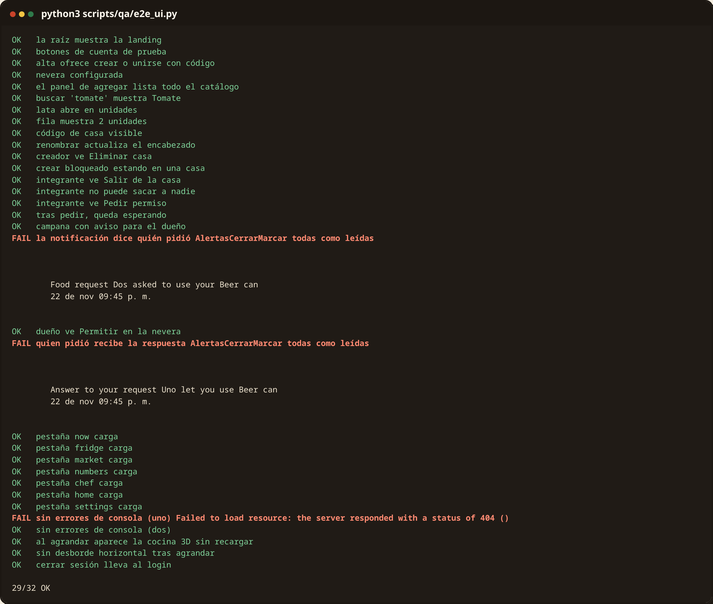
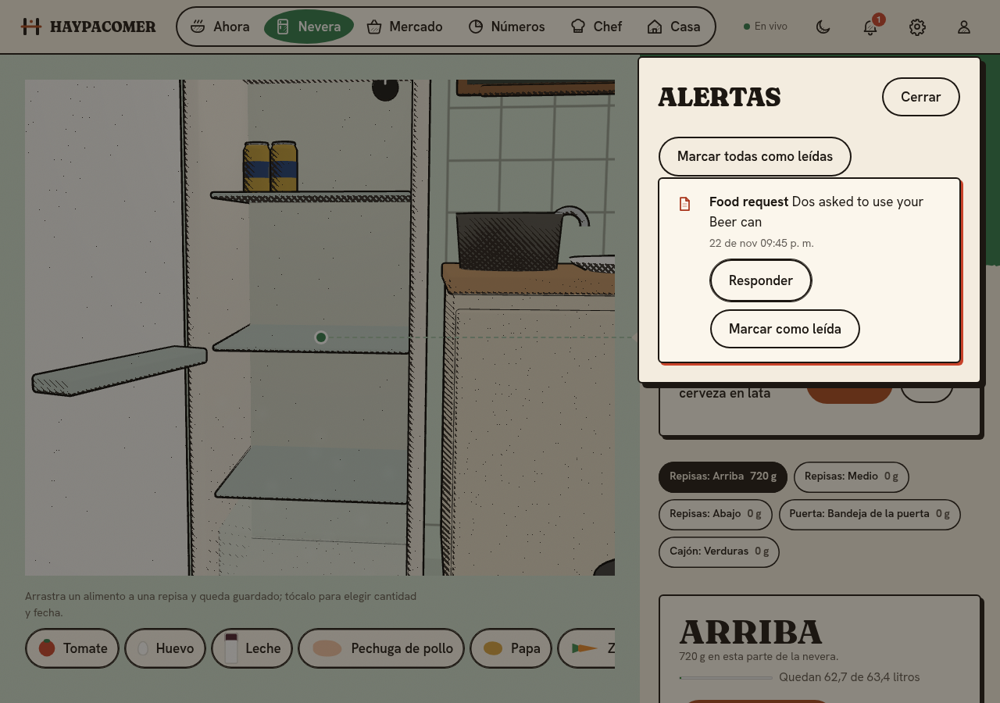
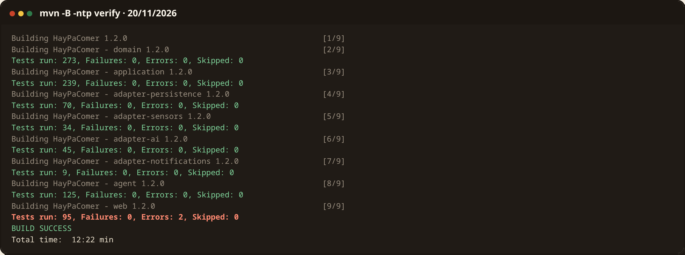
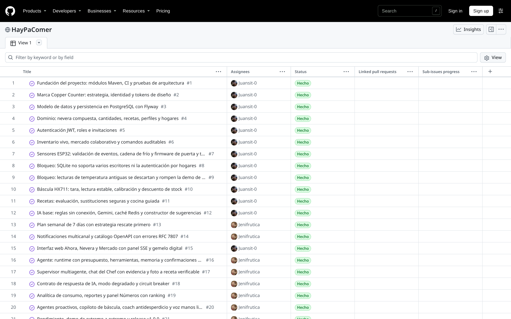

# Pruebas de HayPaComer: unitarias, de integración y automatizadas

Este documento reúne todo lo que pide la entrega de Calidad de Software:

- qué pruebas hay;
- cómo se automatizaron, con los scripts y los resultados reales;
- el tablero de GitHub Projects (lo usamos en lugar de Jira);
- qué se hizo con agentes de IA;
- quién trabajó en qué;
- los bloqueos con su solución.

El detalle de la versión 1.2.0 (los 25 casos del plan con captura de código y de resultado, y el catálogo prueba por prueba) sigue en [`../sprint-4/README.md`](../sprint-4/README.md). Aquí está el estado actual (20 y 21 de noviembre de 2026).

- [1. Resumen](#1-resumen)
- [2. Tipos de prueba](#2-tipos-de-prueba)
- [3. Cómo se automatizaron](#3-cómo-se-automatizaron)
- [4. Las tres pruebas automatizadas que exponemos](#4-las-tres-pruebas-automatizadas-que-exponemos)
- [5. Resultados](#5-resultados)
- [6. Defectos que encontraron las pruebas](#6-defectos-que-encontraron-las-pruebas)
- [7. Tablero en GitHub Projects](#7-tablero-en-github-projects)
- [8. Qué se hizo con agentes de IA](#8-qué-se-hizo-con-agentes-de-ia)
- [9. Quién trabajó en qué](#9-quién-trabajó-en-qué)
- [10. Bloqueos encontrados y soluciones](#10-bloqueos-encontrados-y-soluciones)

## 1. Resumen

| Nivel | Herramienta | Cantidad | Resultado |
| --- | --- | ---: | --- |
| Unitarias, integración, API y arquitectura (backend) | JUnit 6, MockMvc, Testcontainers, ArchUnit | **890** | 888 aprobadas; 2 no aplican en local (ver 5) |
| Interfaz web | `node --test` y revisión de textos | **23** | 23 / 23 |
| API de extremo a extremo | [`scripts/qa/smoke_api.py`](../scripts/qa/smoke_api.py) | **147 comprobaciones** | 147 / 147 |
| Navegador de extremo a extremo | [`scripts/qa/e2e_ui.py`](../scripts/qa/e2e_ui.py) (Playwright) | **32 comprobaciones** | 29 / 32: **3 fallos reales** (ver 6) |
| Plan de pruebas del curso | [`Plan de Pruebas HayPaComer.xlsx`](../presentacion/Plan%20de%20Pruebas%20HayPaComer.xlsx) | 31 casos (25 de la v1.2.0 + 6 nuevos) | 30 / 31 (QC007 encontró 2 defectos) |

## Pruebas que salen en las diapositivas

| Diapositiva | Prueba | Archivo | Caso en el Excel | Tarea de VS Code |
| --- | --- | --- | --- | --- |
| 7 | Integración: la comida viaja con su dueño | [`HayPaComer-backend/web/src/test/java/dev/haypacomer/web/household/MovingFoodIntegrationTest.java`](https://github.com/Juansit-0/HayPaComer-backend/blob/main/web/src/test/java/dev/haypacomer/web/household/MovingFoodIntegrationTest.java) | QC005 | `Prueba 1 · Integración` |
| 8 | API de extremo a extremo | [`scripts/qa/smoke_api.py`](../scripts/qa/smoke_api.py) | QC006 | `Prueba 2 · API de extremo a extremo` |
| 9 | Navegador de extremo a extremo | [`scripts/qa/e2e_ui.py`](../scripts/qa/e2e_ui.py) | QC007 | `Prueba 3 · Navegador de extremo a extremo` |
| 5 y 10 | Unitarias nuevas: código de casa, solicitudes de permiso, notificación dirigida | `JoinCodeTest`, `AccessRequestTest`, `NotificationChannelsTest` (backend) | QA022, QA023, QA024 | `Unitarias nuevas` |

Todas están también en el [plan de pruebas en Excel](../presentacion/Plan%20de%20Pruebas%20HayPaComer.xlsx), que pasa de 25 a 31 casos. Para abrirlas y correrlas en VS Code, abre `haypacomer-pruebas.code-workspace` (en la raíz de este repo) y entra a **Terminal → Run Task**.

## 2. Tipos de prueba

- **Unitaria:** prueba una clase sola, en memoria, sin Spring, base de datos ni red. Ejemplos: `JoinCodeTest` (el código de casa tiene 8 caracteres sin O, 0, I ni 1, y nunca da el rol de dueño) y `AccessRequestTest` (una solicitud se responde una sola vez y nadie se pide permiso a sí mismo).
- **Integración:** levanta la aplicación Spring completa contra **PostgreSQL 18 real** en Docker (Testcontainers) y le hace peticiones HTTP con MockMvc. Ejemplo: `MovingFoodIntegrationTest`.
- **API (MockMvc):** prueba un controlador con sus validaciones y errores, sin base de datos. Ejemplo: `HouseholdControllerTest`.
- **Arquitectura:** ArchUnit falla si el dominio importa Spring, o si un caso de uso tiene más de un método público.
- **De extremo a extremo:** prueban el sistema desplegado desde fuera, por la API (`smoke_api.py`) y con un navegador (`e2e_ui.py`).

## 3. Cómo se automatizaron

```text
git push  ─►  GitHub Actions  ─►  mvn -B -ntp verify  ─►  ¿todo verde?  ─►  merge y despliegue en Render
                                     │
                                     ├─ compila los 8 módulos
                                     ├─ JUnit: unitarias, integración (Testcontainers), API, arquitectura
                                     ├─ JaCoCo: falla si la cobertura de domain/application/agent baja del 80 %
                                     └─ construye la imagen Docker
```

- **En cada push:** GitHub Actions corre `mvn -B -ntp verify` en el backend (workflow en `.github/workflows/ci.yml` del repo backend) y `npm run check` en la web. Si algo falla, el merge queda bloqueado y Render no despliega. Capturas del workflow y de la regla del 80 %: [`../sprint-4/README.md#1-cómo-se-automatizan-las-pruebas`](../sprint-4/README.md#1-cómo-se-automatizan-las-pruebas).
- **En local:** el mismo comando `mvn -B -ntp verify`, con Docker abierto para Testcontainers y JDK 25.
- **De extremo a extremo:** los dos scripts de [`scripts/qa`](../scripts/qa/README.md) se corren contra el servidor (`http://localhost:8090` o la URL desplegada). Cada uno imprime `OK` o `FAIL` por comprobación y el total al final.

## 4. Las tres pruebas automatizadas que exponemos

### 4.1 Integración: la comida viaja con su dueño a la nueva casa

`MovingFoodIntegrationTest` (backend, módulo `web`) arranca la app con un PostgreSQL 18 real y, en una sola prueba:

1. Ana guarda 2 latas privadas y leche con fecha; Carla se une con el código y guarda huevos.
2. Carla sale de la casa: sus huevos se van con ella y lo de Ana se queda.
3. Carla se une a la casa de Beto y sus huevos entran a su nevera.
4. Ana elimina su casa y se une a la de Beto: sus latas llegan con 720 g, 360 g por unidad, todavía privadas, y la leche llega con su fecha.
5. Beto ve las latas de Ana solo como "Alimento privado".



### 4.2 API de extremo a extremo: `smoke_api.py`

Recorre la API con tres personas y revisa los códigos HTTP y las reglas: una casa por persona, permisos, unidades, y que cada notificación le llegue solo a quien debe.





Salida completa: [`resultado-smoke.txt`](resultado-smoke.txt).

### 4.3 Navegador de extremo a extremo: `e2e_ui.py`

Abre Chromium con dos personas y hace el recorrido completo:

1. Registro, crear la casa y configurar la nevera.
2. Agregar 2 latas por unidades.
3. La otra persona se une con el código y pide permiso.
4. Al dueño le llega la notificación y aprueba.
5. A quien pidió le llega la respuesta.
6. Cambiar de teléfono a pantalla completa sin recargar, y cerrar sesión.





Captura tomada por la prueba en el paso de la notificación:



Salida completa: [`resultado-e2e.txt`](resultado-e2e.txt).

## 5. Resultados

**Backend, `mvn -B -ntp verify`, 20/11/2026, local con Docker y JDK 25: 890 pruebas, `BUILD SUCCESS` en 12:22 min.**



| Módulo | Pruebas |
| --- | ---: |
| domain | 273 |
| application | 239 |
| adapter-persistence | 70 |
| adapter-sensors | 34 |
| adapter-ai | 45 |
| adapter-notifications | 9 |
| agent | 125 |
| web | 95 |
| **Total** | **890** |

Los 2 errores de `web` son de `WebTextsTest`. Esa prueba lee la interfaz web copiada dentro del backend, como hace el CI antes de compilar. En local no se copió, así que no encontró la carpeta (`NoSuchFileException`). Lo que revisa (que cada texto exista en español e inglés) pasa en `npm run check` del repo web: 23 / 23 y 0 textos faltantes.

**Pruebas nuevas desde la v1.2.0**, todas aprobadas:
- `JoinCodeTest`, `AccessRequestTest` (dominio);
- `NotificationChannelsTest.aNotificationForOnePersonReachesOnlyThem` (aplicación);
- `DemoAccountControllerTest` (web);
- `MovingFoodIntegrationTest` (integración, 2 pruebas).

Además se actualizó una decena de pruebas existentes que verificaban la regla anterior de roles (antes un integrante no podía renombrar, montar la nevera ni conectar sensores; ahora sí puede).

## 6. Defectos que encontraron las pruebas

| # | Encontrado por | Defecto | Causa | Estado |
| --- | --- | --- | --- | --- |
| 1 | `e2e_ui.py` (21/11) | Las notificaciones de permisos salen en inglés ("Food request · Dos asked to use your Beer can") | Las frases del servidor se traducen desde la tabla `message_templates`, y las migraciones V83, V85 y V89 las escribieron en `translations` | Abierto, planeado: [#46](https://github.com/NicoalsD/HayPaComer-docs/issues/46), sprint 5 |
| 2 | `e2e_ui.py` (21/11) | `GET /market-budget` responde 404 y el navegador lo registra como error | Que una casa aún no tenga presupuesto es un estado normal, pero la API lo responde como "no encontrado". La interfaz no se rompe; solo queda el error en la consola | Abierto, planeado: [#47](https://github.com/NicoalsD/HayPaComer-docs/issues/47), sprint 5 |
| 3 | Prueba manual + `e2e_ui.py` | "Tomate" aparecía dos veces en el catálogo: el de la IA y el original | La IA aprendía el nombre en español como un alimento nuevo | **Resuelto** (V90 y búsqueda por nombre traducido) |
| 4 | Prueba manual | El panel de agregar no mostraba el tomate | El catálogo se cortaba en 60 alimentos y ya hay 72 | **Resuelto** |
| 5 | `smoke_api.py` | Eliminar una casa daba 409 | `food_access_grants.granted_by` no se borra en cascada | **Resuelto** (se borran los permisos primero) |
| 6 | `MovingFoodIntegrationTest` | La comida con fecha vencida no se podía llevar a la nueva casa | La fecha ya no era posible al desempacar | **Resuelto** (se usa una fecha estimada) |

### Por qué los defectos 1 y 2 siguen abiertos y cómo se van a resolver

**La restricción.** La entrega de Calidad se trabaja solo en este repositorio de documentación (el fork de Nicolas). Los repositorios de código (`HayPaComer-backend`, `HayPaComer-db` y `HayPaComer-web`) no se modifican en esta entrega, así que los defectos que encontró la prueba no se pueden corregir aquí. Lo correcto en calidad es no esconderlos: se documentan con su causa, se registran en el tablero y se planean.

**El plan.** Los dos quedaron como issues del sprint 5 (16 al 29 de noviembre), con su responsable y una forma de verificar que quedaron resueltos:

| Issue | Defecto | Solución planeada | Cómo se verifica |
| --- | --- | --- | --- |
| [#46](https://github.com/NicoalsD/HayPaComer-docs/issues/46) | Notificaciones en inglés | Migración V91 que copia las frases de `translations` a `message_templates`, en backend y db | Nueva prueba de integración: `GET /notifications` con `Accept-Language: es-CO` devuelve "Solicitud de comida"; `e2e_ui.py` vuelve a pasar esas 2 comprobaciones |
| [#47](https://github.com/NicoalsD/HayPaComer-docs/issues/47) | 404 de `/market-budget` | Responder **204 No Content** cuando no hay presupuesto, y que la web lo trate como "sin presupuesto" | Se actualizan la prueba de la API y `smoke_api.py` (hoy esperan 404); `e2e_ui.py` vuelve a pasar "sin errores de consola" |

Cuando se cierren, QC007 pasa a **SI** en el plan de pruebas y la prueba de navegador queda en 32 / 32. Los dos son defectos de presentación (un idioma y un mensaje en la consola): no pierden datos ni dejan pasar a nadie sin permiso. Eso lo confirman las 147 comprobaciones de la API, que sí pasan.

## 7. Tablero en GitHub Projects

Usamos [GitHub Projects](https://github.com/users/NicoalsD/projects/1) en lugar de Jira: 45 issues en 6 sprints, cada uno asignado a su responsable. Foto del 21/11/2026:



Estado: **40 hechas** (sprints 1 a 4) y **5 en backlog** (#41 a #44 en el sprint 5 y #45 en el sprint 6).

## 8. Qué se hizo con agentes de IA

| Agente | Qué parte |
| --- | --- |
| **Claude Code** | Implementó pasos del roadmap de la v1.2 bajo las guías de [`docs/tasks/`](../docs/tasks/), y en noviembre: casas con código para unirse, una casa por persona, notificaciones de permisos, traslado de comida al cambiar de casa, cantidades por unidades y su dibujo, corrección del catálogo; los scripts `smoke_api.py` y `e2e_ui.py`; este documento y la presentación de Calidad |
| **OpenCode** | Las mismas tareas con las mismas instrucciones (`AGENTS.md`) y las mismas 19 skills |
| **Impeccable** (skill de diseño) | Auditoría de la interfaz (24/40) que llevó al rediseño v1.2 (issue #29) |

**Control humano:**
- `AGENTS.md` dice qué puede hacer el agente.
- Cada paso tiene su guía con una definición de hecho.
- El CI obligatorio bloquea el merge si una prueba falla.
- El equipo revisa, hace el commit y el push. El agente no publica solo.

## 9. Quién trabajó en qué

| Integrante | Área | Issues (hechas / total) |
| --- | --- | --- |
| Juan Camilo Lopez (`Juansit-0`) | Dominio, web e interfaz 3D, firmware ESP32, despliegue | 21 / 24 |
| Jenifer Urbano (`Jenifrutica`) | Backend, base de datos, agente de IA, analítica; en noviembre, casas, permisos y notificaciones | 15 / 17 |
| Nicolas Diaz (`NicoalsD`) | QA y plan de pruebas, tablero en GitHub Projects, presentación | 4 / 4 |

El reparto issue por issue está en [`../sprint-4/README.md#5-asignación-de-tareas`](../sprint-4/README.md#5-asignación-de-tareas).

## 10. Bloqueos encontrados y soluciones

| Bloqueo | Solución | Estado |
| --- | --- | --- |
| SQLite no aguantaba varios escritores (#8) | PostgreSQL 18 + Flyway, probado con Testcontainers | Resuelto |
| 20 consumos simultáneos de 50 g respondían OK pero solo salían 150 g | Bloqueo por hogar en PostgreSQL (`pg_advisory_xact_lock`); lo vigila la prueba de concurrencia en cada build | Resuelto |
| Google retiró el modelo de Gemini (#28) | `gemini-flash-latest`, circuit breaker y reglas offline | Resuelto |
| La auditoría de interfaz dio 24/40 (#29) | Rediseño v1.2 | Resuelto |
| ArchUnit se quedaba sin memoria en Docker | `JAVA_TOOL_OPTIONS=-Xmx2g` para la JVM de las pruebas | Resuelto |
| `mvn verify` reempaquetaba el jar del servidor de pruebas y lo rompía | El servidor local corre una copia del jar | Resuelto |
| Pruebas que afirmaban la regla vieja de roles | Se actualizaron a la regla nueva (mismos permisos salvo sacar integrantes y eliminar la casa) | Resuelto |
| Notificaciones sin traducir (defecto 1) | Pasar las frases a `message_templates` | Abierto |
| Producción no envía correo (#41) | Las invitaciones devuelven un enlace; falta el proveedor de correo | Abierto (sprint 5) |
| La base gratuita de Render caduca (#42) | Respaldos con `pg_dump`; pasar a plan de pago | Abierto (sprint 5) |
