# Sprint 4: pruebas automatizadas, tareas y bloqueos

Sprint 4 (2 al 15 de noviembre de 2026) cierra las pruebas de la versión 1.2.0. El backend tiene **800 pruebas automáticas en 212 clases** y todas pasan en el CI de GitHub ([run 42324439173](https://github.com/Juansit-0/HayPaComer-backend/actions/runs/42324439173), 7 de noviembre de 2026, commit `e8d28ac`). Este documento reúne en un solo lugar todas las pruebas unitarias y de integración, cómo se automatizó cada una, las capturas del código y de los resultados, quién es responsable de cada tarea y los bloqueos con su solución.

- [1. Cómo se automatizan las pruebas](#1-cómo-se-automatizan-las-pruebas)
- [2. Resultados](#2-resultados)
- [3. Los 25 casos del plan de pruebas, uno por uno](#3-los-25-casos-del-plan-de-pruebas-uno-por-uno)
- [4. Catálogo completo de pruebas](#4-catálogo-completo-de-pruebas)
- [5. Asignación de tareas](#5-asignación-de-tareas)
- [6. Bloqueos encontrados y soluciones](#6-bloqueos-encontrados-y-soluciones)

Las capturas de código se generaron directamente desde los archivos del repositorio en el commit `e8d28ac`, y las de resultados son líneas copiadas tal cual del log del CI. Ninguna está editada a mano.

## 1. Cómo se automatizan las pruebas

Una prueba automatizada es un programa que usa una parte del sistema y revisa que el resultado sea el esperado. Nadie tiene que hacer clic: se corren todas con un comando, y GitHub las corre solas cada vez que alguien sube código.

| Herramienta | Para qué se usa |
| --- | --- |
| JUnit 6 | Escribir y correr cada prueba (`@Test`, `assertEquals`, `assertThrows`) |
| Fakes en memoria | Reemplazar repositorios, reloj y notificaciones en las pruebas unitarias de casos de uso |
| MockMvc | Hacer peticiones HTTP a la API sin abrir un puerto real |
| Testcontainers | Levantar PostgreSQL 18 y Redis 8 reales en Docker durante la prueba |
| ArchUnit | Verificar que el código respete las capas (el dominio no puede usar Spring ni la base de datos) |
| JaCoCo | Medir cobertura y hacer fallar el build si baja del 80 % |
| `node --test` | Pruebas de JavaScript de la interfaz web |
| GitHub Actions | Correr todo en cada push y bloquear el merge si algo falla |

**Cuántas hay de cada tipo (backend):**

| Tipo | Clases | Pruebas |
| --- | ---: | ---: |
| Unitaria | 148 | 659 |
| Integración | 56 | 105 |
| API (MockMvc) | 5 | 30 |
| Arquitectura | 3 | 6 |
| **Total** | **212** | **800** |

### El CI: todo corre solo en cada push

Cada vez que alguien sube código al backend, GitHub Actions instala Java 25, trae la interfaz web y corre `mvn -B -ntp verify`. Ese comando compila los 8 módulos, ejecuta las 800 pruebas y revisa la cobertura. Después construye la imagen Docker y verifica que no corra como root. Si un paso falla, el merge queda bloqueado y Render no despliega.

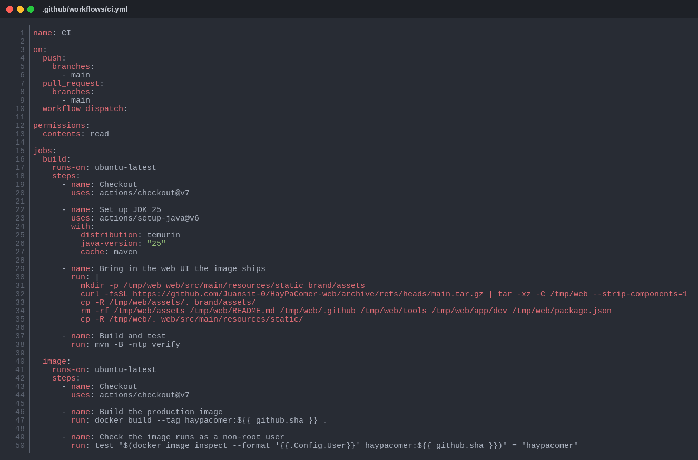

### La regla de cobertura del 80 %

JaCoCo mide qué líneas del código se ejecutaron durante las pruebas. Si en `domain`, `application` o `agent` queda por debajo del 80 %, el build falla.

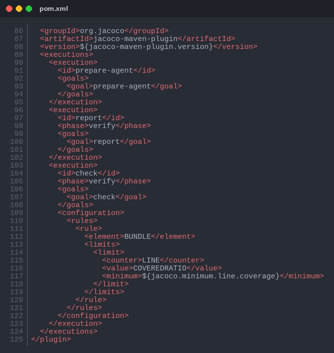

### Pruebas de integración con bases de datos reales

Las pruebas de integración no simulan la base de datos. Testcontainers descarga y arranca un PostgreSQL 18 y un Redis 8 en contenedores, Flyway aplica las 71 migraciones y la prueba trabaja contra ellos. Al terminar, los contenedores se borran.

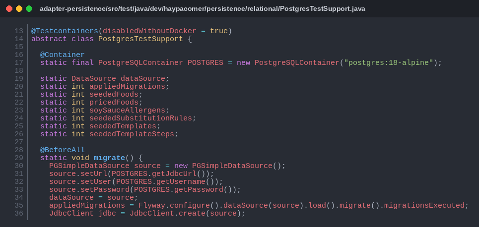

En `web`, la aplicación Spring Boot completa se conecta sola a los contenedores con `@ServiceConnection`:

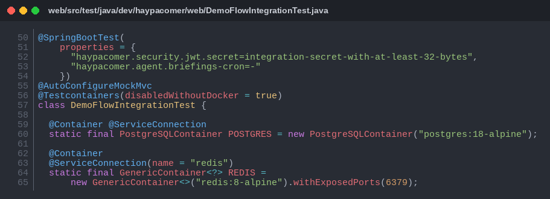

### Pruebas de arquitectura

No revisan un resultado: revisan que el código respete las fronteras de la arquitectura hexagonal. Si alguien importa Spring dentro del dominio, esta prueba falla.

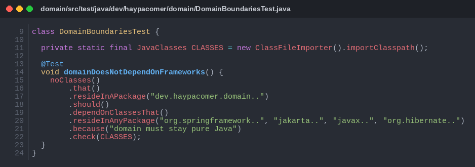

## 2. Resultados

Resultado oficial: **CI de GitHub Actions, versión 1.2.0, 7 de noviembre de 2026: 800 pruebas, 0 fallos, 0 errores, 0 omitidas**. Enlace: [https://github.com/Juansit-0/HayPaComer-backend/actions/runs/42324439173](https://github.com/Juansit-0/HayPaComer-backend/actions/runs/42324439173) (paso *Build and test*).

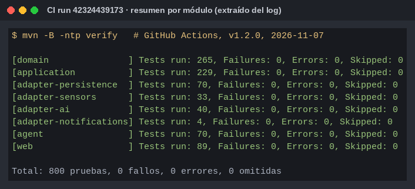

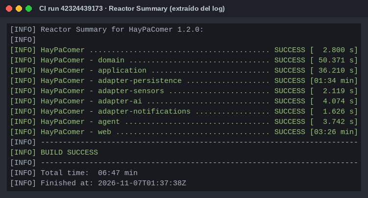

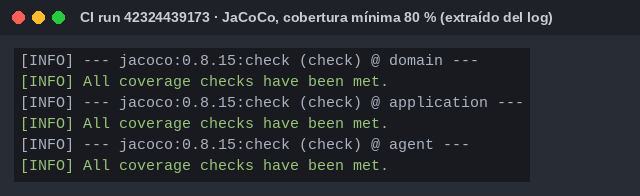

Prueba de que las pruebas de integración usaron bases de datos reales:

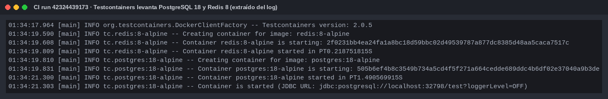

**Ejecución local del 10/11/2026** (plan de pruebas, Docker con JDK 25): 800 ejecutadas, 797 aprobadas. Los 3 fallos fueron del módulo `web`, porque en esa ejecución no se copió la interfaz estática dentro del `.jar`, paso que el CI sí hace. No son defectos del código.

## 3. Los 25 casos del plan de pruebas, uno por uno

Cada caso del archivo [`Plan de Pruebas HayPaComer.xlsx`](../presentacion/Plan%20de%20Pruebas%20HayPaComer.xlsx) es una prueba real del código. Para cada uno: qué prueba, cómo se automatizó, la captura del código y la captura del resultado en el CI.

### QA001: Calibrar la báscula: tara en vacío y calibración con un peso conocido, y conversión de cuentas crudas a gramos

- **Tipo:** Unitario. **Prueba:** [ScaleCalibrationTest.tareThenCalibrateWithAKnownWeight](https://github.com/Juansit-0/HayPaComer-backend/blob/e8d28ac/domain/src/test/java/dev/haypacomer/domain/scale/ScaleCalibrationTest.java)
- **Cómo se automatizó:** Prueba unitaria pura con JUnit: construye los objetos del dominio en memoria con datos fijos, llama al método y verifica el resultado con `assertEquals`/`assertThrows`. No usa Spring, base de datos ni red.
- **Entrada:** Tara con lectura cruda 84000; calibración con lectura 298000 y peso patrón 500 g; luego lecturas crudas 298000, 84000 + 428*842 y 80000
- **Resultado esperado:** Antes de calibrar isCalibrated() es falso y toGrams devuelve vacío; después 298000 -> 500 g, 84000 + 428*842 -> 842 g y 80000 (bajo la tara) -> 0 g
- **Resultado obtenido:** Las aserciones se cumplieron: la báscula pasa de sin calibrar a calibrada y devuelve 500 g, 842 g y 0 g (surefire: OK, 0,002 s) **Pasa: SI**

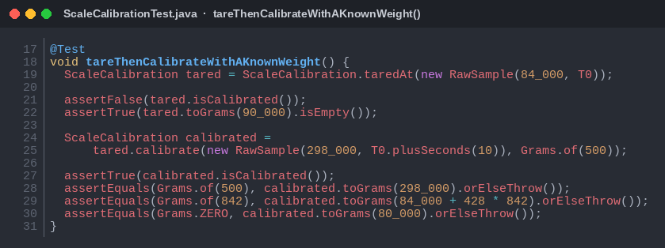

En el CI la clase `ScaleCalibrationTest` corrió 4 pruebas con 0 fallos en 0.01 s.

### QA002: Evaluar el peso del modo cocina contra la meta con tolerancia del 3 %

- **Tipo:** Unitario. **Prueba:** [WeighingTargetTest.reportsShortOnTargetAndOver](https://github.com/Juansit-0/HayPaComer-backend/blob/e8d28ac/domain/src/test/java/dev/haypacomer/domain/scale/WeighingTargetTest.java)
- **Cómo se automatizó:** Prueba unitaria pura con JUnit: construye los objetos del dominio en memoria con datos fijos, llama al método y verifica el resultado con `assertEquals`/`assertThrows`. No usa Spring, base de datos ni red.
- **Entrada:** Meta Chicken breast 200 g; pesos medidos 80, 193, 194, 206 y 250 g
- **Resultado esperado:** 80 g -> SHORT, faltan 120 g, 40 %; 194 g y 206 g -> ON_TARGET (200 +/- 6 g); 193 g -> SHORT; 250 g -> OVER, faltan 0 g, 125 %
- **Resultado obtenido:** Las aserciones se cumplieron: SHORT con 120 g restantes (40 %), ON_TARGET en 194 y 206 g, SHORT en 193 g, OVER con 125 % (surefire: OK, 0,003 s) **Pasa: SI**

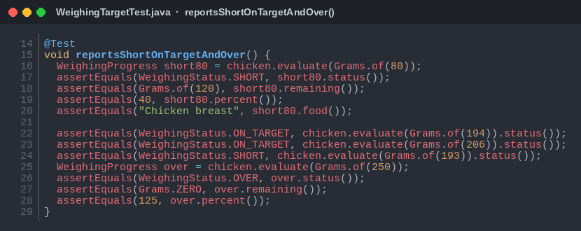

En el CI la clase `WeighingTargetTest` corrió 2 pruebas con 0 fallos en 0.01 s.

### QA003: Detectar lectura estable de la báscula: ventana de 1 s dentro de +/- 2 g

- **Tipo:** Unitario. **Prueba:** [ScaleCalibrationTest.stabilityNeedsOneSecondWithinTwoGrams](https://github.com/Juansit-0/HayPaComer-backend/blob/e8d28ac/domain/src/test/java/dev/haypacomer/domain/scale/ScaleCalibrationTest.java)
- **Cómo se automatizó:** Prueba unitaria pura con JUnit: construye los objetos del dominio en memoria con datos fijos, llama al método y verifica el resultado con `assertEquals`/`assertThrows`. No usa Spring, base de datos ni red.
- **Entrada:** Muestras en gramos con su instante: 700 (t=0), 651 (0,3 s), 650 (0,6 s), 651 (1,2 s), 650 (1,3 s), 640 (1,5 s) y 640 (1,0 s, fuera de orden)
- **Resultado esperado:** offer devuelve falso, falso, falso, falso, verdadero (650 a 1,3 s tras >= 1 s dentro de +/- 2 g), falso (640 rompe la ventana) y falso (muestra fuera de orden)
- **Resultado obtenido:** Las aserciones se cumplieron: la lectura solo se declara estable en la muestra de 650 g a 1,3 s (surefire: OK, 0,003 s) **Pasa: SI**

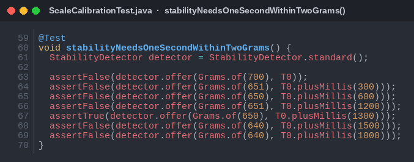

En el CI la clase `ScaleCalibrationTest` corrió 4 pruebas con 0 fallos en 0.01 s.

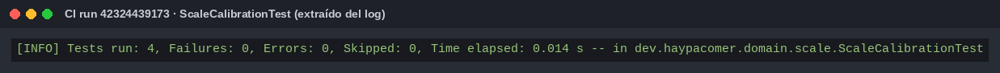

### QA004: Descontar del inventario el consumo medido por la báscula en modo nevera (leche con tara del envase)

- **Tipo:** Unitario. **Prueba:** [FridgeModeDiscountTest.stableFridgeReadingsDiscountTheMeasuredGrams](https://github.com/Juansit-0/HayPaComer-backend/blob/e8d28ac/application/src/test/java/dev/haypacomer/application/scale/FridgeModeDiscountTest.java)
- **Cómo se automatizó:** Prueba unitaria del caso de uso con JUnit: los puertos que necesita (repositorios, reloj, notificaciones) se reemplazan por implementaciones en memoria escritas para las pruebas, así el caso de uso corre igual que en producción pero sin base de datos.
- **Entrada:** Leche ingresada con 892 g brutos y tara 50 g (neta 842 g); lectura estable en modo FRIDGE de 700 g brutos; umbral de ruido 5 g
- **Resultado esperado:** La cantidad restante es 650 g; el movimiento queda con origen SCALE y tipo CONSUME
- **Resultado obtenido:** Las aserciones se cumplieron: restante 650 g y último movimiento SCALE/CONSUME (surefire: OK, 0,007 s) **Pasa: SI**

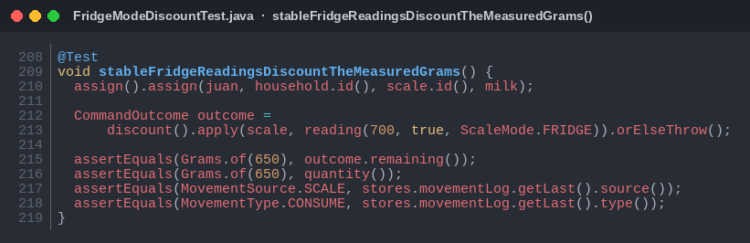

En el CI la clase `FridgeModeDiscountTest` corrió 5 pruebas con 0 fallos en 0.05 s.

### QA005: Ignorar ruido (caída menor a 5 g), lecturas inestables, modo cocina y básculas sin asignar

- **Tipo:** Unitario. **Prueba:** [FridgeModeDiscountTest.ignoresNoiseCookingModeUnstableReadingsAndUnassignedScales](https://github.com/Juansit-0/HayPaComer-backend/blob/e8d28ac/application/src/test/java/dev/haypacomer/application/scale/FridgeModeDiscountTest.java)
- **Cómo se automatizó:** Prueba unitaria del caso de uso con JUnit: los puertos que necesita (repositorios, reloj, notificaciones) se reemplazan por implementaciones en memoria escritas para las pruebas, así el caso de uso corre igual que en producción pero sin base de datos.
- **Entrada:** Leche neta 842 g (892 brutos, tara 50). Lecturas: 700 g sin asignar; 889 g estable (caída de 3 g); 700 g inestable; 700 g en modo COOKING; 990 g estable (mayor al stock)
- **Resultado esperado:** Todas las llamadas a apply devuelven vacío y la cantidad de leche sigue en 842 g
- **Resultado obtenido:** Las aserciones se cumplieron: ninguna lectura descuenta y la leche se mantiene en 842 g (surefire: OK, 0,001 s) **Pasa: SI**

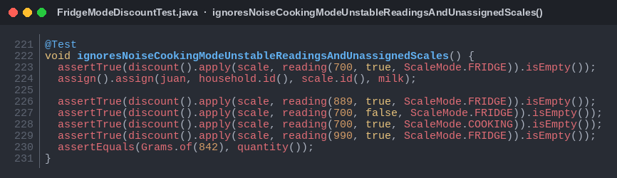

En el CI la clase `FridgeModeDiscountTest` corrió 5 pruebas con 0 fallos en 0.05 s.

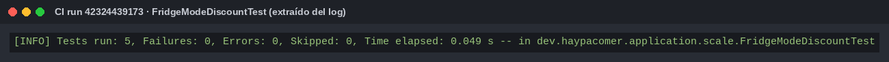

### QA006: Evaluar una receta con la estrategia STRICT cuando falta ingrediente

- **Tipo:** Unitario. **Prueba:** [EvaluationStrategyTest.strictReportsTheMissingGrams](https://github.com/Juansit-0/HayPaComer-backend/blob/e8d28ac/domain/src/test/java/dev/haypacomer/domain/cooking/EvaluationStrategyTest.java)
- **Cómo se automatizó:** Prueba unitaria pura con JUnit: construye los objetos del dominio en memoria con datos fijos, llama al método y verifica el resultado con `assertEquals`/`assertThrows`. No usa Spring, base de datos ni red.
- **Entrada:** Receta Rice with chicken (200 g pollo, 150 g arroz, 15 g salsa de soya opcional) para 2 porciones; stock 80 g pollo y 300 g arroz
- **Resultado esperado:** Veredicto MISSING, 0 porciones alcanzables, faltan 120 g de pollo, soya ENOUGH y la receta no se puede cocinar
- **Resultado obtenido:** Las aserciones se cumplieron: MISSING, 0 porciones, faltante de 120 g de pollo, cookable falso (surefire: OK, 0,002 s) **Pasa: SI**

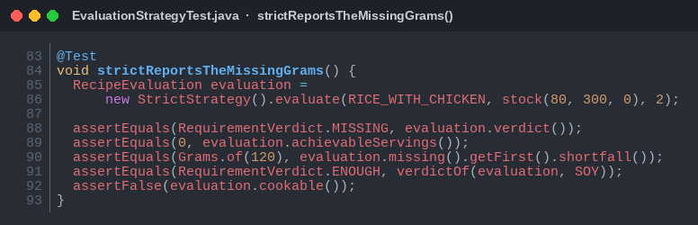

En el CI la clase `EvaluationStrategyTest` corrió 7 pruebas con 0 fallos en 0.02 s.

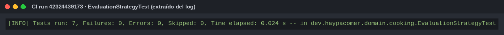

### QA007: Evaluar una receta con la estrategia FLEXIBLE: reducir a una porción dentro de la tolerancia

- **Tipo:** Unitario. **Prueba:** [EvaluationStrategyTest.flexibleReducesToOnePortionWithinTheCookingTolerance](https://github.com/Juansit-0/HayPaComer-backend/blob/e8d28ac/domain/src/test/java/dev/haypacomer/domain/cooking/EvaluationStrategyTest.java)
- **Cómo se automatizó:** Prueba unitaria pura con JUnit: construye los objetos del dominio en memoria con datos fijos, llama al método y verifica el resultado con `assertEquals`/`assertThrows`. No usa Spring, base de datos ni red.
- **Entrada:** Misma receta para 2 porciones; stock 80 g de pollo y 300 g de arroz
- **Resultado esperado:** Veredicto REDUCE, 1 porción alcanzable, el pollo se reduce a 100 g (REDUCE) y el arroz queda ENOUGH
- **Resultado obtenido:** Las aserciones se cumplieron: REDUCE con 1 porción, pollo 100 g y arroz ENOUGH (surefire: OK, 0,004 s) **Pasa: SI**

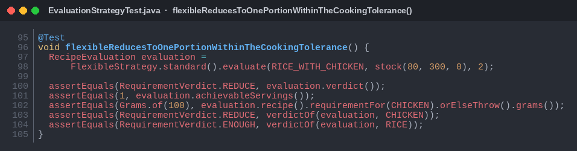

En el CI la clase `EvaluationStrategyTest` corrió 7 pruebas con 0 fallos en 0.02 s.

### QA008: Evaluar una receta con la estrategia RESCUE: sustituir el pollo por atún si hay stock suficiente

- **Tipo:** Unitario. **Prueba:** [EvaluationStrategyTest.rescueUsesAnAllowedSubstituteThatIsInStock](https://github.com/Juansit-0/HayPaComer-backend/blob/e8d28ac/domain/src/test/java/dev/haypacomer/domain/cooking/EvaluationStrategyTest.java)
- **Cómo se automatizó:** Prueba unitaria pura con JUnit: construye los objetos del dominio en memoria con datos fijos, llama al método y verifica el resultado con `assertEquals`/`assertThrows`. No usa Spring, base de datos ni red.
- **Entrada:** Regla pollo -> atún con proporción 1,1 y límite 200 g; stock 80 g pollo, 300 g arroz y 132 g de atún (segundo caso: 131 g)
- **Resultado esperado:** Con 132 g de atún: SUBSTITUTE, atún por 120 g de pollo faltantes (132 g de atún) y 2 porciones; con 131 g: REDUCE
- **Resultado obtenido:** Las aserciones se cumplieron: SUBSTITUTE con 132 g de atún por 120 g, y REDUCE cuando solo hay 131 g (surefire: OK, 0,002 s) **Pasa: SI**

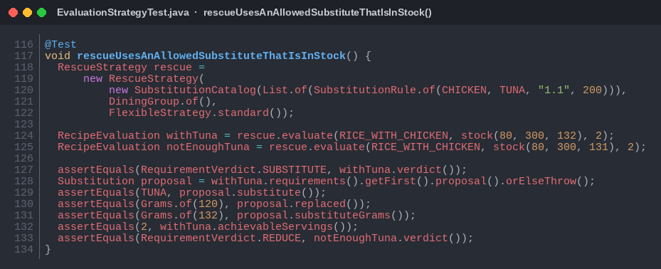

En el CI la clase `EvaluationStrategyTest` corrió 7 pruebas con 0 fallos en 0.02 s.

### QA009: Proponer sustituciones validando alergias del grupo de comensales

- **Tipo:** Unitario. **Prueba:** [SubstitutionCatalogTest.prefersTheFirstRuleThatPassesEveryCheck](https://github.com/Juansit-0/HayPaComer-backend/blob/e8d28ac/domain/src/test/java/dev/haypacomer/domain/substitution/SubstitutionCatalogTest.java)
- **Cómo se automatizó:** Prueba unitaria pura con JUnit: construye los objetos del dominio en memoria con datos fijos, llama al método y verifica el resultado con `assertEquals`/`assertThrows`. No usa Spring, base de datos ni red.
- **Entrada:** Faltan 40 g de mantequilla (alérgeno LECHE); reglas a ghee (alérgeno LECHE) y a aceite vegetal; stock 500 g de ghee y 500 g de aceite; comensales: omnívoro sin alergias y otro con alergia a LECHE; también faltante de 120 g
- **Resultado esperado:** Sin alergias propone ghee; con alergia a la leche propone aceite vegetal; con faltante de 120 g (excede el límite) no propone nada
- **Resultado obtenido:** Las aserciones se cumplieron: ghee para el omnívoro, aceite para el alérgico a la leche y vacío con 120 g (surefire: OK, 0,007 s) **Pasa: SI**

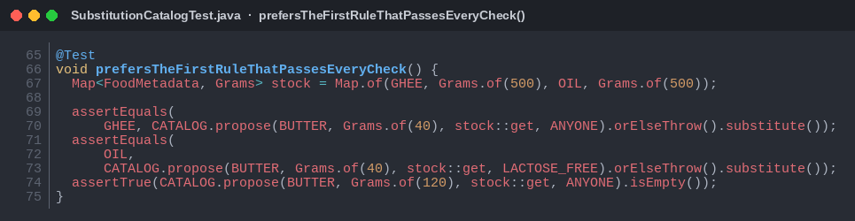

En el CI la clase `SubstitutionCatalogTest` corrió 4 pruebas con 0 fallos en 0.01 s.

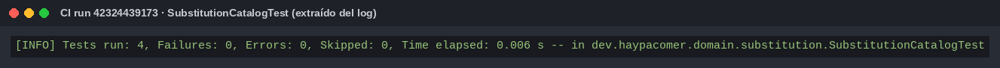

### QA010: Verificar propiedad y visibilidad de alimentos: un alimento privado exige permiso explícito

- **Tipo:** Unitario. **Prueba:** [FoodAccessGuardTest.privateFoodNeedsAGrant](https://github.com/Juansit-0/HayPaComer-backend/blob/e8d28ac/application/src/test/java/dev/haypacomer/application/inventory/FoodAccessGuardTest.java)
- **Cómo se automatizó:** Prueba unitaria del caso de uso con JUnit: los puertos que necesita (repositorios, reloj, notificaciones) se reemplazan por implementaciones en memoria escritas para las pruebas, así el caso de uso corre igual que en producción pero sin base de datos.
- **Entrada:** Hogar con Juan (OWNER) y Ana (MEMBER); yogur de Juan con visibilidad PRIVATE; Ana intenta usarlo sin permiso y luego con grant(Ana)
- **Resultado esperado:** Sin permiso lanza AccessDeniedException; con grant devuelve el miembro Ana
- **Resultado obtenido:** Las aserciones se cumplieron: AccessDeniedException sin permiso y acceso concedido con grant (surefire: OK, 0,002 s) **Pasa: SI**

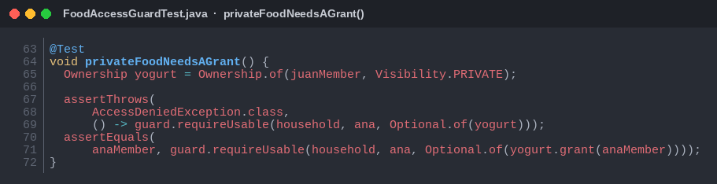

En el CI la clase `FoodAccessGuardTest` corrió 5 pruebas con 0 fallos en 0.01 s.

### QA011: Comprobar permisos por rol OWNER, MEMBER y GUEST

- **Tipo:** Unitario. **Prueba:** [HouseholdTest.rolesGrantPermissions](https://github.com/Juansit-0/HayPaComer-backend/blob/e8d28ac/domain/src/test/java/dev/haypacomer/domain/household/HouseholdTest.java)
- **Cómo se automatizó:** Prueba unitaria pura con JUnit: construye los objetos del dominio en memoria con datos fijos, llama al método y verifica el resultado con `assertEquals`/`assertThrows`. No usa Spring, base de datos ni red.
- **Entrada:** Juan (OWNER), Ana (MEMBER), invitado (GUEST) y un usuario externo; permisos MANAGE_DEVICES, EDIT_INVENTORY, MANAGE_MEMBERS, VIEW_HOUSEHOLD y COOK
- **Resultado esperado:** OWNER puede MANAGE_DEVICES; MEMBER puede EDIT_INVENTORY pero no MANAGE_MEMBERS; GUEST puede VIEW_HOUSEHOLD pero no COOK; un externo no puede nada; OWNER incluye los permisos de MEMBER
- **Resultado obtenido:** Las aserciones se cumplieron: los permisos concedidos y negados coinciden con cada rol (surefire: OK, 0,002 s) **Pasa: SI**

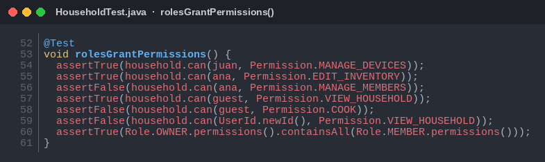

En el CI la clase `HouseholdTest` corrió 11 pruebas con 0 fallos en 0.05 s.

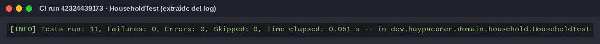

### QA012: Cadena de frío: calentamiento sostenido (>5 C por 20 min) pasa a revisión humana tras recuperarse

- **Tipo:** Unitario. **Prueba:** [ColdChainTest.sustainedWarmingNeedsAHumanReviewAfterRecovery](https://github.com/Juansit-0/HayPaComer-backend/blob/e8d28ac/domain/src/test/java/dev/haypacomer/domain/coldchain/ColdChainTest.java)
- **Cómo se automatizó:** Prueba unitaria pura con JUnit: construye los objetos del dominio en memoria con datos fijos, llama al método y verifica el resultado con `assertEquals`/`assertThrows`. No usa Spring, base de datos ni red.
- **Entrada:** Lecturas 7 C (min 0), 9,5 C (min 20), 4 C (min 40), 6 C (min 45), 3,5 C (min 60); revisión por Juan en el minuto 62
- **Resultado esperado:** En el min 20 la fase es UNDER_REVIEW con pico 9,5; revisar antes de recuperarse lanza IllegalStateException; tras 3,5 C se revisa y queda NORMAL con incidente (inicio T0, pico 9,5, revisado por Juan)
- **Resultado obtenido:** Las aserciones se cumplieron: UNDER_REVIEW a los 20 min, revisión rechazada antes de recuperar y fase NORMAL con 1 incidente cerrado (surefire: OK, 0,007 s) **Pasa: SI**

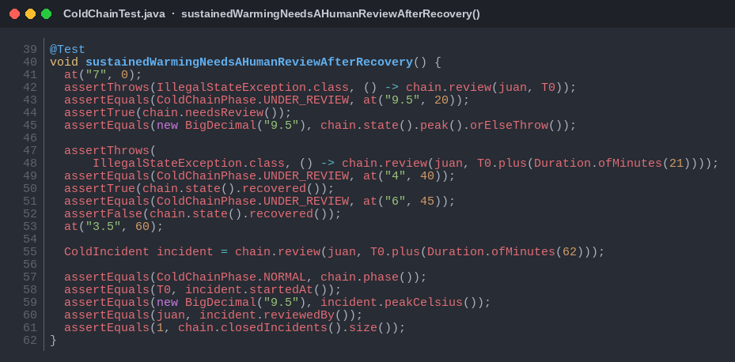

En el CI la clase `ColdChainTest` corrió 3 pruebas con 0 fallos en 0.02 s.

### QA013: Alerta por puerta abierta más de 40 s: un pitido por episodio y notificación al hogar

- **Tipo:** Unitario. **Prueba:** [SensorMonitoringTest.doorLeftOpenBeepsOncePerEpisodeFromThePeriodicCheck](https://github.com/Juansit-0/HayPaComer-backend/blob/e8d28ac/application/src/test/java/dev/haypacomer/application/sensor/SensorMonitoringTest.java)
- **Cómo se automatizó:** Prueba unitaria del caso de uso con JUnit: los puertos que necesita (repositorios, reloj, notificaciones) se reemplazan por implementaciones en memoria escritas para las pruebas, así el caso de uso corre igual que en producción pero sin base de datos.
- **Entrada:** Puerta OPEN en t=0; chequeos en t=30, 41 y 50 s; CLOSED en t=55, OPEN en t=100 y chequeo en t=145
- **Resultado esperado:** Sin hallazgos a los 30 s; DOOR_LEFT_OPEN a los 41 s; sin repetir a los 50 s; el segundo episodio genera otro pitido DOOR_OPEN_BEEP (2 en total) y 2 notificaciones; mensaje: The fridge door has been open for 41 s. Close it to keep the food cold.
- **Resultado obtenido:** Las aserciones se cumplieron: hallazgo a los 41 s, un pitido por episodio (2 en total) y mensaje de 41 s (surefire: OK, 0,147 s) **Pasa: SI**

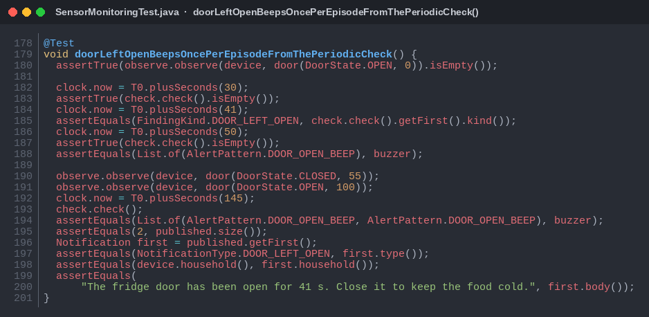

En el CI la clase `SensorMonitoringTest` corrió 4 pruebas con 0 fallos en 0.02 s.

### QA014: Sesión única por nevera: solo una persona a la vez hasta que salga o pase a inactividad

- **Tipo:** Unitario. **Prueba:** [FridgeSessionTest.onePersonAtATimeUntilTheyLeaveOrGoIdle](https://github.com/Juansit-0/HayPaComer-backend/blob/e8d28ac/domain/src/test/java/dev/haypacomer/domain/fridge/FridgeSessionTest.java)
- **Cómo se automatizó:** Prueba unitaria pura con JUnit: construye los objetos del dominio en memoria con datos fijos, llama al método y verifica el resultado con `assertEquals`/`assertThrows`. No usa Spring, base de datos ni red.
- **Entrada:** Juan toma la nevera en t=0 s; Ana intenta tomarla en t=60 s; Ana intenta liberar en t=130 s; Juan libera en t=140 s; Ana toma en t=150 s y pasa el tiempo de inactividad (3 min)
- **Resultado esperado:** Ana recibe FridgeBusyException mientras Juan está activo; liberar por quien no es el titular no cambia nada; al liberar Juan queda vacía; vencida la inactividad Juan puede tomarla
- **Resultado obtenido:** Las aserciones se cumplieron: FridgeBusyException para Ana, liberación solo por el titular y toma tras inactividad (surefire: OK, 0,006 s) **Pasa: SI**

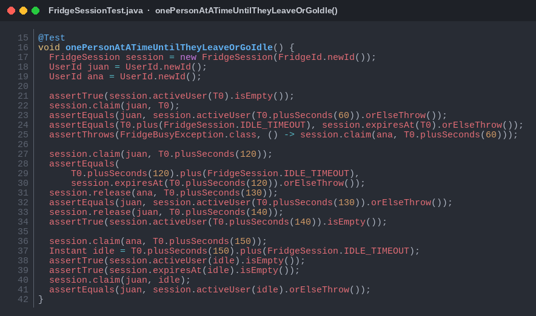

En el CI la clase `FridgeSessionTest` corrió 1 pruebas con 0 fallos en 0.01 s.

### QA015: Fusionar duplicados pendientes en la lista de mercado entre miembros

- **Tipo:** Unitario. **Prueba:** [MarketListTest.mergesPendingDuplicatesAcrossMembers](https://github.com/Juansit-0/HayPaComer-backend/blob/e8d28ac/domain/src/test/java/dev/haypacomer/domain/market/MarketListTest.java)
- **Cómo se automatizó:** Prueba unitaria pura con JUnit: construye los objetos del dominio en memoria con datos fijos, llama al método y verifica el resultado con `assertEquals`/`assertThrows`. No usa Spring, base de datos ni red.
- **Entrada:** Juan agrega Rice 500 g (MANUAL); Ana agrega RICE 250 g (RECIPE)
- **Resultado esperado:** Se conserva el mismo item (mismo id) con 750 g, agregado por Juan, y solo hay 1 item pendiente
- **Resultado obtenido:** Las aserciones se cumplieron: un único item de 750 g agregado por Juan (surefire: OK, 0,001 s) **Pasa: SI**

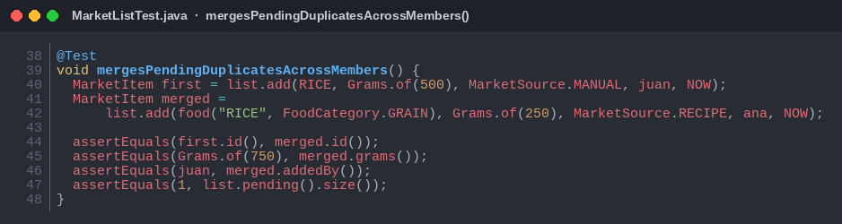

En el CI la clase `MarketListTest` corrió 9 pruebas con 0 fallos en 0.02 s.

### QA016: Plan semanal: rescatar primero el alimento por vencer y no repetir receta en días consecutivos

- **Tipo:** Unitario. **Prueba:** [WeeklyPlanTest.rescuesExpiringFoodFirstAndNeverRepeatsOnConsecutiveDays](https://github.com/Juansit-0/HayPaComer-backend/blob/e8d28ac/domain/src/test/java/dev/haypacomer/domain/planning/WeeklyPlanTest.java)
- **Cómo se automatizó:** Prueba unitaria pura con JUnit: construye los objetos del dominio en memoria con datos fijos, llama al método y verifica el resultado con `assertEquals`/`assertThrows`. No usa Spring, base de datos ni red.
- **Entrada:** Recetas Fried rice, Lentil stew, Omelette y Rice with chicken para 2 porciones; pollo (200 g) por vencer; comensales sin restricciones (DiningGroup vacío)
- **Resultado esperado:** 14 entradas (7 días x 2 comidas); la primera es Rice with chicken, día 1 almuerzo y sin necesidad de compra; nunca la misma receta en la misma comida del día anterior; las repeticiones de esa receta requieren compra
- **Resultado obtenido:** Las aserciones se cumplieron: 14 entradas, pollo con arroz primero y sin repeticiones consecutivas (surefire: OK, 0,005 s) **Pasa: SI**

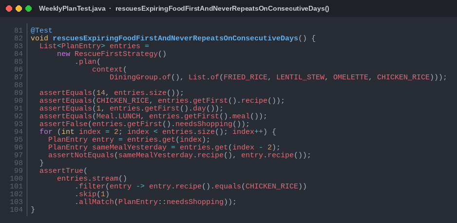

En el CI la clase `WeeklyPlanTest` corrió 4 pruebas con 0 fallos en 0.01 s.

### QA017: Estimar la fecha de vencimiento según el lugar de almacenamiento

- **Tipo:** Unitario. **Prueba:** [ExpiryRulesTest.unknownDatesAreEstimatedByStorage](https://github.com/Juansit-0/HayPaComer-backend/blob/e8d28ac/domain/src/test/java/dev/haypacomer/domain/expiry/ExpiryRulesTest.java)
- **Cómo se automatizó:** Prueba unitaria pura con JUnit: construye los objetos del dominio en memoria con datos fijos, llama al método y verifica el resultado con `assertEquals`/`assertThrows`. No usa Spring, base de datos ni red.
- **Entrada:** Hoy 2026-10-09; carne molida (vida 2 d nevera, 120 d congelador) y leche (7 d nevera, 5 d puerta, 4 d abierta) en estante, congelador y puerta
- **Resultado esperado:** Carne en estante: hoy + 2 días, fuente ESTIMATED y confianza 0,6; en congelador hoy + 120; leche en puerta hoy + 5; leche abierta en estante hoy + 4
- **Resultado obtenido:** Las aserciones se cumplieron: +2, +120, +5 y +4 días, fuente ESTIMATED y confianza 0,6 (surefire: OK, 0,003 s) **Pasa: SI**

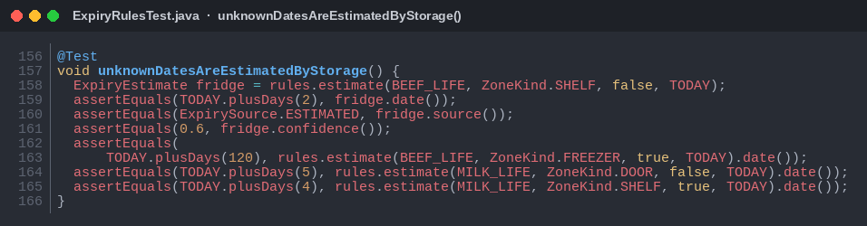

En el CI la clase `ExpiryRulesTest` corrió 6 pruebas con 0 fallos en 0.02 s.

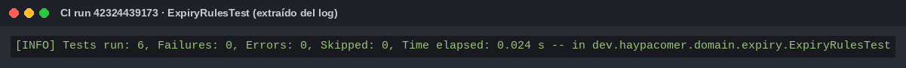

### QA018: Idempotencia de comandos: un comando repetido no se aplica dos veces

- **Tipo:** Unitario. **Prueba:** [LiveInventoryTest.replayedCommandsDoNotApplyTwice](https://github.com/Juansit-0/HayPaComer-backend/blob/e8d28ac/application/src/test/java/dev/haypacomer/application/inventory/LiveInventoryTest.java)
- **Cómo se automatizó:** Prueba unitaria del caso de uso con JUnit: los puertos que necesita (repositorios, reloj, notificaciones) se reemplazan por implementaciones en memoria escritas para las pruebas, así el caso de uso corre igual que en producción pero sin base de datos.
- **Entrada:** Leche 892 g con tara 50 g (neta 842); comando ConsumeFoodCommand de 192 g (origen SCALE) con el mismo id ejecutado dos veces por Ana
- **Resultado esperado:** El primero no es replay y el segundo sí (replayed = true); la cantidad restante es 650 g en ambos y el historial tiene 2 movimientos
- **Resultado obtenido:** Las aserciones se cumplieron: primer envío aplicado, reintento marcado como replay, 650 g y 2 movimientos (surefire: OK, 0,002 s) **Pasa: SI**

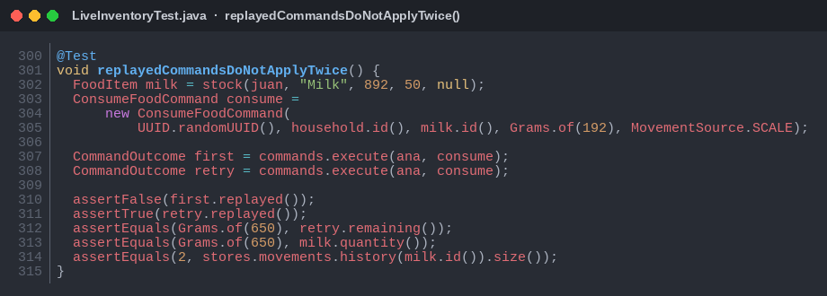

En el CI la clase `LiveInventoryTest` corrió 13 pruebas con 0 fallos en 0.21 s.

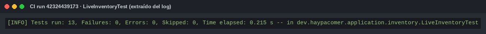

### QA019: Deshacer los últimos cambios del inventario paso a paso (undo)

- **Tipo:** Unitario. **Prueba:** [UndoAndSnapshotsTest.undoesTheLastChangesStepByStep](https://github.com/Juansit-0/HayPaComer-backend/blob/e8d28ac/application/src/test/java/dev/haypacomer/application/inventory/UndoAndSnapshotsTest.java)
- **Cómo se automatizó:** Prueba unitaria del caso de uso con JUnit: los puertos que necesita (repositorios, reloj, notificaciones) se reemplazan por implementaciones en memoria escritas para las pruebas, así el caso de uso corre igual que en producción pero sin base de datos.
- **Entrada:** Juan ingresa leche 842 g PRIVATE, consume 192 g y luego 650 g; ejecuta undo tres veces y una cuarta vez
- **Resultado esperado:** 1er undo (motivo CONSUME_FOOD) deja 650 g; 2do deja 842 g con visibilidad PRIVATE; 3ro elimina la leche; 4to lanza NothingToUndoException; último registro de auditoría UNDO_STOCK_FOOD
- **Resultado obtenido:** Las aserciones se cumplieron: 650 g, 842 g, alimento retirado y NothingToUndoException al final (surefire: OK, 0,007 s) **Pasa: SI**

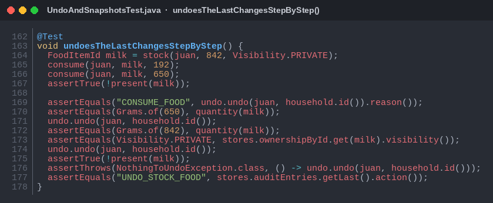

En el CI la clase `UndoAndSnapshotsTest` corrió 6 pruebas con 0 fallos en 0.02 s.

### QA020: Guardrail de IA: validar los argumentos de las herramientas del agente antes de ejecutarlas

- **Tipo:** Unitario. **Prueba:** [ToolRegistryTest.schemaChecksEveryParameterType](https://github.com/Juansit-0/HayPaComer-backend/blob/e8d28ac/agent/src/test/java/dev/haypacomer/agent/tools/ToolRegistryTest.java)
- **Cómo se automatizó:** Prueba unitaria del agente con JUnit: registra herramientas falsas y verifica que el agente rechace argumentos que no cumplen el esquema antes de ejecutar nada.
- **Entrada:** Llamadas a herramientas de mercado con food=" ", food de 201 caracteres, grams="lots", by="Friday", item="42" y servings="500"; también llamadas válidas
- **Resultado esperado:** Las válidas se aceptan; las inválidas se rechazan con mensajes como: Argument food must not be blank, Argument grams must be whole grams between 1 and 100000, Argument by must be an ISO date
- **Resultado obtenido:** Las aserciones se cumplieron: llamadas válidas aceptadas y cada argumento inválido rechazado con su mensaje (surefire: OK, 0,005 s) **Pasa: SI**

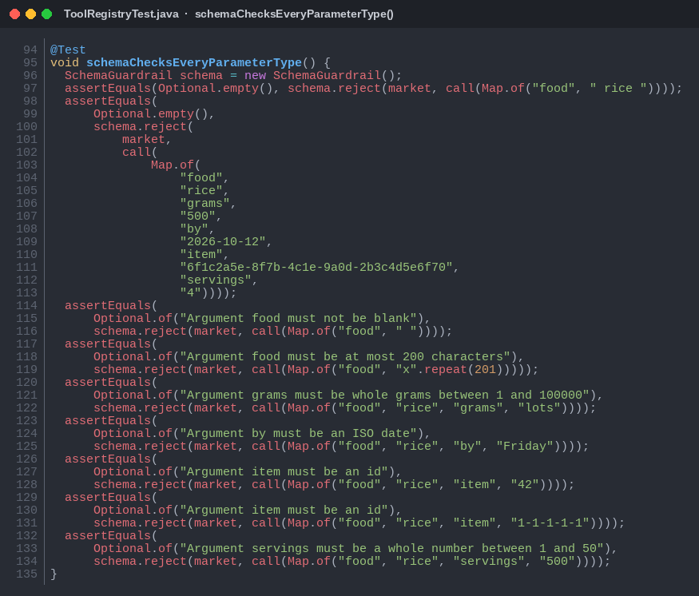

En el CI la clase `ToolRegistryTest` corrió 5 pruebas con 0 fallos en 0.01 s.

### QA021: Interfaz web: búsqueda aproximada de alimentos tolerante a errores de digitación

- **Tipo:** Unitario. **Prueba:** [fuzzy.test.mjs](https://github.com/Juansit-0/HayPaComer-web/blob/main/tools/checks/fuzzy.test.mjs)
- **Cómo se automatizó:** Prueba unitaria de JavaScript con el corredor integrado de Node (`node --test`), sin instalar dependencias: importa `closest` de `app/fuzzy.js` y verifica que palabras mal escritas encuentren el alimento correcto.
- **Entrada:** Texto tomtae, lehce, polo y pechga sobre el catálogo Tomato, Milk, Chicken breast, Potato y Lime (con nombres en español)
- **Resultado esperado:** tomtae -> Tomato; lehce -> Milk; polo -> Chicken breast; pechga -> Chicken breast
- **Resultado obtenido:** Las aserciones se cumplieron: las cuatro búsquedas devolvieron el alimento esperado (node --test: OK, 9 de 9 pruebas del lote, 0,042 s) **Pasa: SI**

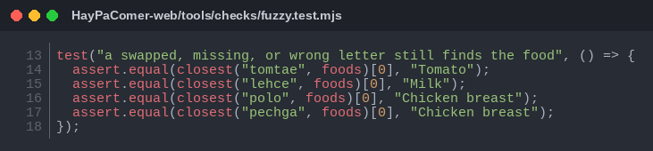

Este repositorio no corre las pruebas en su CI (solo despliega), así que no hay log de GitHub. Se ejecutó a mano el 10/11/2026 con `npm run check`: 9 de 9 pruebas del lote aprobadas.

### QC001: Demo de aceptación de extremo a extremo: invitación, permisos de alimento privado, alerta de puerta, consumo por báscula, receta y analítica (Spring Boot + PostgreSQL + Redis con Testcontainers)

- **Tipo:** De Integracion. **Prueba:** [DemoFlowIntegrationTest.theAcceptanceDemoRunsEndToEnd](https://github.com/Juansit-0/HayPaComer-backend/blob/e8d28ac/web/src/test/java/dev/haypacomer/web/DemoFlowIntegrationTest.java)
- **Cómo se automatizó:** Prueba de integración: levanta la aplicación Spring Boot completa, con PostgreSQL 18 y Redis 8 reales en contenedores (Testcontainers), y hace peticiones HTTP con MockMvc como lo haría el navegador o el ESP32.
- **Entrada:** Juan invita a Ana como MEMBER; leche 892 g (tara 50), yogur 125 g PRIVATE, pollo 80 g; puerta abierta hace 45 s; báscula en modo FRIDGE con 700 g; evaluar receta con FLEXIBLE y RESCUE; alergia de Ana a FISH
- **Resultado esperado:** Ana recibe 403 al consumir el yogur privado y 200 tras el permiso; comando DOOR_OPEN_BEEP y notificación DOOR_LEFT_OPEN; leche queda en 650 g; FLEXIBLE da REDUCE con 1 porción; RESCUE sustituye por Tuna salvo con Ana (alergia a pescado); analítica con 80 g rescatados
- **Resultado obtenido:** Las aserciones se cumplieron: flujo completo de la demo sin fallos (surefire: OK, 4,054 s) **Pasa: SI**

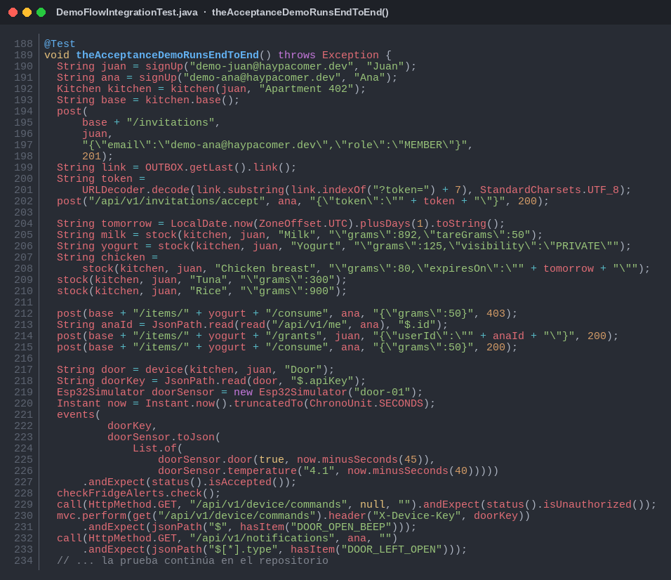

En el CI la clase `DemoFlowIntegrationTest` corrió 3 pruebas con 0 fallos en 7.85 s.

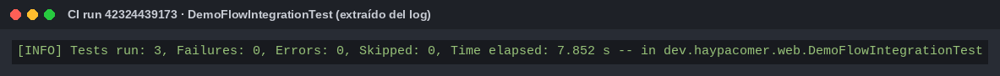

### QC002: Concurrencia: el uso simultáneo del mismo alimento nunca pierde gramos

- **Tipo:** De Integracion. **Prueba:** [DemoFlowIntegrationTest.concurrentUseOfTheSameFoodNeverLosesGrams](https://github.com/Juansit-0/HayPaComer-backend/blob/e8d28ac/web/src/test/java/dev/haypacomer/web/DemoFlowIntegrationTest.java)
- **Cómo se automatizó:** Prueba de integración: levanta la aplicación Spring Boot completa, con PostgreSQL 18 y Redis 8 reales en contenedores (Testcontainers), y hace peticiones HTTP con MockMvc como lo haría el navegador o el ESP32.
- **Entrada:** Leche de 842 g; 20 solicitudes concurrentes (8 hilos) de consumo de 50 g
- **Resultado esperado:** Exactamente 16 solicitudes con 200; quedan 842 - 50*16 = 42 g (nunca negativo); 16 registros CONSUME_FOOD en la auditoría
- **Resultado obtenido:** Las aserciones se cumplieron: 16 consumos exitosos, 42 g restantes y 16 registros de auditoría (surefire: OK, 2,313 s) **Pasa: SI**

En el CI la clase `DemoFlowIntegrationTest` corrió 3 pruebas con 0 fallos en 7.85 s.

### QC003: Seguridad: aislamiento entre hogares y roles aplicados en la API (JWT, Spring Security)

- **Tipo:** De Integracion. **Prueba:** [SecurityIntegrationTest.householdsAreIsolatedAndRolesAreEnforced](https://github.com/Juansit-0/HayPaComer-backend/blob/e8d28ac/web/src/test/java/dev/haypacomer/web/security/SecurityIntegrationTest.java)
- **Cómo se automatizó:** Prueba de integración: levanta la aplicación Spring Boot completa, con PostgreSQL 18 y Redis 8 reales en contenedores (Testcontainers), y hace peticiones HTTP con MockMvc como lo haría el navegador o el ESP32.
- **Entrada:** Un propietario crea el hogar Apartment; un usuario externo consulta, edita, lista dispositivos e invitaciones, invita y cambia propietario; el propietario invita con rol OWNER
- **Resultado esperado:** El externo recibe 404 en todas las operaciones (no se revela que el hogar existe); invitar con rol OWNER devuelve 400
- **Resultado obtenido:** Las aserciones se cumplieron: 404 para el externo en las seis operaciones y 400 para el rol OWNER (surefire: OK, 1,053 s) **Pasa: SI**

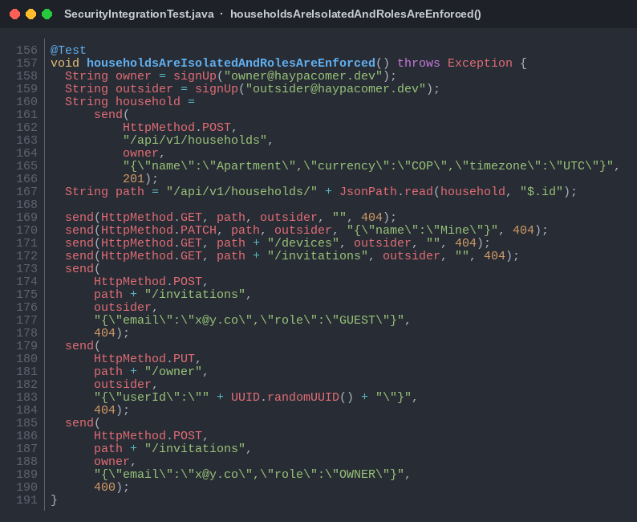

En el CI la clase `SecurityIntegrationTest` corrió 6 pruebas con 0 fallos en 7.81 s.

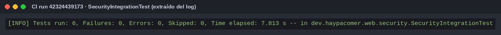

### QC004: Persistencia de la cadena de frío en PostgreSQL (Testcontainers): estados e incidente revisado

- **Tipo:** De Integracion. **Prueba:** [PostgresColdChainRepositoryTest.persistsEveryStateAndTheReviewedIncident](https://github.com/Juansit-0/HayPaComer-backend/blob/e8d28ac/adapter-persistence/src/test/java/dev/haypacomer/persistence/relational/PostgresColdChainRepositoryTest.java)
- **Cómo se automatizó:** Prueba de integración: Testcontainers levanta un PostgreSQL 18 real, Flyway aplica las 71 migraciones y el repositorio guarda y lee datos de verdad.
- **Entrada:** Cadena con 8 C (WARMING); luego 11,25 C a los 25 min y 4 C a los 40 min; revisión por Juan a los 45 min; guardado dos veces
- **Resultado esperado:** Se recupera Warming, luego UnderReview con máximo 11,25 y recuperado; tras la revisión la fase es NORMAL y la tabla cold_incidents tiene exactamente 1 fila
- **Resultado obtenido:** Las aserciones se cumplieron: estados persistidos y 1 incidente en cold_incidents (surefire: OK, 0,233 s) **Pasa: SI**

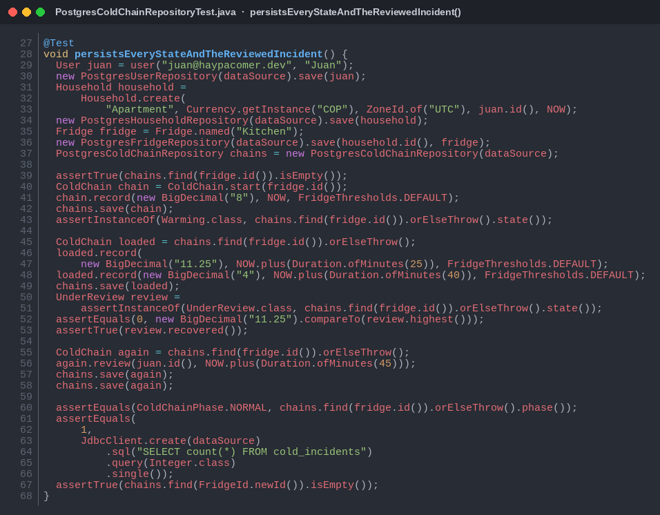

En el CI la clase `PostgresColdChainRepositoryTest` corrió 1 pruebas con 0 fallos en 2.86 s.

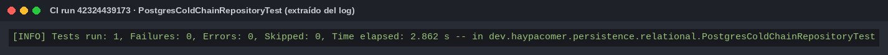

## 4. Catálogo completo de pruebas

Todas las clases de prueba del backend, con el número de pruebas y el resultado del CI de la versión 1.2.0. Cada nombre lleva al archivo en GitHub.

### `domain`: 50 clases, 265 pruebas

Reglas puras del negocio: pesa, recetas, permisos, cadena de frío, vencimientos, mercado. Carpeta: [domain/src/test/java](https://github.com/Juansit-0/HayPaComer-backend/tree/e8d28ac/domain/src/test/java)

| Clase | Tipo | Pruebas en CI | Resultado | Tiempo |
| --- | --- | ---: | --- | ---: |
| [DomainBoundariesTest](https://github.com/Juansit-0/HayPaComer-backend/blob/e8d28ac/domain/src/test/java/dev/haypacomer/domain/DomainBoundariesTest.java) | Arquitectura | 1 | OK | 33.45 s |
| [MetricsCalculatorTest](https://github.com/Juansit-0/HayPaComer-backend/blob/e8d28ac/domain/src/test/java/dev/haypacomer/domain/analytics/MetricsCalculatorTest.java) | Unitaria | 3 | OK | 0.01 s |
| [WeeklyCoachTest](https://github.com/Juansit-0/HayPaComer-backend/blob/e8d28ac/domain/src/test/java/dev/haypacomer/domain/analytics/WeeklyCoachTest.java) | Unitaria | 2 | OK | 0.01 s |
| [ReportsTest](https://github.com/Juansit-0/HayPaComer-backend/blob/e8d28ac/domain/src/test/java/dev/haypacomer/domain/analytics/report/ReportsTest.java) | Unitaria | 4 | OK | 0.03 s |
| [ColdChainTest](https://github.com/Juansit-0/HayPaComer-backend/blob/e8d28ac/domain/src/test/java/dev/haypacomer/domain/coldchain/ColdChainTest.java) | Unitaria | 3 | OK | 0.02 s |
| [ColdInvestigatorTest](https://github.com/Juansit-0/HayPaComer-backend/blob/e8d28ac/domain/src/test/java/dev/haypacomer/domain/coldchain/investigation/ColdInvestigatorTest.java) | Unitaria | 6 | OK | 0.03 s |
| [ColdRuleTest](https://github.com/Juansit-0/HayPaComer-backend/blob/e8d28ac/domain/src/test/java/dev/haypacomer/domain/coldchain/investigation/ColdRuleTest.java) | Unitaria | 2 | OK | 0.01 s |
| [CookingBoundariesTest](https://github.com/Juansit-0/HayPaComer-backend/blob/e8d28ac/domain/src/test/java/dev/haypacomer/domain/cooking/CookingBoundariesTest.java) | Unitaria | 5 | OK | 0.01 s |
| [EvaluationStrategyTest](https://github.com/Juansit-0/HayPaComer-backend/blob/e8d28ac/domain/src/test/java/dev/haypacomer/domain/cooking/EvaluationStrategyTest.java) | Unitaria | 7 | OK | 0.02 s |
| [DeviceTest](https://github.com/Juansit-0/HayPaComer-backend/blob/e8d28ac/domain/src/test/java/dev/haypacomer/domain/device/DeviceTest.java) | Unitaria | 3 | OK | 0.01 s |
| [ExpiryRulesTest](https://github.com/Juansit-0/HayPaComer-backend/blob/e8d28ac/domain/src/test/java/dev/haypacomer/domain/expiry/ExpiryRulesTest.java) | Unitaria | 6 | OK | 0.02 s |
| [FoodMetadataCatalogTest](https://github.com/Juansit-0/HayPaComer-backend/blob/e8d28ac/domain/src/test/java/dev/haypacomer/domain/food/FoodMetadataCatalogTest.java) | Unitaria | 5 | OK | 0.08 s |
| [FoodMetadataTest](https://github.com/Juansit-0/HayPaComer-backend/blob/e8d28ac/domain/src/test/java/dev/haypacomer/domain/food/FoodMetadataTest.java) | Unitaria | 7 | OK | 0.02 s |
| [FoodItemTest](https://github.com/Juansit-0/HayPaComer-backend/blob/e8d28ac/domain/src/test/java/dev/haypacomer/domain/fridge/FoodItemTest.java) | Unitaria | 7 | OK | 0.01 s |
| [FridgeMementoTest](https://github.com/Juansit-0/HayPaComer-backend/blob/e8d28ac/domain/src/test/java/dev/haypacomer/domain/fridge/FridgeMementoTest.java) | Unitaria | 2 | OK | 0.01 s |
| [FridgeSessionTest](https://github.com/Juansit-0/HayPaComer-backend/blob/e8d28ac/domain/src/test/java/dev/haypacomer/domain/fridge/FridgeSessionTest.java) | Unitaria | 1 | OK | 0.01 s |
| [FridgeTest](https://github.com/Juansit-0/HayPaComer-backend/blob/e8d28ac/domain/src/test/java/dev/haypacomer/domain/fridge/FridgeTest.java) | Unitaria | 11 | OK | 0.02 s |
| [FridgeTreeIteratorTest](https://github.com/Juansit-0/HayPaComer-backend/blob/e8d28ac/domain/src/test/java/dev/haypacomer/domain/fridge/FridgeTreeIteratorTest.java) | Unitaria | 7 | OK | 0.01 s |
| [RemovingPartsTest](https://github.com/Juansit-0/HayPaComer-backend/blob/e8d28ac/domain/src/test/java/dev/haypacomer/domain/fridge/RemovingPartsTest.java) | Unitaria | 2 | OK | 0.01 s |
| [ZoneAndTrayTest](https://github.com/Juansit-0/HayPaComer-backend/blob/e8d28ac/domain/src/test/java/dev/haypacomer/domain/fridge/ZoneAndTrayTest.java) | Unitaria | 5 | OK | 0.01 s |
| [HouseholdTest](https://github.com/Juansit-0/HayPaComer-backend/blob/e8d28ac/domain/src/test/java/dev/haypacomer/domain/household/HouseholdTest.java) | Unitaria | 11 | OK | 0.05 s |
| [InvitationTest](https://github.com/Juansit-0/HayPaComer-backend/blob/e8d28ac/domain/src/test/java/dev/haypacomer/domain/household/InvitationTest.java) | Unitaria | 3 | OK | 0.01 s |
| [RefreshTokenTest](https://github.com/Juansit-0/HayPaComer-backend/blob/e8d28ac/domain/src/test/java/dev/haypacomer/domain/identity/RefreshTokenTest.java) | Unitaria | 4 | OK | 0.02 s |
| [UserTest](https://github.com/Juansit-0/HayPaComer-backend/blob/e8d28ac/domain/src/test/java/dev/haypacomer/domain/identity/UserTest.java) | Unitaria | 5 | OK | 0.03 s |
| [UserTokenTest](https://github.com/Juansit-0/HayPaComer-backend/blob/e8d28ac/domain/src/test/java/dev/haypacomer/domain/identity/UserTokenTest.java) | Unitaria | 2 | OK | 0.30 s |
| [PrivateFoodProxyTest](https://github.com/Juansit-0/HayPaComer-backend/blob/e8d28ac/domain/src/test/java/dev/haypacomer/domain/inventory/PrivateFoodProxyTest.java) | Unitaria | 2 | OK | 0.00 s |
| [StockedFoodTest](https://github.com/Juansit-0/HayPaComer-backend/blob/e8d28ac/domain/src/test/java/dev/haypacomer/domain/inventory/StockedFoodTest.java) | Unitaria | 12 | OK | 0.03 s |
| [BudgetPlannerTest](https://github.com/Juansit-0/HayPaComer-backend/blob/e8d28ac/domain/src/test/java/dev/haypacomer/domain/market/BudgetPlannerTest.java) | Unitaria | 2 | OK | 0.01 s |
| [MarketListTest](https://github.com/Juansit-0/HayPaComer-backend/blob/e8d28ac/domain/src/test/java/dev/haypacomer/domain/market/MarketListTest.java) | Unitaria | 9 | OK | 0.02 s |
| [DiningGroupTest](https://github.com/Juansit-0/HayPaComer-backend/blob/e8d28ac/domain/src/test/java/dev/haypacomer/domain/member/DiningGroupTest.java) | Unitaria | 4 | OK | 0.01 s |
| [FoodProfileTest](https://github.com/Juansit-0/HayPaComer-backend/blob/e8d28ac/domain/src/test/java/dev/haypacomer/domain/member/FoodProfileTest.java) | Unitaria | 8 | OK | 0.02 s |
| [MemberTest](https://github.com/Juansit-0/HayPaComer-backend/blob/e8d28ac/domain/src/test/java/dev/haypacomer/domain/member/MemberTest.java) | Unitaria | 3 | OK | 0.01 s |
| [PrototypeCopiesTest](https://github.com/Juansit-0/HayPaComer-backend/blob/e8d28ac/domain/src/test/java/dev/haypacomer/domain/planning/PrototypeCopiesTest.java) | Unitaria | 2 | OK | 0.00 s |
| [WeeklyPlanBoundariesTest](https://github.com/Juansit-0/HayPaComer-backend/blob/e8d28ac/domain/src/test/java/dev/haypacomer/domain/planning/WeeklyPlanBoundariesTest.java) | Unitaria | 4 | OK | 0.02 s |
| [WeeklyPlanTest](https://github.com/Juansit-0/HayPaComer-backend/blob/e8d28ac/domain/src/test/java/dev/haypacomer/domain/planning/WeeklyPlanTest.java) | Unitaria | 4 | OK | 0.01 s |
| [ConversionFactorsTest](https://github.com/Juansit-0/HayPaComer-backend/blob/e8d28ac/domain/src/test/java/dev/haypacomer/domain/quantity/ConversionFactorsTest.java) | Unitaria | 7 | OK | 0.01 s |
| [GramsTest](https://github.com/Juansit-0/HayPaComer-backend/blob/e8d28ac/domain/src/test/java/dev/haypacomer/domain/quantity/GramsTest.java) | Unitaria | 11 | OK | 0.01 s |
| [QuantityParserTest](https://github.com/Juansit-0/HayPaComer-backend/blob/e8d28ac/domain/src/test/java/dev/haypacomer/domain/quantity/QuantityParserTest.java) | Unitaria | 28 | OK | 0.13 s |
| [QuantityTest](https://github.com/Juansit-0/HayPaComer-backend/blob/e8d28ac/domain/src/test/java/dev/haypacomer/domain/quantity/QuantityTest.java) | Unitaria | 6 | OK | 0.01 s |
| [UnitTest](https://github.com/Juansit-0/HayPaComer-backend/blob/e8d28ac/domain/src/test/java/dev/haypacomer/domain/quantity/UnitTest.java) | Unitaria | 4 | OK | 0.01 s |
| [RecipeStepTest](https://github.com/Juansit-0/HayPaComer-backend/blob/e8d28ac/domain/src/test/java/dev/haypacomer/domain/recipe/RecipeStepTest.java) | Unitaria | 3 | OK | 0.01 s |
| [RecipeTest](https://github.com/Juansit-0/HayPaComer-backend/blob/e8d28ac/domain/src/test/java/dev/haypacomer/domain/recipe/RecipeTest.java) | Unitaria | 10 | OK | 0.02 s |
| [ScaleCalibrationTest](https://github.com/Juansit-0/HayPaComer-backend/blob/e8d28ac/domain/src/test/java/dev/haypacomer/domain/scale/ScaleCalibrationTest.java) | Unitaria | 4 | OK | 0.01 s |
| [ScaleEdgeCasesTest](https://github.com/Juansit-0/HayPaComer-backend/blob/e8d28ac/domain/src/test/java/dev/haypacomer/domain/scale/ScaleEdgeCasesTest.java) | Unitaria | 5 | OK | 0.02 s |
| [WeighingTargetTest](https://github.com/Juansit-0/HayPaComer-backend/blob/e8d28ac/domain/src/test/java/dev/haypacomer/domain/scale/WeighingTargetTest.java) | Unitaria | 2 | OK | 0.01 s |
| [MeasurementBridgeTest](https://github.com/Juansit-0/HayPaComer-backend/blob/e8d28ac/domain/src/test/java/dev/haypacomer/domain/sensor/MeasurementBridgeTest.java) | Unitaria | 7 | OK | 0.01 s |
| [SensorEventTest](https://github.com/Juansit-0/HayPaComer-backend/blob/e8d28ac/domain/src/test/java/dev/haypacomer/domain/sensor/SensorEventTest.java) | Unitaria | 2 | OK | 0.01 s |
| [CookingSessionTest](https://github.com/Juansit-0/HayPaComer-backend/blob/e8d28ac/domain/src/test/java/dev/haypacomer/domain/session/CookingSessionTest.java) | Unitaria | 6 | OK | 0.02 s |
| [StepTimerTest](https://github.com/Juansit-0/HayPaComer-backend/blob/e8d28ac/domain/src/test/java/dev/haypacomer/domain/session/StepTimerTest.java) | Unitaria | 2 | OK | 0.00 s |
| [SubstitutionCatalogTest](https://github.com/Juansit-0/HayPaComer-backend/blob/e8d28ac/domain/src/test/java/dev/haypacomer/domain/substitution/SubstitutionCatalogTest.java) | Unitaria | 4 | OK | 0.01 s |

Ver el nombre de cada prueba de este módulo

- **DomainBoundariesTest**: `domainDoesNotDependOnFrameworks`
- **MetricsCalculatorTest**: `countsRescuedFoodWasteAndMoneyPerFoodMemberAndDay`, `anEmptyPeriodIsZeroEverywhere`, `legacyMovementsWithoutFoodStillCount`
- **WeeklyCoachTest**: `foodsThrownAwayTwiceBecomeBuyLessTips`, `theDigestComparesTheWeekAndNamesTheTopRescuer`
- **ReportsTest**: `csvWalksEverySectionInOrderAndEscapesCells`, `markdownReadsLikeAReportForPeople`, `emptyPeriodsSaySoInsteadOfShowingEmptyTables`, `anyVisitorCanWalkTheSameSections`
- **ColdChainTest**: `shortWarmingReturnsToNormalWithoutReview`, `sustainedWarmingNeedsAHumanReviewAfterRecovery`, `ignoresOutOfOrderReadingsAndRestoresState`
- **ColdInvestigatorTest**: `aDoorLeftOpenWarmsTheFridgeAndPerishablesMustBeUsedToday`, `anOngoingWarmFridgeWithTheDoorShutPointsAtCoolingAndDiscardsPerishables`, `silenceBetweenReadingsIsReportedAsMissingReadings`, `aColdFridgeKeepsEverythingAndBadWindowsAreRejected`, `briefWarmthIsKept`, `aStricterHouseholdRuleDiscardsSooner`
- **ColdRuleTest**: `defaultIsTheTwoHourRule`, `useTodayComesBeforeDiscard`
- **CookingBoundariesTest**: `oddServingsScaleEveryRequirementAndWeighingTarget`, `theCookingToleranceEndsExactlyAtAQuarter`, `theSubstitutionLimitIncludesItsOwnValue`, `aTimerPausedAtZeroOnlyRingsAfterResuming`, `quantitiesWrittenInTheRecipeMatchTheScaleGrams`
- **EvaluationStrategyTest**: `everyStrategyAgreesWhenThereIsEnough`, `strictReportsTheMissingGrams`, `flexibleReducesToOnePortionWithinTheCookingTolerance`, `flexibleGivesUpWhenEvenOnePortionIsFarOff`, `rescueUsesAnAllowedSubstituteThatIsInStock`, `rescueDoesNotSpendStockTheRecipeAlreadyNeeds`, `rejectsInvalidInputs`
- **DeviceTest**: `registersActiveAndNeverSeen`, `tracksLastSeenAndRevocation`, `rejectsBlankNames`
- **ExpiryRulesTest**: `milkOrMeatAMonthAwayIsRejectedWithTheReason`, `datesWithinTheShelfLifeAndTheMarginAreKept`, `unknownDatesAreEstimatedByStorage`, `openingOnlyBringsTheDateCloser`, `shelfLifeFallsBackToTheCatalogDays`, `foodItemsRememberWhereTheirDateCameFromAndWhenTheyWereOpened`
- **FoodMetadataCatalogTest**: `sharesOneInstancePerFood`, `findsByNameIgnoringCaseAndSpaces`, `rejectsConflictingDefinitionForSameFood`, `sharesInstanceAcrossConcurrentCallers`, `latestSharesOneInstanceAndFollowsAChangedDefinition`
- **FoodMetadataTest**: `stripsNameAndBuildsCaseInsensitiveKey`, `convertsQuantityWithItsOwnFactors`, `reportsAllergens`, `allergensAreImmutableCopies`, `rejectsBlankName`, `rejectsNegativeShelfDays`, `comparesDefinitionIgnoringNameCase`
- **FoodItemTest**: `weighedItemDiscountsTare`, `consumesAndRestocksMeasuredGrams`, `cannotConsumeMoreThanMeasured`, `becomesEmptyWhenFullyConsumed`, `isALeafOfTheTree`, `expiryIsOptional`, `requiresQuantity`
- **FridgeMementoTest**: `restoresTheExactTreeAfterLaterChanges`, `mementoIsImmutableAndNeedsKnownFoods`
- **FridgeSessionTest**: `onePersonAtATimeUntilTheyLeaveOrGoIdle`
- **FridgeTest**: `aggregatesGramsAndItemsAcrossTheTree`, `treatsEveryNodeUniformly`, `emptyFridgeHasNothing`, `findsItemAndItsTray`, `movesItemBetweenTrays`, `moveToSameTrayKeepsItem`, `takesItemOutOfTheFridge`, `rejectsPlacingTheSameItemTwice`, `rejectsUnknownTrayAndItem`, `rejectsDuplicateZone`, `exposesIdentityAndReadOnlyChildren`
- **FridgeTreeIteratorTest**: `depthFirstVisitsEachBranchBeforeTheNext`, `breadthFirstVisitsLevelByLevel`, `worksWithEnhancedForLoopFromAnyNode`, `leafYieldsOnlyItself`, `streamsFoodItemsAndTrays`, `failsAfterTheLastNode`, `requiresRootAndTraversal`
- **RemovingPartsTest**: `anEmptyTrayLeavesItsZoneAndAFullOneStays`, `anEmptyZoneLeavesTheFridgeAndOneWithFoodStays`
- **ZoneAndTrayTest**: `zoneKeepsKindAndRejectsDuplicateTrays`, `trayAddsAndRemovesItems`, `renamingATrayKeepsItsIdPositionAndFood`, `rejectsInvalidNamesAndPositions`, `idsRequireValue`
- **HouseholdTest**: `creatorIsTheOwner`, `eachMembershipHasItsOwnMemberId`, `rolesGrantPermissions`, `requirePermissionDeniesOutsiders`, `ownerChangesRolesButMembersCannot`, `joinRejectsDuplicatesAndOwnerRole`, `membersLeaveOrAreRemovedButOwnerStays`, `memberCannotRemoveOthers`, `ownershipTransfersToAnExistingMember`, `ownerRenamesAndConfigures`, `restoreRequiresExactlyOneOwner`
- **InvitationTest**: `isPendingForSevenDays`, `isAcceptedOnlyOnce`, `cannotGrantOwnership`
- **RefreshTokenTest**: `isUsableUntilItExpires`, `revokeIsIdempotent`, `rotationLinksToTheSuccessor`, `mustExpireAfterIssue`
- **UserTest**: `registersUnverifiedAndEnabled`, `changesStateImmutably`, `validatesEmail`, `passwordHashNeverPrintsItsValue`, `rejectsBlankDisplayName`
- **UserTokenTest**: `expiresAccordingToItsType`, `canBeUsedOnlyOnce`
- **PrivateFoodProxyTest**: `hidesPrivateFoodFromEveryoneButTheOwner`, `leavesVisibleFoodUntouched`
- **StockedFoodTest**: `plainFoodHasNoStatusAndIsUsableByEveryone`, `decoratorsStackStatusesAndPriority`, `expiredFoodIsNotEdible`, `privateFoodIsOnlyForItsOwnerUntilGranted`, `askFirstFoodNeedsPermission`, `sharedFoodIsUsableByEveryone`, `ownershipCombinesWithOtherDecorators`, `freshnessPolicyAppliesTheRightDecorator`, `rescueOrderPutsEdibleHighPriorityAndSoonestFirst`, `rejectsInvalidInputs`, `aDecoratorNeverMakesInedibleFoodEdible`, `foodUnderReviewIsNotEdibleAndSaysWhy`
- **BudgetPlannerTest**: `planNeedsComeFirstAndTheRestFillsWhatIsLeftOfTheMonth`, `anOverspentMonthLeavesNothingButStillListsTheNeeds`
- **MarketListTest**: `mergesPendingDuplicatesAcrossMembers`, `checkedItemsDoNotBlockANewPendingEntry`, `clearedItemsLeaveTheRecordAfterTheMonth`, `checkAndUncheckAreIdempotent`, `groupsPendingItemsByCategoryAlphabetically`, `editsAndRemovesItems`, `restoresExistingItems`, `topsUpOnlyTheGramsThatAreNotPendingYet`, `foodAlreadyInTheCartIsNotAskedForAgain`
- **DiningGroupTest**: `everyMemberMustAllowTheFood`, `recipeIsSharedOnlyWithoutConflicts`, `conflictsNameTheMember`, `rejectsDuplicateMembers`
- **FoodProfileTest**: `omnivoreWithoutAllergiesAllowsEverything`, `allergyBlocksFoodContainingTheAllergen`, `dietExcludesCategories`, `avoidedFoodsMatchIgnoringCase`, `reportsEveryReasonForOneFood`, `checksEveryRequirementOfARecipe`, `collectionsAreImmutable`, `requiresMemberAndDiet`
- **MemberTest**: `stripsDisplayName`, `eachMemberGetsItsOwnId`, `rejectsBlankOrMissingValues`
- **PrototypeCopiesTest**: `aRecipeCopyHasItsOwnIdAndRemembersItsOrigin`, `aPlanCopyIsIndependentFromTheOriginal`
- **WeeklyPlanBoundariesTest**: `theSameFridgeAlwaysGivesTheSameWeek`, `rescueComesFirstEvenWhenThereIsNotEnoughForEveryone`, `rescuePointsStopOnceTheAtRiskFoodIsUsedUp`, `anEmptyFridgeStillPlansEveryMealAndMarksShopping`
- **WeeklyPlanTest**: `rescuesExpiringFoodFirstAndNeverRepeatsOnConsecutiveDays`, `skipsRecipesThatADinerCannotEat`, `aSingleRecipeStillFillsTheWeek`, `thePlanKeepsOneEntryPerSlotAndCanChangeOne`
- **ConversionFactorsTest**: `convertsVolumeWithDensity`, `convertsPiecesWithPieceWeight`, `combinesDensityAndPieceWeight`, `failsWithoutDensityForVolume`, `failsWithoutPieceWeightForCount`, `rejectsNonPositiveFactors`, `equalFactorsIgnoreTrailingZeros`
- **GramsTest**: `normalizesScaleSoEqualValuesAreEqual`, `roundsToTwoDecimals`, `rejectsNegativeValues`, `rejectsNullValue`, `discountsMeasuredConsumption`, `addsQuantities`, `cannotSubtractMoreThanAvailable`, `scalesByFactor`, `computesShortfallAgainstRequirement`, `comparesQuantities`, `printsCompactly`
- **QuantityParserTest**: `convertsVolumeAndCountWithTheFoodFactors`, `readsFractionsAndMixedNumbers`, `addsTermsWithMixedUnits`, `tellsWhenTheFoodLacksAConversionFactor`, `rejectsTextThatIsNotAQuantity`, `rejectsMissingAndOversizedText`, `vocabularyIgnoresCaseAndAbbreviationDots`, `refusesWhatItCannotReadWholly`, `aMisreadAmountIsRefusedInsteadOfStored`, `readsTheFractionCharacters`, `stillReadsPiecesAndFoodNames`
- **QuantityTest**: `convertsBetweenCompatibleUnits`, `rejectsConversionBetweenKinds`, `convertsMassToGramsWithoutFactors`, `rejectsNegativeAmount`, `rejectsMissingUnit`, `printsAmountAndSymbol`
- **UnitTest**: `convertsToBaseUnit`, `convertsFromBaseUnit`, `exposesKindAndSymbol`, `compatibilityFollowsKind`
- **RecipeStepTest**: `plainStepHasNoTimerOrWeighing`, `rejectsInvalidStepData`, `rejectsZeroTargetsAndRequirements`
- **RecipeTest**: `findsRequirementByFood`, `separatesMandatoryFromOptional`, `collectsAllergensFromRequirements`, `scalesRequirementsAndWeighingTargetsToServings`, `scalesUpForMorePeople`, `rejectsInvalidServingsAndMinutes`, `rejectsDuplicateRequirements`, `rejectsStepsOutOfOrder`, `rejectsWeighingOfFoodNotRequired`, `exposesImmutableLists`
- **ScaleCalibrationTest**: `tareThenCalibrateWithAKnownWeight`, `retareKeepsTheFactorAndDiscountsAContainer`, `rejectsMeaninglessCalibrations`, `stabilityNeedsOneSecondWithinTwoGrams`
- **ScaleEdgeCasesTest**: `aReversedLoadCellStillReadsPositiveGrams`, `nonIntegerFactorsRoundToHundredthsOfAGram`, `recalibrationKeepsTheTareAndReplacesTheFactor`, `smallNoiseIsStableButVibrationIsNot`, `stabilityIsLostAndRegainedAfterARemoval`
- **WeighingTargetTest**: `reportsShortOnTargetAndOver`, `rejectsMeaninglessTargets`
- **MeasurementBridgeTest**: `sameThresholdAbstractionWorksOnDoorAndTemperatureChannels`, `stableDeltaReadsStockChangesFromTheScale`, `channelsIgnoreForeignEventsAndKeepOrder`, `channelsDropReadingsOlderThanTheRetentionWindow`, `fridgeMonitorCombinesEveryInterpretation`, `exactlyAtTheLimitIsNeverABreach`, `fridgeMonitorListensToTheRightChannelForEachRule`
- **SensorEventTest**: `weightKeepsAnOptionalIngredientHint`, `everyEventRequiresIdentityAndPayload`
- **CookingSessionTest**: `walksThroughEveryStepUntilFinished`, `pausesAndResumesOnTheSameStep`, `canBeAbandonedFromAnyActivePhase`, `aRecipeWithoutStepsFinishesRightAway`, `restoresAndValidatesState`, `weighsOnlyTheCurrentWeighingStepAndKeepsTheMeasurement`
- **StepTimerTest**: `countsDownAndPausesWithoutLosingTime`, `rejectsInvalidTimers`
- **SubstitutionCatalogTest**: `appliesTheProportionToTheMissingGrams`, `prefersTheFirstRuleThatPassesEveryCheck`, `reportsEveryProblemWithARule`, `rulesAreValid`

### `application`: 59 clases, 229 pruebas

Casos de uso: consumir, invitar, cocinar, mercado, sensores, analítica. Carpeta: [application/src/test/java](https://github.com/Juansit-0/HayPaComer-backend/tree/e8d28ac/application/src/test/java)

| Clase | Tipo | Pruebas en CI | Resultado | Tiempo |
| --- | --- | ---: | --- | ---: |
| [ApplicationArchitectureTest](https://github.com/Juansit-0/HayPaComer-backend/blob/e8d28ac/application/src/test/java/dev/haypacomer/application/ApplicationArchitectureTest.java) | Arquitectura | 4 | OK | 0.88 s |
| [ApplicationBoundariesTest](https://github.com/Juansit-0/HayPaComer-backend/blob/e8d28ac/application/src/test/java/dev/haypacomer/application/ApplicationBoundariesTest.java) | Arquitectura | 1 | OK | 26.70 s |
| [CookingScenarioTest](https://github.com/Juansit-0/HayPaComer-backend/blob/e8d28ac/application/src/test/java/dev/haypacomer/application/CookingScenarioTest.java) | Unitaria | 4 | OK | 0.01 s |
| [HayPaComerFacadeTest](https://github.com/Juansit-0/HayPaComer-backend/blob/e8d28ac/application/src/test/java/dev/haypacomer/application/HayPaComerFacadeTest.java) | Unitaria | 4 | OK | 0.01 s |
| [KitchenScenarioTest](https://github.com/Juansit-0/HayPaComer-backend/blob/e8d28ac/application/src/test/java/dev/haypacomer/application/KitchenScenarioTest.java) | Unitaria | 6 | OK | 0.02 s |
| [AgentStateTest](https://github.com/Juansit-0/HayPaComer-backend/blob/e8d28ac/application/src/test/java/dev/haypacomer/application/agent/AgentStateTest.java) | Unitaria | 3 | OK | 0.02 s |
| [HouseholdMemoryTest](https://github.com/Juansit-0/HayPaComer-backend/blob/e8d28ac/application/src/test/java/dev/haypacomer/application/agent/HouseholdMemoryTest.java) | Unitaria | 6 | OK | 0.13 s |
| [TraceAndConfirmationsTest](https://github.com/Juansit-0/HayPaComer-backend/blob/e8d28ac/application/src/test/java/dev/haypacomer/application/agent/TraceAndConfirmationsTest.java) | Unitaria | 5 | OK | 0.03 s |
| [AdvisorContractTest](https://github.com/Juansit-0/HayPaComer-backend/blob/e8d28ac/application/src/test/java/dev/haypacomer/application/ai/AdvisorContractTest.java) | Unitaria | 2 | OK | 0.01 s |
| [CircuitStateTest](https://github.com/Juansit-0/HayPaComer-backend/blob/e8d28ac/application/src/test/java/dev/haypacomer/application/ai/CircuitStateTest.java) | Unitaria | 2 | OK | 0.00 s |
| [ReadRecipePhotoTest](https://github.com/Juansit-0/HayPaComer-backend/blob/e8d28ac/application/src/test/java/dev/haypacomer/application/ai/ReadRecipePhotoTest.java) | Unitaria | 4 | OK | 0.01 s |
| [SuggestDishesTest](https://github.com/Juansit-0/HayPaComer-backend/blob/e8d28ac/application/src/test/java/dev/haypacomer/application/ai/SuggestDishesTest.java) | Unitaria | 4 | OK | 0.01 s |
| [AnalyticsUseCasesTest](https://github.com/Juansit-0/HayPaComer-backend/blob/e8d28ac/application/src/test/java/dev/haypacomer/application/analytics/AnalyticsUseCasesTest.java) | Unitaria | 3 | OK | 0.02 s |
| [ExportHouseholdReportTest](https://github.com/Juansit-0/HayPaComer-backend/blob/e8d28ac/application/src/test/java/dev/haypacomer/application/analytics/ExportHouseholdReportTest.java) | Unitaria | 1 | OK | 0.04 s |
| [AccountRecoveryTest](https://github.com/Juansit-0/HayPaComer-backend/blob/e8d28ac/application/src/test/java/dev/haypacomer/application/auth/AccountRecoveryTest.java) | Unitaria | 9 | OK | 0.04 s |
| [GetUserProfileTest](https://github.com/Juansit-0/HayPaComer-backend/blob/e8d28ac/application/src/test/java/dev/haypacomer/application/auth/GetUserProfileTest.java) | Unitaria | 2 | OK | 0.01 s |
| [PasswordProofTest](https://github.com/Juansit-0/HayPaComer-backend/blob/e8d28ac/application/src/test/java/dev/haypacomer/application/auth/PasswordProofTest.java) | Unitaria | 4 | OK | 0.01 s |
| [RegisterUserTest](https://github.com/Juansit-0/HayPaComer-backend/blob/e8d28ac/application/src/test/java/dev/haypacomer/application/auth/RegisterUserTest.java) | Unitaria | 5 | OK | 0.02 s |
| [SessionUseCasesTest](https://github.com/Juansit-0/HayPaComer-backend/blob/e8d28ac/application/src/test/java/dev/haypacomer/application/auth/SessionUseCasesTest.java) | Unitaria | 8 | OK | 0.06 s |
| [ColdChainUseCasesTest](https://github.com/Juansit-0/HayPaComer-backend/blob/e8d28ac/application/src/test/java/dev/haypacomer/application/coldchain/ColdChainUseCasesTest.java) | Unitaria | 2 | OK | 0.01 s |
| [InvestigateColdIncidentsTest](https://github.com/Juansit-0/HayPaComer-backend/blob/e8d28ac/application/src/test/java/dev/haypacomer/application/coldchain/InvestigateColdIncidentsTest.java) | Unitaria | 2 | OK | 0.02 s |
| [EvaluateRecipeTest](https://github.com/Juansit-0/HayPaComer-backend/blob/e8d28ac/application/src/test/java/dev/haypacomer/application/cooking/EvaluateRecipeTest.java) | Unitaria | 3 | OK | 0.06 s |
| [DeviceUseCasesTest](https://github.com/Juansit-0/HayPaComer-backend/blob/e8d28ac/application/src/test/java/dev/haypacomer/application/device/DeviceUseCasesTest.java) | Unitaria | 4 | OK | 0.03 s |
| [ChangeFridgeShapeTest](https://github.com/Juansit-0/HayPaComer-backend/blob/e8d28ac/application/src/test/java/dev/haypacomer/application/fridge/ChangeFridgeShapeTest.java) | Unitaria | 3 | OK | 0.01 s |
| [FridgeRoomTest](https://github.com/Juansit-0/HayPaComer-backend/blob/e8d28ac/application/src/test/java/dev/haypacomer/application/fridge/FridgeRoomTest.java) | Unitaria | 2 | OK | 0.01 s |
| [FridgeShapeTest](https://github.com/Juansit-0/HayPaComer-backend/blob/e8d28ac/application/src/test/java/dev/haypacomer/application/fridge/FridgeShapeTest.java) | Unitaria | 5 | OK | 0.02 s |
| [UseFridgeSessionTest](https://github.com/Juansit-0/HayPaComer-backend/blob/e8d28ac/application/src/test/java/dev/haypacomer/application/fridge/UseFridgeSessionTest.java) | Unitaria | 2 | OK | 0.01 s |
| [HouseholdUseCasesTest](https://github.com/Juansit-0/HayPaComer-backend/blob/e8d28ac/application/src/test/java/dev/haypacomer/application/household/HouseholdUseCasesTest.java) | Unitaria | 6 | OK | 0.03 s |
| [InvitationUseCasesTest](https://github.com/Juansit-0/HayPaComer-backend/blob/e8d28ac/application/src/test/java/dev/haypacomer/application/household/InvitationUseCasesTest.java) | Unitaria | 4 | OK | 0.03 s |
| [I18nTest](https://github.com/Juansit-0/HayPaComer-backend/blob/e8d28ac/application/src/test/java/dev/haypacomer/application/i18n/I18nTest.java) | Unitaria | 5 | OK | 0.02 s |
| [ExpiryInventoryTest](https://github.com/Juansit-0/HayPaComer-backend/blob/e8d28ac/application/src/test/java/dev/haypacomer/application/inventory/ExpiryInventoryTest.java) | Unitaria | 5 | OK | 0.01 s |
| [FoodAccessGuardTest](https://github.com/Juansit-0/HayPaComer-backend/blob/e8d28ac/application/src/test/java/dev/haypacomer/application/inventory/FoodAccessGuardTest.java) | Unitaria | 5 | OK | 0.01 s |
| [LearnFoodTest](https://github.com/Juansit-0/HayPaComer-backend/blob/e8d28ac/application/src/test/java/dev/haypacomer/application/inventory/LearnFoodTest.java) | Unitaria | 4 | OK | 0.01 s |
| [LiveInventoryTest](https://github.com/Juansit-0/HayPaComer-backend/blob/e8d28ac/application/src/test/java/dev/haypacomer/application/inventory/LiveInventoryTest.java) | Unitaria | 13 | OK | 0.21 s |
| [ReadExpiryFromLabelTest](https://github.com/Juansit-0/HayPaComer-backend/blob/e8d28ac/application/src/test/java/dev/haypacomer/application/inventory/ReadExpiryFromLabelTest.java) | Unitaria | 4 | OK | 0.01 s |
| [SearchFoodsTest](https://github.com/Juansit-0/HayPaComer-backend/blob/e8d28ac/application/src/test/java/dev/haypacomer/application/inventory/SearchFoodsTest.java) | Unitaria | 1 | OK | 0.00 s |
| [UndoAndSnapshotsTest](https://github.com/Juansit-0/HayPaComer-backend/blob/e8d28ac/application/src/test/java/dev/haypacomer/application/inventory/UndoAndSnapshotsTest.java) | Unitaria | 6 | OK | 0.02 s |
| [LiveTwinTest](https://github.com/Juansit-0/HayPaComer-backend/blob/e8d28ac/application/src/test/java/dev/haypacomer/application/live/LiveTwinTest.java) | Unitaria | 2 | OK | 0.02 s |
| [MailLinksTest](https://github.com/Juansit-0/HayPaComer-backend/blob/e8d28ac/application/src/test/java/dev/haypacomer/application/mail/MailLinksTest.java) | Unitaria | 2 | OK | 0.08 s |
| [AddMissingToMarketListTest](https://github.com/Juansit-0/HayPaComer-backend/blob/e8d28ac/application/src/test/java/dev/haypacomer/application/market/AddMissingToMarketListTest.java) | Unitaria | 3 | OK | 0.01 s |
| [MarketBudgetTest](https://github.com/Juansit-0/HayPaComer-backend/blob/e8d28ac/application/src/test/java/dev/haypacomer/application/market/MarketBudgetTest.java) | Unitaria | 2 | OK | 0.02 s |
| [MarketListUseCasesTest](https://github.com/Juansit-0/HayPaComer-backend/blob/e8d28ac/application/src/test/java/dev/haypacomer/application/market/MarketListUseCasesTest.java) | Unitaria | 3 | OK | 0.01 s |
| [NotificationChannelsTest](https://github.com/Juansit-0/HayPaComer-backend/blob/e8d28ac/application/src/test/java/dev/haypacomer/application/notification/NotificationChannelsTest.java) | Unitaria | 5 | OK | 0.02 s |
| [AddPlanDeltaToMarketListTest](https://github.com/Juansit-0/HayPaComer-backend/blob/e8d28ac/application/src/test/java/dev/haypacomer/application/planning/AddPlanDeltaToMarketListTest.java) | Unitaria | 3 | OK | 0.01 s |
| [CloneUseCasesTest](https://github.com/Juansit-0/HayPaComer-backend/blob/e8d28ac/application/src/test/java/dev/haypacomer/application/planning/CloneUseCasesTest.java) | Unitaria | 2 | OK | 0.01 s |
| [WeeklyPlanUseCasesTest](https://github.com/Juansit-0/HayPaComer-backend/blob/e8d28ac/application/src/test/java/dev/haypacomer/application/planning/WeeklyPlanUseCasesTest.java) | Unitaria | 3 | OK | 0.02 s |
| [FoodProfileUseCasesTest](https://github.com/Juansit-0/HayPaComer-backend/blob/e8d28ac/application/src/test/java/dev/haypacomer/application/profile/FoodProfileUseCasesTest.java) | Unitaria | 2 | OK | 0.00 s |
| [InterpretQuantityTest](https://github.com/Juansit-0/HayPaComer-backend/blob/e8d28ac/application/src/test/java/dev/haypacomer/application/quantity/InterpretQuantityTest.java) | Unitaria | 2 | OK | 0.01 s |
| [ViewServiceStatusTest](https://github.com/Juansit-0/HayPaComer-backend/blob/e8d28ac/application/src/test/java/dev/haypacomer/application/resilience/ViewServiceStatusTest.java) | Unitaria | 1 | OK | 0.00 s |
| [FridgeModeDiscountTest](https://github.com/Juansit-0/HayPaComer-backend/blob/e8d28ac/application/src/test/java/dev/haypacomer/application/scale/FridgeModeDiscountTest.java) | Unitaria | 5 | OK | 0.05 s |
| [ScaleUseCasesTest](https://github.com/Juansit-0/HayPaComer-backend/blob/e8d28ac/application/src/test/java/dev/haypacomer/application/scale/ScaleUseCasesTest.java) | Unitaria | 4 | OK | 0.02 s |
| [HardwareFactoriesTest](https://github.com/Juansit-0/HayPaComer-backend/blob/e8d28ac/application/src/test/java/dev/haypacomer/application/sensor/HardwareFactoriesTest.java) | Unitaria | 2 | OK | 0.01 s |
| [IngestSensorEventsTest](https://github.com/Juansit-0/HayPaComer-backend/blob/e8d28ac/application/src/test/java/dev/haypacomer/application/sensor/IngestSensorEventsTest.java) | Unitaria | 3 | OK | 0.01 s |
| [SensorMonitoringTest](https://github.com/Juansit-0/HayPaComer-backend/blob/e8d28ac/application/src/test/java/dev/haypacomer/application/sensor/SensorMonitoringTest.java) | Unitaria | 4 | OK | 0.02 s |
| [ValidationChainTest](https://github.com/Juansit-0/HayPaComer-backend/blob/e8d28ac/application/src/test/java/dev/haypacomer/application/sensor/validation/ValidationChainTest.java) | Unitaria | 6 | OK | 0.02 s |
| [CookingSessionUseCasesTest](https://github.com/Juansit-0/HayPaComer-backend/blob/e8d28ac/application/src/test/java/dev/haypacomer/application/session/CookingSessionUseCasesTest.java) | Unitaria | 4 | OK | 0.01 s |
| [GuidedCookingMediatorTest](https://github.com/Juansit-0/HayPaComer-backend/blob/e8d28ac/application/src/test/java/dev/haypacomer/application/session/GuidedCookingMediatorTest.java) | Unitaria | 4 | OK | 0.01 s |
| [GuidedWeighingTest](https://github.com/Juansit-0/HayPaComer-backend/blob/e8d28ac/application/src/test/java/dev/haypacomer/application/session/GuidedWeighingTest.java) | Unitaria | 4 | OK | 0.03 s |
| [RuntimeSettingsTest](https://github.com/Juansit-0/HayPaComer-backend/blob/e8d28ac/application/src/test/java/dev/haypacomer/application/settings/RuntimeSettingsTest.java) | Unitaria | 10 | OK | 0.04 s |

Ver el nombre de cada prueba de este módulo

- **ApplicationArchitectureTest**: `everyUseCaseHasASinglePublicMethod`, `portsAreInterfaces`, `applicationNeverDependsOnAdaptersOrWeb`, `domainNeverDependsOnApplication`
- **ApplicationBoundariesTest**: `applicationDoesNotDependOnFrameworks`
- **CookingScenarioTest**: `portionsFollowTheQuantitiesThatAreReallyAtHome`, `substitutionsRespectProportionLimitAndTheDinersAllergies`, `aGuidedSessionWeighsTimesAndFinishes`, `whatIsMissingGoesToTheMarketListOnce`
- **HayPaComerFacadeTest**: `setsUpAStandardFridgeForOwnersOnly`, `inventoryUsesTheHouseholdTimezoneAndRescueOrder`, `snapshotSummarisesTheKitchen`, `rescueFirstLeavesOutFoodTheViewerMayNotUse`
- **KitchenScenarioTest**: `milkRemovalDiscountsMeasuredGramsWithTare`, `anaCannotTakeJuansPrivateYogurtUntilHeGrantsIt`, `rescueModeSurfacesWhatExpiresFirstAndExcludesExpiredFood`, `householdListMergesWhatEachMemberAdds`, `aMistakenConsumptionCanBeUndone`, `tunaIsRejectedForAnaWhoIsAllergicToFish`
- **AgentStateTest**: `runsStayWithinTheirStepBudget`, `confirmationsExpireAfterTenMinutes`, `messagesAndAuditEntriesAreValidated`
- **HouseholdMemoryTest**: `membersTeachAndEditWhatTheAgentRemembers`, `guestsReadButCannotEditAndStrangersSeeNothing`, `notesStayShortAndUsualQuantitiesMustBeReadable`, `onlyTheOwnerClearsEverything`, `memoryHasACeiling`, `aBatchThatDoesNotFitLeavesNothing`
- **TraceAndConfirmationsTest**: `membersOfTheHouseholdReadTheTrace`, `onlyTheProposerSeesLiveConfirmations`, `rejectingClosesTheRunWithoutWriting`, `expiredConfirmationsFailTheRun`, `closingAMissingRunStillLeavesATrace`
- **AdvisorContractTest**: `suggestionRequestsStayWithinTheContract`, `parsedIntentsNeedAFoodAndAConfidenceBetweenZeroAndOne`
- **CircuitStateTest**: `opensAfterTheThresholdAndRetriesOnceAfterTheCooldown`, `rejectsInvalidStatesAndPolicies`
- **ReadRecipePhotoTest**: `verifiesEveryIngredientAgainstTheCatalogAndTheScale`, `aFullyVerifiedDraftIsMarkedSo`, `unavailableReadersAreAuditedAndStrangersAndFloodsRejected`, `photosAreCheckedByTypeSizeAndContent`
- **SuggestDishesTest**: `passesTheRealStockProfilesAndRulesToTheAdvisor`, `rescueModeOnlyOffersRecipesThatUseFoodAboutToExpire`, `rateLimitsAndChecksMembership`, `theBuilderValidatesEveryConstraint`
- **AnalyticsUseCasesTest**: `metricsUseTheHouseholdTimezoneCurrencyAndPrices`, `periodsPricesAndPermissionsAreChecked`, `theWeeklyDigestAndWastePatternsUseTheLastWeek`
- **ExportHouseholdReportTest**: `exportsTheSameMetricsAsCsvOrMarkdownWithMemberNames`
- **AccountRecoveryTest**: `verifiesEmailWithASingleUseLink`, `skipsVerifiedUsersAndRejectsUnknownOnes`, `verificationLinksExpireAfterADay`, `passwordResetChangesThePasswordAndEndsEverySession`, `resetRequestsNeverRevealWhetherAnAccountExists`, `weakPasswordIsRejectedWithoutBurningTheLink`, `resetLinksExpireAfterAnHour`, `resetLinksStopAtThreeInFlight`, `aNewPasswordClosesOlderResetLinks`
- **GetUserProfileTest**: `returnsActiveUser`, `hidesMissingAndDisabledUsers`
- **PasswordProofTest**: `registersWithAProofAndSignsInWithTheProofOrThePassword`, `rejectsAMalformedProofOnRegistration`, `upgradesALegacyAccountOnTheFirstSignInWithItsPassword`, `aWrongProofOrPasswordNeverSignsIn`
- **RegisterUserTest**: `registersWithHashedPassword`, `rejectsDuplicateEmailIgnoringCase`, `enforcesPasswordLength`, `rejectsInvalidEmail`, `commandNeverPrintsPassword`
- **SessionUseCasesTest**: `loginIssuesAccessAndRefreshTokens`, `wrongPasswordUnknownEmailAndDisabledUserLookTheSame`, `locksOutAfterRepeatedFailuresWithinTheWindow`, `refreshRotatesWithinTheSameFamily`, `reusingARotatedTokenRevokesTheWholeFamily`, `refreshRejectsUnknownExpiredAndDisabled`, `logoutRevokesTheSessionAndIsIdempotent`, `onlyAnAccountFromBeforeProofsIsAskedForItsPassword`
- **ColdChainUseCasesTest**: `breachPutsPerishablesUnderReviewUntilAHumanReviews`, `reviewRequiresAFridgeOfTheHouseholdAndReadingsTheirDevice`
- **InvestigateColdIncidentsTest**: `investigatesTheLastHoursAndHidesOtherMembersPrivateFood`, `checksMembershipFridgeAndWindow`
- **EvaluateRecipeTest**: `theDemoCaseReducesToOnePortionOrSubstitutesWithTuna`, `ignoresExpiredFoodAndFoodTheViewerCannotUse`, `rescueSkipsSubstitutesThatTheChosenDinersCannotEat`
- **DeviceUseCasesTest**: `ownerRegistersADeviceAndGetsTheKeyOnce`, `onlyDeviceManagersRegisterForTheirOwnFridges`, `authenticatesByKeyAndThrottlesLastSeenWrites`, `rejectsUnknownMalformedAndRevokedKeys`
- **ChangeFridgeShapeTest**: `aStandardFridgeBecomesTheChallengerMinibarAndIsReadBackSo`, `aTrayWithFoodIsNeverRemoved`, `onlyWhoManagesFridgesAndOnlyFridgesOfTheHousehold`
- **FridgeRoomTest**: `foodTakesItsWeightOverHowDenseItSits`, `aChallengerShelfFillsUpAndSaysHowMuchRoomIsLeft`
- **FridgeShapeTest**: `theChallengerMinibarComesFirstAndEveryExampleBuildsItsOwnCounts`, `rangesAndAFreezerWhereTheTypeHasOne`, `theStandardFridgeIsReadFromItsTraysAndNamesNewTraysInOrder`, `shrinkingRemovesTheLowestTraysAndZonesLeftEmpty`, `shelvesAreRenamedByHowManyThereAreButAChosenNameStays`
- **UseFridgeSessionTest**: `claimsViewsAndReleasesTheSingleSession`, `onlyFridgesOfTheHouseholdAndOnlyMembers`
- **HouseholdUseCasesTest**: `createsHouseholdOwnedByTheActor`, `rejectsUnknownCurrencyOrTimezone`, `listsOnlyTheActorsHouseholds`, `nonMembersCannotEvenSeeTheHousehold`, `ownerUpdatesSettingsPartially`, `managesMembersThroughTheAggregateRules`
- **InvitationUseCasesTest**: `ownerInvitesAndTheInviteeJoinsWithTheRole`, `onlyMembersManagersCanInviteListOrCancel`, `cancelledInvitationsCannotBeAccepted`, `invitationIsPersonalSingleUseAndExpires`
- **I18nTest**: `foodsInsideMessagesTakeTheirName`, `translatorMatchesExactTextAndTemplatesWithValues`, `theMostSpecificTemplateWins`, `resolvesUserPreferenceThenBrowserThenDefault`, `bundlesAndTranslatorsComeFromTheRepository`
- **ExpiryInventoryTest**: `foodWithoutADateGetsAnEstimateByWhereItIsStored`, `impossibleDatesAreRejectedAndRealOnesKeepTheirSource`, `theLenientDeskKeepsWhatWasTyped`, `estimatesArePreviewedForMembersOnly`, `openingBringsTheDateCloserAndIsAudited`
- **FoodAccessGuardTest**: `sharedFoodIsForMembersWhoCanEditInventory`, `ownersUseTheirOwnFoodEvenAsGuests`, `privateFoodNeedsAGrant`, `askFirstFoodAsksForPermission`, `outsidersAreDenied`
- **LearnFoodTest**: `learnsAFoodTheAiRecognisesAndKeepsItInTheCatalog`, `refusesWhatIsNotFood`, `withoutTheAiOnlyCatalogFoodsAreAccepted`, `guestsCannotTeachFoodsAndCallsAreRateLimited`
- **LiveInventoryTest**: `movesFoodToAnotherTrayWithoutChangingItsGrams`, `movingRespectsPrivateFoodAndUnknownTrays`, `stocksWeighedFoodAndLogsTheAddition`, `rejectsUnknownFoodsFridgesAndGuestsSharingFood`, `consumesMeasuredGramsAndRemovesEmptyItems`, `privateFoodIsProtectedUntilTheOwnerGrantsAccess`, `askFirstAsksAndSharingOpensTheFood`, `replayedCommandsDoNotApplyTwice`, `everyCommandIsAuditedInsideAUnitOfWork`, `failedCommandsAreNotAudited`, `inventoryShowsOwnershipAndUsabilityPerViewer`, `everyRealChangeIsBroadcastLiveButReplaysAreNot`, `otherMembersSeeNoFoodOrGramsOfPrivateStock`
- **ReadExpiryFromLabelTest**: `aReadableAndPossibleDateIsProposedFromTheLabel`, `impossibleUnreadableOrUnsureDatesFallBackToTheEstimate`, `anOutageStillGivesTheUsualShelfLife`, `membersFoodsAndTheRateLimitAreChecked`
- **SearchFoodsTest**: `searchesByPrefixAndIgnoresBlankQueries`
- **UndoAndSnapshotsTest**: `undoesTheLastChangesStepByStep`, `onlyTheAuthorOrTheOwnerCanUndo`, `ownerRestoresAManualSnapshotAndUndoHistoryCloses`, `undoKeepsWhatTheOwnerHidLater`, `undoneChangesLeaveTheMovementHistory`, `foodComingBackRecoversItsOwner`
- **LiveTwinTest**: `theTwinShowsTheLatestDoorAndTemperatureOrNothingYet`, `alertsAlsoReachTheLivePanel`
- **MailLinksTest**: `buildsFragmentLinksSoTokensStayOutOfServerLogs`, `requiresHttpsOutsideLocalhost`
- **AddMissingToMarketListTest**: `addsTheMandatoryShortfallsOnce`, `nothingMissingLeavesTheListAlone`, `guestsCannotChangeTheMarketList`
- **MarketBudgetTest**: `theMonthStartsInTheHouseholdTimezoneAndCountsWhatWasBought`, `onlyMembersWhoShopCanSetARealisticBudget`
- **MarketListUseCasesTest**: `membersShareOneListWithoutDuplicates`, `guestsAndOutsidersCannotChangeTheList`, `appliesChangesAndPersistsThem`
- **NotificationChannelsTest**: `everyObserverHearsEveryNotification`, `theInboxCannotBeTurnedOff`, `eachMemberGetsTheChannelsTheyChose`, `preferencesAreValidated`, `theWebInboxListsAndMarksOnlyTheCallersNotifications`
- **AddPlanDeltaToMarketListTest**: `addsTheWeekTotalMinusWhatIsAtHomeAndPendingOnce`, `needsACurrentPlanAndMarketPermission`, `nothingMissingLeavesTheListUntouched`
- **CloneUseCasesTest**: `clonesTemplatesAndOwnRecipesIntoTheHousehold`, `clonesAPlanToAnotherWeekOfTheSameHousehold`
- **WeeklyPlanUseCasesTest**: `generatesARescueFirstWeekStartingToday`, `changesAnEntryAndRechecksTheFridge`, `guardsAccessAndMissingPlans`
- **FoodProfileUseCasesTest**: `membersDeclareTheirOwnProfileAndSeeEveryone`, `outsidersCannotReadOrWriteProfiles`
- **InterpretQuantityTest**: `interpretsTextWithTheFoodConversionFactors`, `reportsUnknownFoodsAndUnreadableQuantities`
- **ViewServiceStatusTest**: `listsDegradedComponentsByName`
- **FridgeModeDiscountTest**: `stableFridgeReadingsDiscountTheMeasuredGrams`, `ignoresNoiseCookingModeUnstableReadingsAndUnassignedScales`, `anEmptyScaleConsumesTheWholeItemAndReplaysOnce`, `assignmentRequiresAUsableItemOfTheHousehold`, `theDiscountGoesToWhoeverIsAtTheFridge`
- **ScaleUseCasesTest**: `tareCalibrateAndReadGrams`, `cookingModeComparesTheScaleWithTheTarget`, `needsAFreshSampleAndAPriorTare`, `onlyActiveScalesOfTheHouseholdCanBeUsed`
- **HardwareFactoriesTest**: `picksTheFamilyForEachDeviceKind`, `requiresExactlyOneFamilyPerKind`
- **IngestSensorEventsTest**: `parallelPostsCountOnce`, `anEmptyReportIsNeitherRejectedNorDuplicate`, `acceptsValidatesAndFeedsMonitorsAndTheColdChain`
- **SensorMonitoringTest**: `doorLeftOpenBeepsOncePerEpisodeFromThePeriodicCheck`, `aWarmFridgeNotifiesTheHouseholdButStockChangesDoNot`, `bufferedEventsAreEvaluatedAtTheirOwnTime`, `rejectsEventsFromAnotherDevice`
- **ValidationChainTest**: `acceptsValidEventsOfEveryType`, `rejectsOutOfRangeReadings`, `rejectsSkewedTimestamps`, `dropsUnstableWeights`, `flagsDuplicatesAndDropsStaleReadings`, `firstFailingLinkAnswersAndStopsTheChain`
- **CookingSessionUseCasesTest**: `cooksARecipeAndResumesTheActiveSession`, `onlyOneActiveSessionPerHousehold`, `guestsWatchButDoNotCookAndStrangersSeeNothing`, `rejectsUnknownSessionsAndIllegalTransitions`
- **GuidedCookingMediatorTest**: `coordinatesTheScaleAndTheTimersAlongTheRecipe`, `abandoningClearsTheTimerAndFreesTheScale`, `timersWorkWithoutAScale`, `onlyAnActiveScaleOfTheHouseholdCanGuideTheSession`
- **GuidedWeighingTest**: `readsTheSessionScaleAndBlinksOnTarget`, `acceptsManualGramsAndReportsTheTimer`, `refusesTheWrongStepAndMissingReadings`, `withoutAScaleTheCookTypesTheGrams`
- **RuntimeSettingsTest**: `storedDefaultsMatchTheFixedDefaults`, `householdOverridesChangeOnlyThatHousehold`, `viewShowsHouseholdSettingsWithTheirOverrides`, `resetGoesBackToTheDefault`, `onlyOwnersChangeAndOnlyMembersSee`, `valuesAreCheckedAgainstTheirRangeKindAndScope`, `globalSettingsIgnoreHouseholdOverrides`, `definitionsListEverySetting`, `fixedPoliciesKeepTheirValues`, `schedulesAndRulesRejectImpossibleValues`

### `agent`: 13 clases, 70 pruebas

Agente de IA: herramientas, validación de argumentos, presupuesto, confirmaciones. Carpeta: [agent/src/test/java](https://github.com/Juansit-0/HayPaComer-backend/tree/e8d28ac/agent/src/test/java)

| Clase | Tipo | Pruebas en CI | Resultado | Tiempo |
| --- | --- | ---: | --- | ---: |
| [ChefChatTest](https://github.com/Juansit-0/HayPaComer-backend/blob/e8d28ac/agent/src/test/java/dev/haypacomer/agent/chat/ChefChatTest.java) | Unitaria | 2 | OK | 0.02 s |
| [ScaleCopilotTest](https://github.com/Juansit-0/HayPaComer-backend/blob/e8d28ac/agent/src/test/java/dev/haypacomer/agent/copilot/ScaleCopilotTest.java) | Unitaria | 4 | OK | 0.03 s |
| [EstimateExpiryToolTest](https://github.com/Juansit-0/HayPaComer-backend/blob/e8d28ac/agent/src/test/java/dev/haypacomer/agent/kitchen/EstimateExpiryToolTest.java) | Unitaria | 2 | OK | 0.01 s |
| [KitchenToolsTest](https://github.com/Juansit-0/HayPaComer-backend/blob/e8d28ac/agent/src/test/java/dev/haypacomer/agent/kitchen/KitchenToolsTest.java) | Unitaria | 9 | OK | 0.08 s |
| [LlmPlannerTest](https://github.com/Juansit-0/HayPaComer-backend/blob/e8d28ac/agent/src/test/java/dev/haypacomer/agent/planning/LlmPlannerTest.java) | Unitaria | 7 | OK | 0.02 s |
| [AgentRuntimeTest](https://github.com/Juansit-0/HayPaComer-backend/blob/e8d28ac/agent/src/test/java/dev/haypacomer/agent/runtime/AgentRuntimeTest.java) | Unitaria | 13 | OK | 0.04 s |
| [AiAgentScenarioTest](https://github.com/Juansit-0/HayPaComer-backend/blob/e8d28ac/agent/src/test/java/dev/haypacomer/agent/runtime/AiAgentScenarioTest.java) | Unitaria | 5 | OK | 0.59 s |
| [ApproveConfirmationTest](https://github.com/Juansit-0/HayPaComer-backend/blob/e8d28ac/agent/src/test/java/dev/haypacomer/agent/runtime/ApproveConfirmationTest.java) | Unitaria | 3 | OK | 0.01 s |
| [MemoryToolsTest](https://github.com/Juansit-0/HayPaComer-backend/blob/e8d28ac/agent/src/test/java/dev/haypacomer/agent/runtime/MemoryToolsTest.java) | Unitaria | 3 | OK | 0.03 s |
| [ProactiveBriefingsTest](https://github.com/Juansit-0/HayPaComer-backend/blob/e8d28ac/agent/src/test/java/dev/haypacomer/agent/runtime/ProactiveBriefingsTest.java) | Unitaria | 6 | OK | 0.29 s |
| [RuleBasedPlannerTest](https://github.com/Juansit-0/HayPaComer-backend/blob/e8d28ac/agent/src/test/java/dev/haypacomer/agent/runtime/RuleBasedPlannerTest.java) | Unitaria | 5 | OK | 0.01 s |
| [SupervisorTest](https://github.com/Juansit-0/HayPaComer-backend/blob/e8d28ac/agent/src/test/java/dev/haypacomer/agent/supervisor/SupervisorTest.java) | Unitaria | 6 | OK | 0.02 s |
| [ToolRegistryTest](https://github.com/Juansit-0/HayPaComer-backend/blob/e8d28ac/agent/src/test/java/dev/haypacomer/agent/tools/ToolRegistryTest.java) | Unitaria | 5 | OK | 0.01 s |

Ver el nombre de cada prueba de este módulo

- **ChefChatTest**: `answersWithEvidenceAndKeepsTheConversation`, `conversationsBelongToTheirAuthor`
- **ScaleCopilotTest**: `guidesThePourAndOnlySpeaksWhenSomethingChanges`, `overPouringOffersToScaleTheRestOfTheRecipe`, `staysQuietOutsideGuidedCooking`, `handlersAllRunAndTheFirstOutcomeWins`
- **EstimateExpiryToolTest**: `answersWhenFoodExpiresByWhereItIsKept`, `rejectsUnknownPlacesBeforeRunning`
- **KitchenToolsTest**: `inventoryListsMeasuredFoodAndFilters`, `longInventoriesAreCut`, `expiriesComeInRescueOrder`, `marketToolsReadAndAddCatalogFood`, `coldChainShowsPhaseAndReview`, `weeklyPlanIsReadDayByDay`, `theBudgetToolExplainsWhatFitsAndCheaperOptions`, `theColdToolExplainsWarmPeriodsAndFoodVerdicts`, `theCoachSeesFoodsThrownAwayTwice`
- **LlmPlannerTest**: `asksTheModelWithToolsAndHistoryAndReadsACall`, `callsWithoutReasonOrArgumentsAreAccepted`, `answersMustQuoteOnlyObservedGramsAndCitedTools`, `fencedAnswersAreReadButProseIsNot`, `aModelWithNothingToSayDefers`, `anythingElseMakesThePlannerUnavailable`, `longReasonsAndObservationsAreClipped`
- **AgentRuntimeTest**: `plansCallsObservesAndAnswers`, `stopsWhenTheStepBudgetIsUsed`, `stopsWhenTheRunTakesTooLong`, `writesWaitForAHumanAndAreNeverInvoked`, `unknownToolsAndFailuresBecomeObservations`, `fallsBackToOfflineRulesWhenThePlannerIsUnavailable`, `aDeferringPlannerHandsOverToTheRulesWithoutAnError`, `aDeferringFallbackFailsTheRun`, `failsWhenNoPlannerIsAvailable`, `guardrailsRejectBadArgumentsAndMissingPermissions`, `guestsCannotProposeWritesTheirRoleDoesNotAllow`, `strangersCannotUseAnyTool`, `validatesItsInputs`
- **AiAgentScenarioTest**: `aGroundedModelAnswerKeepsTheMeasuredGrams`, `anInventedAmountFallsBackToTheOfflineRules`, `aProviderOutageStillAnswersFromMeasuredData`, `aModelCannotUseToolsOutsideItsSpecialist`, `aModelWriteWaitsForAPersonAndThenRunsOnce`
- **ApproveConfirmationTest**: `approvingRunsTheRealToolOnceAndClosesTheRun`, `permissionsAreCheckedAgainWhenApproving`, `removedToolsAndFailuresAreTraced`
- **MemoryToolsTest**: `recallsWhatTheHouseholdTaughtTheAgent`, `rememberingWaitsForConfirmationAndRunsTheUseCaseWhenInvoked`, `invalidNotesAreRejectedBeforeAnyProposal`
- **ProactiveBriefingsTest**: `mondayMorningBringsTheWeeklyDigestOnce`, `theMorningBriefingGoesOutOncePerDayAtSeven`, `aClusterOfExpiringFoodBringsTheCoachOncePerDay`, `fridgeAlertsGetOneColdBriefingPerTypeAndDayInTheBackground`, `oneFailingHouseholdDoesNotStopTheOthers`, `aBrokenBriefingNeverBreaksTheAlert`
- **RuleBasedPlannerTest**: `readsRegisteredToolsInOrderOnce`, `answersWithoutEvidenceWhenNothingCouldBeRead`, `proposesWhatThePersonAskedToAdd`, `onlyTheLastAskCountsInAConversation`, `aQuestionIsNotAnOrder`
- **SupervisorTest**: `routesByKeywordsInEnglishAndSpanish`, `specialistsAnswerWithTheirOwnToolsAndMergeEvidence`, `aSpecialistCanBeChosenAndOnlySeesItsTools`, `aProposedWriteStopsTheSupervisorUntilConfirmed`, `unfinishedSpecialistsAreReportedAndStrangersAreRejected`, `specialistsRejectOfflineReadsOutsideTheirTools`
- **ToolRegistryTest**: `findsToolsAndKeepsRegistrationOrder`, `allowlistsNarrowTheRegistryForASpecialist`, `rejectsDuplicatesAndMalformedSpecs`, `schemaChecksEveryParameterType`, `theChainStopsAtTheFirstRejection`

### `adapter-persistence`: 28 clases, 70 pruebas

Repositorios contra PostgreSQL 18 y Redis 8 reales (Testcontainers). Carpeta: [adapter-persistence/src/test/java](https://github.com/Juansit-0/HayPaComer-backend/tree/e8d28ac/adapter-persistence/src/test/java)

| Clase | Tipo | Pruebas en CI | Resultado | Tiempo |
| --- | --- | ---: | --- | ---: |
| [RedisAgentStoresTest](https://github.com/Juansit-0/HayPaComer-backend/blob/e8d28ac/adapter-persistence/src/test/java/dev/haypacomer/persistence/redis/RedisAgentStoresTest.java) | Integración | 5 | OK | 0.71 s |
| [RedisAiStoresTest](https://github.com/Juansit-0/HayPaComer-backend/blob/e8d28ac/adapter-persistence/src/test/java/dev/haypacomer/persistence/redis/RedisAiStoresTest.java) | Integración | 3 | OK | 2.53 s |
| [FridgeQueryCountTest](https://github.com/Juansit-0/HayPaComer-backend/blob/e8d28ac/adapter-persistence/src/test/java/dev/haypacomer/persistence/relational/FridgeQueryCountTest.java) | Integración | 3 | OK | 3.51 s |
| [MigrationsTest](https://github.com/Juansit-0/HayPaComer-backend/blob/e8d28ac/adapter-persistence/src/test/java/dev/haypacomer/persistence/relational/MigrationsTest.java) | Integración | 1 | OK | 2.76 s |
| [PostgresAuditAndUnitOfWorkTest](https://github.com/Juansit-0/HayPaComer-backend/blob/e8d28ac/adapter-persistence/src/test/java/dev/haypacomer/persistence/relational/PostgresAuditAndUnitOfWorkTest.java) | Integración | 2 | OK | 3.05 s |
| [PostgresColdChainRepositoryTest](https://github.com/Juansit-0/HayPaComer-backend/blob/e8d28ac/adapter-persistence/src/test/java/dev/haypacomer/persistence/relational/PostgresColdChainRepositoryTest.java) | Integración | 1 | OK | 2.86 s |
| [PostgresCookingSessionRepositoryTest](https://github.com/Juansit-0/HayPaComer-backend/blob/e8d28ac/adapter-persistence/src/test/java/dev/haypacomer/persistence/relational/PostgresCookingSessionRepositoryTest.java) | Integración | 1 | OK | 3.19 s |
| [PostgresDeviceRepositoryTest](https://github.com/Juansit-0/HayPaComer-backend/blob/e8d28ac/adapter-persistence/src/test/java/dev/haypacomer/persistence/relational/PostgresDeviceRepositoryTest.java) | Integración | 1 | OK | 2.94 s |
| [PostgresFoodCatalogRepositoryTest](https://github.com/Juansit-0/HayPaComer-backend/blob/e8d28ac/adapter-persistence/src/test/java/dev/haypacomer/persistence/relational/PostgresFoodCatalogRepositoryTest.java) | Integración | 3 | OK | 3.31 s |
| [PostgresFridgeRepositoryTest](https://github.com/Juansit-0/HayPaComer-backend/blob/e8d28ac/adapter-persistence/src/test/java/dev/haypacomer/persistence/relational/PostgresFridgeRepositoryTest.java) | Integración | 5 | OK | 4.22 s |
| [PostgresFridgeShapeRepositoryTest](https://github.com/Juansit-0/HayPaComer-backend/blob/e8d28ac/adapter-persistence/src/test/java/dev/haypacomer/persistence/relational/PostgresFridgeShapeRepositoryTest.java) | Integración | 1 | OK | 2.93 s |
| [PostgresHouseholdRepositoryTest](https://github.com/Juansit-0/HayPaComer-backend/blob/e8d28ac/adapter-persistence/src/test/java/dev/haypacomer/persistence/relational/PostgresHouseholdRepositoryTest.java) | Integración | 4 | OK | 7.94 s |
| [PostgresInvitationAndTokenStoresTest](https://github.com/Juansit-0/HayPaComer-backend/blob/e8d28ac/adapter-persistence/src/test/java/dev/haypacomer/persistence/relational/PostgresInvitationAndTokenStoresTest.java) | Integración | 2 | OK | 3.05 s |
| [PostgresMarketListRepositoryTest](https://github.com/Juansit-0/HayPaComer-backend/blob/e8d28ac/adapter-persistence/src/test/java/dev/haypacomer/persistence/relational/PostgresMarketListRepositoryTest.java) | Integración | 1 | OK | 2.96 s |
| [PostgresNotificationsTest](https://github.com/Juansit-0/HayPaComer-backend/blob/e8d28ac/adapter-persistence/src/test/java/dev/haypacomer/persistence/relational/PostgresNotificationsTest.java) | Integración | 2 | OK | 3.17 s |
| [PostgresOwnershipAndMovementsTest](https://github.com/Juansit-0/HayPaComer-backend/blob/e8d28ac/adapter-persistence/src/test/java/dev/haypacomer/persistence/relational/PostgresOwnershipAndMovementsTest.java) | Integración | 5 | OK | 3.79 s |
| [PostgresPlanningRepositoriesTest](https://github.com/Juansit-0/HayPaComer-backend/blob/e8d28ac/adapter-persistence/src/test/java/dev/haypacomer/persistence/relational/PostgresPlanningRepositoriesTest.java) | Integración | 3 | OK | 4.02 s |
| [PostgresScaleAssignmentRepositoryTest](https://github.com/Juansit-0/HayPaComer-backend/blob/e8d28ac/adapter-persistence/src/test/java/dev/haypacomer/persistence/relational/PostgresScaleAssignmentRepositoryTest.java) | Integración | 1 | OK | 2.85 s |
| [PostgresScaleCalibrationRepositoryTest](https://github.com/Juansit-0/HayPaComer-backend/blob/e8d28ac/adapter-persistence/src/test/java/dev/haypacomer/persistence/relational/PostgresScaleCalibrationRepositoryTest.java) | Integración | 1 | OK | 2.85 s |
| [PostgresSensorEventLogTest](https://github.com/Juansit-0/HayPaComer-backend/blob/e8d28ac/adapter-persistence/src/test/java/dev/haypacomer/persistence/relational/PostgresSensorEventLogTest.java) | Integración | 1 | OK | 2.96 s |
| [PostgresSessionStoresTest](https://github.com/Juansit-0/HayPaComer-backend/blob/e8d28ac/adapter-persistence/src/test/java/dev/haypacomer/persistence/relational/PostgresSessionStoresTest.java) | Integración | 3 | OK | 3.27 s |
| [PostgresSettingsRepositoryTest](https://github.com/Juansit-0/HayPaComer-backend/blob/e8d28ac/adapter-persistence/src/test/java/dev/haypacomer/persistence/relational/PostgresSettingsRepositoryTest.java) | Integración | 3 | OK | 3.19 s |
| [PostgresSnapshotStoreTest](https://github.com/Juansit-0/HayPaComer-backend/blob/e8d28ac/adapter-persistence/src/test/java/dev/haypacomer/persistence/relational/PostgresSnapshotStoreTest.java) | Integración | 2 | OK | 3.03 s |
| [PostgresSubstitutionAndProfileTest](https://github.com/Juansit-0/HayPaComer-backend/blob/e8d28ac/adapter-persistence/src/test/java/dev/haypacomer/persistence/relational/PostgresSubstitutionAndProfileTest.java) | Integración | 3 | OK | 3.19 s |
| [PostgresTranslationRepositoryTest](https://github.com/Juansit-0/HayPaComer-backend/blob/e8d28ac/adapter-persistence/src/test/java/dev/haypacomer/persistence/relational/PostgresTranslationRepositoryTest.java) | Integración | 3 | OK | 3.12 s |
| [PostgresUserRepositoryTest](https://github.com/Juansit-0/HayPaComer-backend/blob/e8d28ac/adapter-persistence/src/test/java/dev/haypacomer/persistence/relational/PostgresUserRepositoryTest.java) | Integración | 3 | OK | 3.33 s |
| [SensorPartitionsTest](https://github.com/Juansit-0/HayPaComer-backend/blob/e8d28ac/adapter-persistence/src/test/java/dev/haypacomer/persistence/relational/SensorPartitionsTest.java) | Integración | 1 | OK | 2.82 s |
| [ResilientReadsTest](https://github.com/Juansit-0/HayPaComer-backend/blob/e8d28ac/adapter-persistence/src/test/java/dev/haypacomer/persistence/resilience/ResilientReadsTest.java) | Unitaria | 6 | OK | 0.02 s |

Ver el nombre de cada prueba de este módulo

- **RedisAgentStoresTest**: `householdMemoryIsEditable`, `conversationsKeepOrderAndAnIndexByLastActivity`, `runsAndTheirTracesAreKeptForThirtyDays`, `confirmationsWaitTenMinutesAtMost`, `theAiAuditIsAnAppendOnlyStreamNewestFirst`
- **RedisAiStoresTest**: `cachesValidatedAnswersWithATimeToLive`, `keepsTheBreakerStatePerProvider`, `limitsCallsPerSubjectAndWindow`
- **FridgeQueryCountTest**: `loadingAndSavingCostTheSameNumberOfStatementsWhateverTheSize`, `theTreeRoundTripsWithOrderEmptyPartsAndRemovals`, `unknownFoodsAreRejected`
- **MigrationsTest**: `appliesAllMigrationsAndSeedsReferenceData`
- **PostgresAuditAndUnitOfWorkTest**: `recordsAndReadsRecentEntriesWithDetail`, `unitOfWorkRollsBackEveryWriteOnFailure`
- **PostgresColdChainRepositoryTest**: `persistsEveryStateAndTheReviewedIncident`
- **PostgresCookingSessionRepositoryTest**: `storesTheRecipeStateAndCompletedSteps`
- **PostgresDeviceRepositoryTest**: `savesFindsTouchesAndRevokesDevices`
- **PostgresFoodCatalogRepositoryTest**: `roundTripsMetadataWithFactorsAndAllergens`, `updatesByNameWithoutDuplicating`, `searchesByPrefixInOrder`
- **PostgresFridgeRepositoryTest**: `roundTripsTheWholeTree`, `keepsWhereTheDateCameFromAndWhenFoodWasOpened`, `persistsConsumptionMovesAndRemovals`, `findsFridgesOfAHousehold`, `rejectsFoodMissingFromCatalog`
- **PostgresFridgeShapeRepositoryTest**: `savesAndReplacesTheShapeOfAFridge`
- **PostgresHouseholdRepositoryTest**: `savesAndRestoresMemberships`, `persistsOwnershipTransfer`, `persistsRemovalAndRename`, `findsHouseholdsOfAUser`
- **PostgresInvitationAndTokenStoresTest**: `storesFindsAcceptsAndDeletesInvitations`, `storesSingleUseTokensAndRevokesAllSessions`
- **PostgresMarketListRepositoryTest**: `roundTripsTheListWithCheckedAndPendingItems`
- **PostgresNotificationsTest**: `storesTheWebInboxPerUserAndMarksReadOnce`, `keepsChannelPreferencesWithDefaults`
- **PostgresOwnershipAndMovementsTest**: `roundTripsOwnershipWithGrants`, `recordsMovementsIdempotently`, `movementsKeepTheirFoodAndAreReadByPeriod`, `householdPricesOverrideTheColombianReference`, `marketBudgetsAreSavedPerHousehold`
- **PostgresPlanningRepositoriesTest**: `storesRecipesWithRequirementsAndSteps`, `keepsOnePlanPerWeekAndFindsItByDateOrEntry`, `copiesRememberTheirOriginAndTemplatesStayGlobal`
- **PostgresScaleAssignmentRepositoryTest**: `assignsReplacesAndRemovesTheItemOnAScale`
- **PostgresScaleCalibrationRepositoryTest**: `savesTareAndCalibration`
- **PostgresSensorEventLogTest**: `storesEventsOnceAndTracksTheLatestPerType`
- **PostgresSessionStoresTest**: `roundTripsAndRotatesRefreshTokens`, `revokesOnlyTheGivenFamily`, `countsRecentFailuresPerEmail`
- **PostgresSettingsRepositoryTest**: `seedsEverySettingWithTheCurrentDefaults`, `householdOverridesAreSavedResetAndCachedUntilWritten`, `servesTheLastCopyWhenTheDatabaseFails`
- **PostgresSnapshotStoreTest**: `roundTripsTheMementoAsJson`, `returnsTheNewestUnusedUndoAndClosesHistory`
- **PostgresSubstitutionAndProfileTest**: `keepsRulesInTheOrderTheyWereAdded`, `hasNoRulesWithoutACatalog`, `savesAndReplacesFoodProfiles`
- **PostgresTranslationRepositoryTest**: `seedsSpanishByDefaultAndEnglish`, `savesTheLanguageOfEachUser`, `catalogSearchFindsFoodsByTheirSpanishName`
- **PostgresUserRepositoryTest**: `savesAndFindsByIdAndEmail`, `updatesExistingUser`, `rejectsDuplicateEmail`
- **SensorPartitionsTest**: `sensorEventsArePartitionedByMonthWithADefaultAndAreKeptAhead`
- **ResilientReadsTest**: `retriesTransientFailuresWithGrowingPauses`, `servesTheLastSavedCopyAndReportsDegradedUntilRecovered`, `writesRetryAndForgetSavedCopies`, `businessErrorsAreNeverRetriedOrHidden`, `referenceDataProxiesCacheRulesTemplatesAndPrices`, `retryPoliciesAreValidatedAndRespectInterrupts`

### `adapter-sensors`: 9 clases, 33 pruebas

Validación de eventos del ESP32 y calibración de la pesa. Carpeta: [adapter-sensors/src/test/java](https://github.com/Juansit-0/HayPaComer-backend/tree/e8d28ac/adapter-sensors/src/test/java)

| Clase | Tipo | Pruebas en CI | Resultado | Tiempo |
| --- | --- | ---: | --- | ---: |
| [InMemoryStepTimerStoreTest](https://github.com/Juansit-0/HayPaComer-backend/blob/e8d28ac/adapter-sensors/src/test/java/dev/haypacomer/sensors/cooking/InMemoryStepTimerStoreTest.java) | Unitaria | 1 | OK | 0.00 s |
| [Esp32EventAdapterTest](https://github.com/Juansit-0/HayPaComer-backend/blob/e8d28ac/adapter-sensors/src/test/java/dev/haypacomer/sensors/esp32/Esp32EventAdapterTest.java) | Unitaria | 5 | OK | 0.42 s |
| [InMemoryFridgeSessionRegistryTest](https://github.com/Juansit-0/HayPaComer-backend/blob/e8d28ac/adapter-sensors/src/test/java/dev/haypacomer/sensors/fridge/InMemoryFridgeSessionRegistryTest.java) | Unitaria | 1 | OK | 0.01 s |
| [HardwareFamiliesTest](https://github.com/Juansit-0/HayPaComer-backend/blob/e8d28ac/adapter-sensors/src/test/java/dev/haypacomer/sensors/hardware/HardwareFamiliesTest.java) | Unitaria | 5 | OK | 0.04 s |
| [InMemoryFridgeMonitorRegistryTest](https://github.com/Juansit-0/HayPaComer-backend/blob/e8d28ac/adapter-sensors/src/test/java/dev/haypacomer/sensors/hardware/InMemoryFridgeMonitorRegistryTest.java) | Unitaria | 2 | OK | 0.01 s |
| [ScalePipelineRobustnessTest](https://github.com/Juansit-0/HayPaComer-backend/blob/e8d28ac/adapter-sensors/src/test/java/dev/haypacomer/sensors/pipeline/ScalePipelineRobustnessTest.java) | Unitaria | 5 | OK | 0.04 s |
| [SensorPipelineRobustnessTest](https://github.com/Juansit-0/HayPaComer-backend/blob/e8d28ac/adapter-sensors/src/test/java/dev/haypacomer/sensors/pipeline/SensorPipelineRobustnessTest.java) | Unitaria | 8 | OK | 0.28 s |
| [Hx711ReadingAdapterTest](https://github.com/Juansit-0/HayPaComer-backend/blob/e8d28ac/adapter-sensors/src/test/java/dev/haypacomer/sensors/scale/Hx711ReadingAdapterTest.java) | Unitaria | 5 | OK | 0.02 s |
| [InMemoryScaleSampleStoreTest](https://github.com/Juansit-0/HayPaComer-backend/blob/e8d28ac/adapter-sensors/src/test/java/dev/haypacomer/sensors/scale/InMemoryScaleSampleStoreTest.java) | Unitaria | 1 | OK | 0.00 s |

Ver el nombre de cada prueba de este módulo

- **InMemoryStepTimerStoreTest**: `keepsOneTimerPerSession`
- **Esp32EventAdapterTest**: `adaptsTheDocumentedWeightEnvelope`, `adaptsDoorAndTemperatureEventsFromTheSimulator`, `decodesBufferedBatchesInOrder`, `defaultsScaleModeToFridgeAndAcceptsLowercase`, `rejectsMalformedPayloads`
- **InMemoryFridgeSessionRegistryTest**: `everyFridgeHasExactlyOneSessionEvenUnderConcurrency`
- **HardwareFamiliesTest**: `eachDeviceKindGetsItsOwnHardwareFamily`, `realHardwareRequiresCompleteEnvelopes`, `simulatedHardwareFillsIdentityAndTime`, `alertsQueueUntilTheDevicePullsThem`, `realDevicesPickUpTheirAlertsFromAQueue`
- **InMemoryFridgeMonitorRegistryTest**: `keepsOneMonitorPerFridgeAndReportsEachEpisodeOnce`, `rebuildsTheMonitorWhenTheThresholdsChange`
- **ScalePipelineRobustnessTest**: `aCountOutsideTheHx711RangeIsMalformed`, `uncalibratedSamplesOnlyFeedTareAndCalibration`, `onlyStableReadingsReachTheStockHandler`, `repeatedHeartbeatsAreDuplicatesOrStale`, `cookingModeReadingsCarryTheModeAndTheTargetCanBeEvaluated`
- **SensorPipelineRobustnessTest**: `anIsolatedTemperatureSpikeIsNoise`, `coldChainBoundariesAreExact`, `doorBounceAndTheFortySecondBoundary`, `duplicatesInsideAndAcrossBatchesApplyOnce`, `outOfOrderReadingsAreDroppedButOtherTypesFlow`, `productRemovalIsSeenOnlyThroughStableReadings`, `enforcesTheBatchLimit`, `simulatedDevicesMayOmitIdentityAndTime`
- **Hx711ReadingAdapterTest**: `uncalibratedSamplesAreRecordedButNotEmitted`, `convertsCountsToGramsAndDetectsStability`, `trustsStabilityReportedByTheDevice`, `usesTheBackendModeWhenTheDeviceDoesNotSendOne`, `rejectsIncompleteRawEnvelopes`
- **InMemoryScaleSampleStoreTest**: `aSampleFromAWrongClockDoesNotHideRealOnes`

### `adapter-ai`: 10 clases, 40 pruebas

Clientes de Gemini y OpenAI compatibles, contrato de respuesta, circuit breaker. Carpeta: [adapter-ai/src/test/java](https://github.com/Juansit-0/HayPaComer-backend/tree/e8d28ac/adapter-ai/src/test/java)

| Clase | Tipo | Pruebas en CI | Resultado | Tiempo |
| --- | --- | ---: | --- | ---: |
| [HttpClientsTest](https://github.com/Juansit-0/HayPaComer-backend/blob/e8d28ac/adapter-ai/src/test/java/dev/haypacomer/ai/llm/HttpClientsTest.java) | Unitaria | 6 | OK | 1.84 s |
| [LlmChatModelTest](https://github.com/Juansit-0/HayPaComer-backend/blob/e8d28ac/adapter-ai/src/test/java/dev/haypacomer/ai/llm/LlmChatModelTest.java) | Unitaria | 1 | OK | 0.00 s |
| [LlmFoodClassifierTest](https://github.com/Juansit-0/HayPaComer-backend/blob/e8d28ac/adapter-ai/src/test/java/dev/haypacomer/ai/llm/LlmFoodClassifierTest.java) | Unitaria | 4 | OK | 0.01 s |
| [LlmKitchenAdvisorTest](https://github.com/Juansit-0/HayPaComer-backend/blob/e8d28ac/adapter-ai/src/test/java/dev/haypacomer/ai/llm/LlmKitchenAdvisorTest.java) | Unitaria | 6 | OK | 0.03 s |
| [LlmLabelPhotoReaderTest](https://github.com/Juansit-0/HayPaComer-backend/blob/e8d28ac/adapter-ai/src/test/java/dev/haypacomer/ai/llm/LlmLabelPhotoReaderTest.java) | Unitaria | 3 | OK | 0.01 s |
| [LlmRecipePhotoReaderTest](https://github.com/Juansit-0/HayPaComer-backend/blob/e8d28ac/adapter-ai/src/test/java/dev/haypacomer/ai/llm/LlmRecipePhotoReaderTest.java) | Unitaria | 4 | OK | 0.01 s |
| [ResponseContractFixturesTest](https://github.com/Juansit-0/HayPaComer-backend/blob/e8d28ac/adapter-ai/src/test/java/dev/haypacomer/ai/llm/ResponseContractFixturesTest.java) | Unitaria | 2 | OK | 0.17 s |
| [OfflineRuleEngineTest](https://github.com/Juansit-0/HayPaComer-backend/blob/e8d28ac/adapter-ai/src/test/java/dev/haypacomer/ai/offline/OfflineRuleEngineTest.java) | Unitaria | 7 | OK | 0.17 s |
| [AiCircuitTest](https://github.com/Juansit-0/HayPaComer-backend/blob/e8d28ac/adapter-ai/src/test/java/dev/haypacomer/ai/resilience/AiCircuitTest.java) | Unitaria | 4 | OK | 0.02 s |
| [ResilientKitchenAdvisorTest](https://github.com/Juansit-0/HayPaComer-backend/blob/e8d28ac/adapter-ai/src/test/java/dev/haypacomer/ai/resilience/ResilientKitchenAdvisorTest.java) | Unitaria | 3 | OK | 0.01 s |

Ver el nombre de cada prueba de este módulo

- **HttpClientsTest**: `geminiSendsTheKeyInAHeaderAndReadsTheFirstPart`, `openAiCompatibleUsesChatCompletionsWithJsonMode`, `imagesTravelInlineForBothProviders`, `providerFailuresAreReportedAsUnavailable`, `answersWithoutTheExpectedShapeAreInvalid`, `settingsNeverPrintTheKey`
- **LlmChatModelTest**: `passesPromptsAndReportsFailuresAsUnavailable`
- **LlmFoodClassifierTest**: `acceptsAFoodWithItsCategoryAndShelfLife`, `refusesThingsThatAreNotFood`, `rejectsAnswersOutsideTheContract`, `anOutageOrOfflineModeNeverLetsUnknownThingsIn`
- **LlmKitchenAdvisorTest**: `keepsJavaEvaluationsAndTakesOnlyOrderAndWording`, `rejectsAnswersOutsideTheContract`, `doesNotCallTheProviderWhenNothingIsCookable`, `validatesParsedIntents`, `onlyRewordsTheRiskThatTheRulesComputed`, `cachesOnlyValidatedAnswers`
- **LlmLabelPhotoReaderTest**: `readsThePrintedDateStrictly`, `rejectsWhatIsNotADateAndReportsOutages`, `theCircuitRestsAfterRepeatedOutages`
- **LlmRecipePhotoReaderTest**: `readsAStrictRecipeContractAndSendsThePhoto`, `stepsAreOptional`, `anythingOutsideTheContractIsRefused`, `outagesAndOfflineModeExplainThemselves`
- **ResponseContractFixturesTest**: `fencedJsonFromRealProvidersIsAccepted`, `proseAroundJsonIsStillRejected`
- **OfflineRuleEngineTest**: `ranksRescueFirstAndExplainsEveryOption`, `respectsDinersTimeAndLimit`, `reducesWhenNoSubstituteFits`, `parsesSpanishAndEnglishKitchenSentences`, `readsRelativeAndExactExpiryDates`, `ignoresTextItCannotUnderstand`, `explainsRiskComputedByTheRules`
- **AiCircuitTest**: `theChatModelOpensTheCircuitAndTheNullModelDefersInstantly`, `otherErrorsAreNotCountedAsOutages`, `photoReadingShortCircuitsWhileTheProviderRests`, `theNullObjectSpeaksThePlannerActionForHandingOver`
- **ResilientKitchenAdvisorTest**: `usesTheProviderWhileItWorks`, `fallsBackToTheRulesAndOpensAfterRepeatedFailures`, `otherErrorsAreNotHidden`

### `adapter-notifications`: 2 clases, 4 pruebas

Canales de aviso: Telegram y bandeja web. Carpeta: [adapter-notifications/src/test/java](https://github.com/Juansit-0/HayPaComer-backend/tree/e8d28ac/adapter-notifications/src/test/java)

| Clase | Tipo | Pruebas en CI | Resultado | Tiempo |
| --- | --- | ---: | --- | ---: |
| [LogEmailSenderTest](https://github.com/Juansit-0/HayPaComer-backend/blob/e8d28ac/adapter-notifications/src/test/java/dev/haypacomer/notifications/LogEmailSenderTest.java) | Unitaria | 1 | OK | 0.01 s |
| [NotificationChannelsAdapterTest](https://github.com/Juansit-0/HayPaComer-backend/blob/e8d28ac/adapter-notifications/src/test/java/dev/haypacomer/notifications/NotificationChannelsAdapterTest.java) | Unitaria | 3 | OK | 0.40 s |

Ver el nombre de cada prueba de este módulo

- **LogEmailSenderTest**: `logsWithOrWithoutLinks`
- **NotificationChannelsAdapterTest**: `telegramSendsTheTitleAndBodyToTheChat`, `telegramNeverBreaksTheAlertFlow`, `logChannelWritesOnlyTheTitle`

### `web`: 41 clases, 89 pruebas

API REST, seguridad JWT, SSE y flujos completos de punta a punta. Carpeta: [web/src/test/java](https://github.com/Juansit-0/HayPaComer-backend/tree/e8d28ac/web/src/test/java)

| Clase | Tipo | Pruebas en CI | Resultado | Tiempo |
| --- | --- | ---: | --- | ---: |
| [DemoFlowIntegrationTest](https://github.com/Juansit-0/HayPaComer-backend/blob/e8d28ac/web/src/test/java/dev/haypacomer/web/DemoFlowIntegrationTest.java) | Integración | 3 | OK | 7.85 s |
| [ProductionProfileTest](https://github.com/Juansit-0/HayPaComer-backend/blob/e8d28ac/web/src/test/java/dev/haypacomer/web/ProductionProfileTest.java) | Unitaria | 3 | OK | 0.01 s |
| [RenderBlueprintTest](https://github.com/Juansit-0/HayPaComer-backend/blob/e8d28ac/web/src/test/java/dev/haypacomer/web/RenderBlueprintTest.java) | Unitaria | 2 | OK | 0.01 s |
| [StaticUiIntegrationTest](https://github.com/Juansit-0/HayPaComer-backend/blob/e8d28ac/web/src/test/java/dev/haypacomer/web/StaticUiIntegrationTest.java) | Integración | 1 | OK | 5.20 s |
| [WebTextsTest](https://github.com/Juansit-0/HayPaComer-backend/blob/e8d28ac/web/src/test/java/dev/haypacomer/web/WebTextsTest.java) | Unitaria | 2 | OK | 0.28 s |
| [AgentConsoleIntegrationTest](https://github.com/Juansit-0/HayPaComer-backend/blob/e8d28ac/web/src/test/java/dev/haypacomer/web/agent/AgentConsoleIntegrationTest.java) | Integración | 1 | OK | 12.47 s |
| [ChefChatIntegrationTest](https://github.com/Juansit-0/HayPaComer-backend/blob/e8d28ac/web/src/test/java/dev/haypacomer/web/agent/ChefChatIntegrationTest.java) | Integración | 1 | OK | 5.65 s |
| [HouseholdMemoryIntegrationTest](https://github.com/Juansit-0/HayPaComer-backend/blob/e8d28ac/web/src/test/java/dev/haypacomer/web/agent/HouseholdMemoryIntegrationTest.java) | Integración | 1 | OK | 5.83 s |
| [ProactiveBriefingIntegrationTest](https://github.com/Juansit-0/HayPaComer-backend/blob/e8d28ac/web/src/test/java/dev/haypacomer/web/agent/ProactiveBriefingIntegrationTest.java) | Integración | 1 | OK | 5.46 s |
| [AiConfigurationTest](https://github.com/Juansit-0/HayPaComer-backend/blob/e8d28ac/web/src/test/java/dev/haypacomer/web/ai/AiConfigurationTest.java) | Unitaria | 4 | OK | 0.05 s |
| [RecipePhotoIntegrationTest](https://github.com/Juansit-0/HayPaComer-backend/blob/e8d28ac/web/src/test/java/dev/haypacomer/web/ai/RecipePhotoIntegrationTest.java) | Integración | 1 | OK | 7.80 s |
| [AnalyticsIntegrationTest](https://github.com/Juansit-0/HayPaComer-backend/blob/e8d28ac/web/src/test/java/dev/haypacomer/web/analytics/AnalyticsIntegrationTest.java) | Integración | 1 | OK | 5.00 s |
| [AuthControllerTest](https://github.com/Juansit-0/HayPaComer-backend/blob/e8d28ac/web/src/test/java/dev/haypacomer/web/auth/AuthControllerTest.java) | API (MockMvc) | 11 | OK | 1.10 s |
| [AuthFlowIntegrationTest](https://github.com/Juansit-0/HayPaComer-backend/blob/e8d28ac/web/src/test/java/dev/haypacomer/web/auth/AuthFlowIntegrationTest.java) | Integración | 2 | OK | 7.96 s |
| [DeviceControllerTest](https://github.com/Juansit-0/HayPaComer-backend/blob/e8d28ac/web/src/test/java/dev/haypacomer/web/device/DeviceControllerTest.java) | API (MockMvc) | 5 | OK | 1.52 s |
| [DeviceFlowIntegrationTest](https://github.com/Juansit-0/HayPaComer-backend/blob/e8d28ac/web/src/test/java/dev/haypacomer/web/device/DeviceFlowIntegrationTest.java) | Integración | 1 | OK | 4.26 s |
| [ScaleFlowIntegrationTest](https://github.com/Juansit-0/HayPaComer-backend/blob/e8d28ac/web/src/test/java/dev/haypacomer/web/device/ScaleFlowIntegrationTest.java) | Integración | 1 | OK | 5.19 s |
| [SensorIntakeIntegrationTest](https://github.com/Juansit-0/HayPaComer-backend/blob/e8d28ac/web/src/test/java/dev/haypacomer/web/device/SensorIntakeIntegrationTest.java) | Integración | 1 | OK | 6.23 s |
| [ApiContractIntegrationTest](https://github.com/Juansit-0/HayPaComer-backend/blob/e8d28ac/web/src/test/java/dev/haypacomer/web/error/ApiContractIntegrationTest.java) | Integración | 3 | OK | 4.59 s |
| [DataUnavailableTest](https://github.com/Juansit-0/HayPaComer-backend/blob/e8d28ac/web/src/test/java/dev/haypacomer/web/error/DataUnavailableTest.java) | Unitaria | 1 | OK | 0.00 s |
| [HouseholdControllerTest](https://github.com/Juansit-0/HayPaComer-backend/blob/e8d28ac/web/src/test/java/dev/haypacomer/web/household/HouseholdControllerTest.java) | API (MockMvc) | 7 | OK | 0.92 s |
| [HouseholdFlowIntegrationTest](https://github.com/Juansit-0/HayPaComer-backend/blob/e8d28ac/web/src/test/java/dev/haypacomer/web/household/HouseholdFlowIntegrationTest.java) | Integración | 1 | OK | 4.99 s |
| [InvitationFlowIntegrationTest](https://github.com/Juansit-0/HayPaComer-backend/blob/e8d28ac/web/src/test/java/dev/haypacomer/web/household/InvitationFlowIntegrationTest.java) | Integración | 1 | OK | 5.71 s |
| [I18nIntegrationTest](https://github.com/Juansit-0/HayPaComer-backend/blob/e8d28ac/web/src/test/java/dev/haypacomer/web/i18n/I18nIntegrationTest.java) | Integración | 2 | OK | 4.16 s |
| [ColdChainFlowIntegrationTest](https://github.com/Juansit-0/HayPaComer-backend/blob/e8d28ac/web/src/test/java/dev/haypacomer/web/kitchen/ColdChainFlowIntegrationTest.java) | Integración | 1 | OK | 4.01 s |
| [CookingSessionIntegrationTest](https://github.com/Juansit-0/HayPaComer-backend/blob/e8d28ac/web/src/test/java/dev/haypacomer/web/kitchen/CookingSessionIntegrationTest.java) | Integración | 1 | OK | 4.06 s |
| [ExpiryIntegrationTest](https://github.com/Juansit-0/HayPaComer-backend/blob/e8d28ac/web/src/test/java/dev/haypacomer/web/kitchen/ExpiryIntegrationTest.java) | Integración | 1 | OK | 4.56 s |
| [FridgeSessionIntegrationTest](https://github.com/Juansit-0/HayPaComer-backend/blob/e8d28ac/web/src/test/java/dev/haypacomer/web/kitchen/FridgeSessionIntegrationTest.java) | Integración | 1 | OK | 3.94 s |
| [FridgeShapeControllerTest](https://github.com/Juansit-0/HayPaComer-backend/blob/e8d28ac/web/src/test/java/dev/haypacomer/web/kitchen/FridgeShapeControllerTest.java) | API (MockMvc) | 3 | OK | 0.54 s |
| [InventoryFlowIntegrationTest](https://github.com/Juansit-0/HayPaComer-backend/blob/e8d28ac/web/src/test/java/dev/haypacomer/web/kitchen/InventoryFlowIntegrationTest.java) | Integración | 1 | OK | 5.00 s |
| [KitchenControllerTest](https://github.com/Juansit-0/HayPaComer-backend/blob/e8d28ac/web/src/test/java/dev/haypacomer/web/kitchen/KitchenControllerTest.java) | API (MockMvc) | 4 | OK | 0.41 s |
| [LabelExpiryIntegrationTest](https://github.com/Juansit-0/HayPaComer-backend/blob/e8d28ac/web/src/test/java/dev/haypacomer/web/kitchen/LabelExpiryIntegrationTest.java) | Integración | 1 | OK | 4.35 s |
| [RecipeEvaluationIntegrationTest](https://github.com/Juansit-0/HayPaComer-backend/blob/e8d28ac/web/src/test/java/dev/haypacomer/web/kitchen/RecipeEvaluationIntegrationTest.java) | Integración | 2 | OK | 4.86 s |
| [SuggestionIntegrationTest](https://github.com/Juansit-0/HayPaComer-backend/blob/e8d28ac/web/src/test/java/dev/haypacomer/web/kitchen/SuggestionIntegrationTest.java) | Integración | 1 | OK | 4.35 s |
| [LiveStreamIntegrationTest](https://github.com/Juansit-0/HayPaComer-backend/blob/e8d28ac/web/src/test/java/dev/haypacomer/web/live/LiveStreamIntegrationTest.java) | Integración | 1 | OK | 4.79 s |
| [MarketFlowIntegrationTest](https://github.com/Juansit-0/HayPaComer-backend/blob/e8d28ac/web/src/test/java/dev/haypacomer/web/market/MarketFlowIntegrationTest.java) | Integración | 1 | OK | 7.18 s |
| [PlanningIntegrationTest](https://github.com/Juansit-0/HayPaComer-backend/blob/e8d28ac/web/src/test/java/dev/haypacomer/web/planning/PlanningIntegrationTest.java) | Integración | 1 | OK | 4.08 s |
| [BCryptPasswordHasherProofTest](https://github.com/Juansit-0/HayPaComer-backend/blob/e8d28ac/web/src/test/java/dev/haypacomer/web/security/BCryptPasswordHasherProofTest.java) | Unitaria | 1 | OK | 0.05 s |
| [JwtAccessTokenIssuerTest](https://github.com/Juansit-0/HayPaComer-backend/blob/e8d28ac/web/src/test/java/dev/haypacomer/web/security/JwtAccessTokenIssuerTest.java) | Unitaria | 5 | OK | 0.88 s |
| [SecurityIntegrationTest](https://github.com/Juansit-0/HayPaComer-backend/blob/e8d28ac/web/src/test/java/dev/haypacomer/web/security/SecurityIntegrationTest.java) | Integración | 6 | OK | 7.81 s |
| [SettingsIntegrationTest](https://github.com/Juansit-0/HayPaComer-backend/blob/e8d28ac/web/src/test/java/dev/haypacomer/web/settings/SettingsIntegrationTest.java) | Integración | 1 | OK | 4.80 s |

Ver el nombre de cada prueba de este módulo

- **DemoFlowIntegrationTest**: `theAcceptanceDemoRunsEndToEnd`, `extremeSensorNoiseNeverCorruptsTheStock`, `concurrentUseOfTheSameFoodNeverLosesGrams`
- **ProductionProfileTest**: `productionListensOnThePlatformPortBehindItsProxy`, `productionTakesDatabaseAndRedisOnlyFromTheEnvironment`, `theImageRunsTheProductionProfileAsAnUnprivilegedUser`
- **RenderBlueprintTest**: `theWebServiceDeploysTheImageOnlyAfterChecksPass`, `secretsNeverLiveInTheRepository`
- **StaticUiIntegrationTest**: `servesTheInterfaceAndBrandAssetsWithoutSigningIn`
- **WebTextsTest**: `everyTextTheInterfaceAsksForExistsInSpanishAndEnglish`, `scriptsShowNoTextOutsideTheTranslations`
- **AgentConsoleIntegrationTest**: `runsLeaveATraceAndWritesWaitForTheirAuthor`
- **ChefChatIntegrationTest**: `theChefAnswersFromTheRealFridgeAndKeepsTheConversation`
- **HouseholdMemoryIntegrationTest**: `theHouseholdEditsWhatTheAgentRemembers`
- **ProactiveBriefingIntegrationTest**: `expiringFoodTriggersOneCoachBriefingInTheInbox`
- **AiConfigurationTest**: `everyAiFeatureSharesTheProviderCircuitOrStaysOffline`, `worksOfflineByDefault`, `wrapsConfiguredProvidersWithTheBreakerAndFallback`, `refusesToStartAProviderWithoutItsSettings`
- **RecipePhotoIntegrationTest**: `aPhotoBecomesADraftThatIsNeverSavedAndIsVerifiedItemByItem`
- **AnalyticsIntegrationTest**: `rescuedFoodAndWasteBecomeGramsAndPesos`
- **AuthControllerTest**: `registersAndReturnsTheUserWithoutSecrets`, `verifiesEmailAndHandlesBadLinks`, `forgotAndResetPassword`, `resendsVerificationForTheCaller`, `validatesRegisterInput`, `mapsDomainErrorsToProblemDetails`, `loginReturnsBearerTokens`, `loginFailuresAreUnauthorizedOrRateLimited`, `refreshRotatesAndReuseIsUnauthorized`, `logoutReturnsNoContent`, `meRequiresAValidBearerToken`
- **AuthFlowIntegrationTest**: `registerLoginRefreshReuseAndLogout`, `locksOutAfterTenFailures`
- **DeviceControllerTest**: `registersAndReturnsTheKeyOnce`, `listsWithoutKeysAndRevokes`, `devicesAuthenticateWithTheirKeyOnly`, `devicesPullTheirPendingAlertCommands`, `deviceKeysCannotCallUserEndpoints`
- **DeviceFlowIntegrationTest**: `ownerRegistersADeviceThatThenAuthenticatesUntilRevoked`
- **ScaleFlowIntegrationTest**: `tareCalibrateAndReadThroughRawSamples`
- **SensorIntakeIntegrationTest**: `deviceEventsAreValidatedStoredOnceAndDriveAlertsAndColdChain`
- **ApiContractIntegrationTest**: `publishesTheOpenApiCatalogWithBothAuthSchemes`, `exposesHealthProbesWithoutDetails`, `everyErrorIsAProblemDocument`
- **DataUnavailableTest**: `anUnreachableDatabaseIsAnHonest503WithRetryAfter`
- **HouseholdControllerTest**: `requiresAuthentication`, `createsAHouseholdForTheCaller`, `validatesCreateInput`, `listsAndShowsHouseholdsWithTheViewersRole`, `hidesHouseholdsFromNonMembers`, `mapsPermissionAndInvariantErrors`, `managesMembersAndOwnership`
- **HouseholdFlowIntegrationTest**: `ownerManagesTheHouseholdAndOutsidersSeeNothing`
- **InvitationFlowIntegrationTest**: `verifyInviteAcceptAndResetPassword`
- **I18nIntegrationTest**: `bundlesArePublicCacheableAndFollowTheBrowser`, `errorsAndSettingsSpeakTheLanguageOfThePerson`
- **ColdChainFlowIntegrationTest**: `breachIsShownUntilReviewedAfterRecovery`
- **CookingSessionIntegrationTest**: `cooksStepByStepAndResumesTheActiveSession`
- **ExpiryIntegrationTest**: `unknownDatesAreEstimatedImpossibleOnesRejectedAndOpeningShortensTheDate`
- **FridgeSessionIntegrationTest**: `oneMemberUsesTheFridgeAtATime`
- **FridgeShapeControllerTest**: `listsTheExamplesWithTheChallengerFirst`, `readsAndChangesTheShape`, `aShapeOutOfRangeIsRejectedAndATrayWithFoodIsAConflict`
- **InventoryFlowIntegrationTest**: `stockConsumeShareAndDiscardWithOwnership`
- **KitchenControllerTest**: `setsUpAFridgeWithTheStandardLayoutByDefault`, `listsFridgesAsATwin`, `masksPrivateFoodInTheTwin`, `showsInventoryWithStatusesAndTheKitchenSnapshot`
- **LabelExpiryIntegrationTest**: `aLabelPhotoProposesADateThatJavaChecksAndNeverSaves`
- **RecipeEvaluationIntegrationTest**: `evaluatesTheDemoRecipeAgainstTheRealInventory`, `interpretsQuantitiesWithTheCatalogFactors`
- **SuggestionIntegrationTest**: `suggestsRescueFirstDishesFromTheRealFridge`
- **LiveStreamIntegrationTest**: `streamsInventorySensorAndTwinUpdatesToMembersOnly`
- **MarketFlowIntegrationTest**: `householdSharesOneDeduplicatedList`
- **PlanningIntegrationTest**: `savesRecipesAndPlansARescueFirstWeek`
- **BCryptPasswordHasherProofTest**: `derivesTheSameProofAsTheBrowserForAnyEmailCase`
- **JwtAccessTokenIssuerTest**: `issuesSignedTokenThatTheDecoderAccepts`, `rejectsTokensSignedWithAnotherSecretOrIssuer`, `rejectsExpiredTokens`, `propertiesFailFastAndHideTheSecret`, `bcryptHasherMatchesOnlyTheOriginalPassword`
- **SecurityIntegrationTest**: `everyEndpointOutsideTheAuthAllowlistRejectsAnonymousCallers`, `rejectsForgedExpiredUnsignedAndForeignTokens`, `householdsAreIsolatedAndRolesAreEnforced`, `deviceKeysAndUserTokensStayInTheirOwnLanes`, `responsesAreStatelessAndHardened`, `loginErrorsDoNotRevealWhichAccountsExist`
- **SettingsIntegrationTest**: `ownersTuneTheirHouseholdWithinTheAllowedRange`

### Interfaz web (`HayPaComer-web`)

Carpeta: [tools/checks](https://github.com/Juansit-0/HayPaComer-web/tree/main/tools/checks). Se corren con `npm run check`, que primero revisa que todos los textos existan en español e inglés y después ejecuta `node --test`.

| Archivo | Tipo | Pruebas |
| --- | --- | ---: |
| [camerapath.test.mjs](https://github.com/Juansit-0/HayPaComer-web/blob/main/tools/checks/camerapath.test.mjs) | Unitaria (JavaScript) | 3 |
| [fuzzy.test.mjs](https://github.com/Juansit-0/HayPaComer-web/blob/main/tools/checks/fuzzy.test.mjs) | Unitaria (JavaScript) | 4 |
| [money.test.mjs](https://github.com/Juansit-0/HayPaComer-web/blob/main/tools/checks/money.test.mjs) | Unitaria (JavaScript) | 5 |
| [motion.test.mjs](https://github.com/Juansit-0/HayPaComer-web/blob/main/tools/checks/motion.test.mjs) | Unitaria (JavaScript) | 4 |
| [quality.test.mjs](https://github.com/Juansit-0/HayPaComer-web/blob/main/tools/checks/quality.test.mjs) | Unitaria (JavaScript) | 4 |
| [scroller.test.mjs](https://github.com/Juansit-0/HayPaComer-web/blob/main/tools/checks/scroller.test.mjs) | Unitaria (JavaScript) | 3 |

## 5. Asignación de tareas

El tablero es [GitHub Projects](https://github.com/users/NicoalsD/projects/1), con 45 issues en 6 sprints. Cada issue tiene un responsable en el campo **Responsable** del tablero y al final de su descripción. Este es el reparto completo:

| Integrante | Tareas | Hechas | En progreso | Backlog |
| --- | ---: | ---: | ---: | ---: |
| Nicolas Diaz (`NicoalsD`) | 4 | 0 | 3 | 1 |
| Jenifer Urbano (`Jenifrutica`) | 17 | 15 | 0 | 2 |
| Juan Camilo Lopez (`Juansit-0`) | 24 | 21 | 0 | 3 |

| Issue | Tarea | Responsable | Área | Sprint | Estado |
| --- | --- | --- | --- | --- | --- |
| [#1](https://github.com/NicoalsD/HayPaComer-docs/issues/1) | Fundación del proyecto: módulos Maven, CI y pruebas de arquitectura | Juan Camilo Lopez (`Juansit-0`) | infra | Sprint 1 | Hecho |
| [#2](https://github.com/NicoalsD/HayPaComer-docs/issues/2) | Marca Copper Counter: estrategia, identidad y tokens de diseño | Juan Camilo Lopez (`Juansit-0`) | docs | Sprint 1 | Hecho |
| [#3](https://github.com/NicoalsD/HayPaComer-docs/issues/3) | Modelo de datos y persistencia en PostgreSQL con Flyway | Juan Camilo Lopez (`Juansit-0`) | db | Sprint 1 | Hecho |
| [#4](https://github.com/NicoalsD/HayPaComer-docs/issues/4) | Dominio: nevera compuesta, cantidades, recetas, perfiles y hogares | Juan Camilo Lopez (`Juansit-0`) | backend | Sprint 1 | Hecho |
| [#5](https://github.com/NicoalsD/HayPaComer-docs/issues/5) | Autenticación JWT, roles e invitaciones | Juan Camilo Lopez (`Juansit-0`) | backend | Sprint 1 | Hecho |
| [#6](https://github.com/NicoalsD/HayPaComer-docs/issues/6) | Inventario vivo, mercado colaborativo y comandos auditables | Juan Camilo Lopez (`Juansit-0`) | backend | Sprint 1 | Hecho |
| [#7](https://github.com/NicoalsD/HayPaComer-docs/issues/7) | Sensores ESP32: validación de eventos, cadena de frío y firmware de puerta y temperatura | Juan Camilo Lopez (`Juansit-0`) | firmware | Sprint 1 | Hecho |
| [#8](https://github.com/NicoalsD/HayPaComer-docs/issues/8) | Bloqueo: SQLite no soporta varios escritores ni la autenticación por hogares | Juan Camilo Lopez (`Juansit-0`) | db | Sprint 1 | Hecho |
| [#9](https://github.com/NicoalsD/HayPaComer-docs/issues/9) | Bloqueo: lecturas de temperatura antiguas se descartan y rompen la demo de la cadena de frío | Juan Camilo Lopez (`Juansit-0`) | backend | Sprint 1 | Hecho |
| [#10](https://github.com/NicoalsD/HayPaComer-docs/issues/10) | Báscula HX711: tara, lectura estable, calibración y descuento de stock | Juan Camilo Lopez (`Juansit-0`) | firmware | Sprint 2 | Hecho |
| [#11](https://github.com/NicoalsD/HayPaComer-docs/issues/11) | Recetas: evaluación, sustituciones seguras y cocina guiada | Juan Camilo Lopez (`Juansit-0`) | backend | Sprint 2 | Hecho |
| [#12](https://github.com/NicoalsD/HayPaComer-docs/issues/12) | IA base: reglas sin conexión, Gemini, caché Redis y constructor de sugerencias | Juan Camilo Lopez (`Juansit-0`) | ia | Sprint 2 | Hecho |
| [#13](https://github.com/NicoalsD/HayPaComer-docs/issues/13) | Plan semanal de 7 días con estrategia rescate primero | Jenifer Urbano (`Jenifrutica`) | backend | Sprint 2 | Hecho |
| [#14](https://github.com/NicoalsD/HayPaComer-docs/issues/14) | Notificaciones multicanal y catálogo OpenAPI con errores RFC 7807 | Jenifer Urbano (`Jenifrutica`) | backend | Sprint 2 | Hecho |
| [#15](https://github.com/NicoalsD/HayPaComer-docs/issues/15) | Interfaz web Ahora, Nevera y Mercado con panel SSE y gemelo digital | Juan Camilo Lopez (`Juansit-0`) | web | Sprint 2 | Hecho |
| [#16](https://github.com/NicoalsD/HayPaComer-docs/issues/16) | Agente: runtime con presupuesto, herramientas, memoria y confirmaciones humanas | Jenifer Urbano (`Jenifrutica`) | ia | Sprint 2 | Hecho |
| [#17](https://github.com/NicoalsD/HayPaComer-docs/issues/17) | Supervisor multiagente, chat del Chef con evidencia y foto a receta verificable | Jenifer Urbano (`Jenifrutica`) | ia | Sprint 2 | Hecho |
| [#18](https://github.com/NicoalsD/HayPaComer-docs/issues/18) | Contrato de respuesta de IA, modo degradado y circuit breaker | Jenifer Urbano (`Jenifrutica`) | ia | Sprint 2 | Hecho |
| [#19](https://github.com/NicoalsD/HayPaComer-docs/issues/19) | Analítica de consumo, reportes y panel Números con ranking | Jenifer Urbano (`Jenifrutica`) | backend | Sprint 2 | Hecho |
| [#20](https://github.com/NicoalsD/HayPaComer-docs/issues/20) | Agentes proactivos, copiloto de báscula, coach antidesperdicio y voz manos libres | Jenifer Urbano (`Jenifrutica`) | ia | Sprint 2 | Hecho |
| [#21](https://github.com/NicoalsD/HayPaComer-docs/issues/21) | Rendimiento, demo de extremo a extremo y release v1.0.0 | Jenifer Urbano (`Jenifrutica`) | db | Sprint 2 | Hecho |
| [#22](https://github.com/NicoalsD/HayPaComer-docs/issues/22) | Ajustes de ejecución en la base de datos con caché y valores por hogar | Jenifer Urbano (`Jenifrutica`) | backend | Sprint 2 | Hecho |
| [#23](https://github.com/NicoalsD/HayPaComer-docs/issues/23) | Internacionalización español e inglés con textos en la base de datos | Jenifer Urbano (`Jenifrutica`) | backend | Sprint 2 | Hecho |
| [#24](https://github.com/NicoalsD/HayPaComer-docs/issues/24) | Vencimientos con lógica: estimados, límites y apertura de alimentos | Jenifer Urbano (`Jenifrutica`) | backend | Sprint 2 | Hecho |
| [#25](https://github.com/NicoalsD/HayPaComer-docs/issues/25) | Etiqueta con foto: propuesta de vencimiento verificada por reglas | Jenifer Urbano (`Jenifrutica`) | ia | Sprint 2 | Hecho |
| [#26](https://github.com/NicoalsD/HayPaComer-docs/issues/26) | Rediseño v2: sistema de diseño bento, sesión persistente y accesibilidad | Juan Camilo Lopez (`Juansit-0`) | web | Sprint 2 | Hecho |
| [#27](https://github.com/NicoalsD/HayPaComer-docs/issues/27) | Despliegue en Render: imagen Docker, perfil prod, CI/CD y runbook | Juan Camilo Lopez (`Juansit-0`) | infra | Sprint 2 | Hecho |
| [#28](https://github.com/NicoalsD/HayPaComer-docs/issues/28) | Bloqueo: modelo Gemini retirado deja la IA respondiendo solo con reglas | Juan Camilo Lopez (`Juansit-0`) | ia | Sprint 2 | Hecho |
| [#29](https://github.com/NicoalsD/HayPaComer-docs/issues/29) | Bloqueo: la auditoría de la interfaz encuentra 24/40 y obliga a rediseñar | Jenifer Urbano (`Jenifrutica`) | web | Sprint 3 | Hecho |
| [#30](https://github.com/NicoalsD/HayPaComer-docs/issues/30) | Rediseño papel y tinta: tema noche, barra superior y bandeja de alertas | Juan Camilo Lopez (`Juansit-0`) | web | Sprint 3 | Hecho |
| [#31](https://github.com/NicoalsD/HayPaComer-docs/issues/31) | Landing pública en 3D: el domingo de mercado en Pasto de 1876 a hoy | Juan Camilo Lopez (`Juansit-0`) | web | Sprint 3 | Hecho |
| [#32](https://github.com/NicoalsD/HayPaComer-docs/issues/32) | Nevera 3D según la forma del hogar con arrastrar y soltar | Juan Camilo Lopez (`Juansit-0`) | web | Sprint 3 | Hecho |
| [#33](https://github.com/NicoalsD/HayPaComer-docs/issues/33) | Catálogo de alimentos cotidianos y andinos con verificación de comida | Jenifer Urbano (`Jenifrutica`) | db | Sprint 3 | Hecho |
| [#34](https://github.com/NicoalsD/HayPaComer-docs/issues/34) | Cuentas: recuperación, invitaciones por enlace y prueba de contraseña desde el navegador | Jenifer Urbano (`Jenifrutica`) | backend | Sprint 3 | Hecho |
| [#35](https://github.com/NicoalsD/HayPaComer-docs/issues/35) | Carcasas imprimibles para los dos nodos de sensores | Juan Camilo Lopez (`Juansit-0`) | firmware | Sprint 3 | Hecho |
| [#36](https://github.com/NicoalsD/HayPaComer-docs/issues/36) | Pruebas completas de v1.2.0 contra el backend real y lanzamiento | Juan Camilo Lopez (`Juansit-0`) | qa | Sprint 4 | Hecho |
| [#37](https://github.com/NicoalsD/HayPaComer-docs/issues/37) | Plan de pruebas en la plantilla Excel del curso | Nicolas Diaz (`NicoalsD`) | qa | Sprint 4 | En progreso |
| [#38](https://github.com/NicoalsD/HayPaComer-docs/issues/38) | Tablero y sprints en GitHub Projects | Nicolas Diaz (`NicoalsD`) | docs | Sprint 4 | En progreso |
| [#39](https://github.com/NicoalsD/HayPaComer-docs/issues/39) | Presentación final del proyecto | Nicolas Diaz (`NicoalsD`) | docs | Sprint 4 | En progreso |
| [#40](https://github.com/NicoalsD/HayPaComer-docs/issues/40) | Ensayo y QA de la demo de 12 minutos | Nicolas Diaz (`NicoalsD`) | qa | Sprint 4 | Backlog |
| [#41](https://github.com/NicoalsD/HayPaComer-docs/issues/41) | Bloqueo: producción no envía correo y la recuperación de contraseña no funciona | Jenifer Urbano (`Jenifrutica`) | backend | Sprint 5 | Backlog |
| [#42](https://github.com/NicoalsD/HayPaComer-docs/issues/42) | Bloqueo: la base de datos gratuita de Render no tiene respaldos y caduca | Juan Camilo Lopez (`Juansit-0`) | infra | Sprint 5 | Backlog |
| [#43](https://github.com/NicoalsD/HayPaComer-docs/issues/43) | Límites de v1.2.0: Telegram y pasos de recetas de IA en español, y estado con Redis caído | Jenifer Urbano (`Jenifrutica`) | backend | Sprint 5 | Backlog |
| [#44](https://github.com/NicoalsD/HayPaComer-docs/issues/44) | Medir la Challenger CR 121 y probar con hardware, Telegram e IA reales | Juan Camilo Lopez (`Juansit-0`) | firmware | Sprint 5 | Backlog |
| [#45](https://github.com/NicoalsD/HayPaComer-docs/issues/45) | Funciones reservadas: etiquetas QR, relevo de sobras, PWA, apagón, lista compartible y clima | Juan Camilo Lopez (`Juansit-0`) | web | Sprint 6 | Backlog |

## 6. Bloqueos encontrados y soluciones

| Issue | Bloqueo | Solución | Responsable | Estado |
| --- | --- | --- | --- | --- |
| [#8](https://github.com/NicoalsD/HayPaComer-docs/issues/8) | SQLite admite un solo escritor, y aquí escriben a la vez la web, el ESP32 y el agente, con varios hogares y roles | PostgreSQL 18 con migraciones Flyway (ADR 0014 reemplaza al 0002); pruebas con Testcontainers en el CI | Juan Camilo Lopez | Resuelto |
| [#9](https://github.com/NicoalsD/HayPaComer-docs/issues/9) | Una lectura de temperatura más vieja que la última aceptada se descarta, y la demo de cadena de frío fallaba | El descarte es una regla intencional; el guion de demo corre la ruptura de frío antes de cualquier temperatura nueva | Juan Camilo Lopez | Resuelto |
| Sin issue (paso 89) | 20 consumos simultáneos de 50 g respondían todos OK, pero solo salían 150 g: actualizaciones perdidas | Bloqueo por hogar en PostgreSQL (`pg_advisory_xact_lock`); ahora pasan 16, se rechazan 4 y quedan 42 g. Lo vigila QC002 | Equipo | Resuelto |
| [#28](https://github.com/NicoalsD/HayPaComer-docs/issues/28) | Google retiró el modelo de Gemini configurado y la IA quedó respondiendo solo con reglas | Modelo `gemini-flash-latest`, timeout de 60 s y circuit breaker con reglas offline | Juan Camilo Lopez | Resuelto |
| [#29](https://github.com/NicoalsD/HayPaComer-docs/issues/29) | La auditoría de interfaz dio 24/40 en heurísticas de Nielsen | Rediseño v1.2: tokens unificados, barra inferior en teléfono, deshacer, accesibilidad (axe en 0) | Jenifer Urbano | Resuelto |
| [#41](https://github.com/NicoalsD/HayPaComer-docs/issues/41) | Producción no envía correos; la recuperación de contraseña no funciona | Mitigado: las invitaciones devuelven un enlace. Pendiente conectar un proveedor de correo en Render | Jenifer Urbano | Abierto (sprint 5) |
| [#42](https://github.com/NicoalsD/HayPaComer-docs/issues/42) | El PostgreSQL gratis de Render no tiene respaldos y expira; el servicio se duerme | Mitigado: solo para demo, respaldos manuales con `pg_dump`. Pendiente pasar a plan de pago | Juan Camilo Lopez | Abierto (sprint 5) |

### El bug más serio: concurrencia en el inventario

La prueba de integración `concurrentUseOfTheSameFoodNeverLosesGrams` lanza 20 peticiones en paralelo que sacan 50 g cada una de una leche de 842 g. En la primera ejecución las 20 respondieron OK pero solo salieron 150 g: dos transacciones leían el mismo valor y la última escritura borraba a la otra. La solución fue que todos los comandos de inventario de un mismo hogar tomen un bloqueo en PostgreSQL antes de ejecutarse, sin bloquear a los demás hogares:

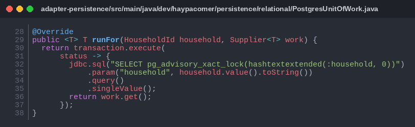

Ahora pasan exactamente 16, las otras 4 responden 400 por falta de stock y quedan 42 g. La prueba corre en cada build:

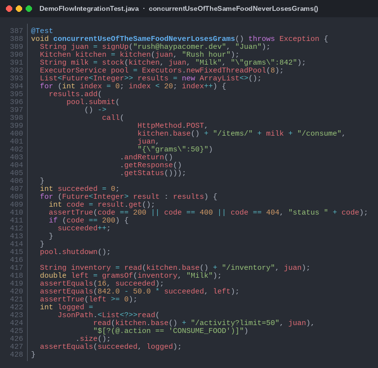

### Otros bloqueos de la versión 1.2

Según el `CHANGELOG.md` 1.2.0 y las notas de la entrega, en la v1.2 también se corrigieron:

- conversaciones del Chef que se compartían entre hogares (ahora cada conversación pertenece a un hogar);
- eventos de sensor que se contaban dos veces;
- el planificador offline, que fallaba desde el segundo mensaje.

Durante el desarrollo también hubo choques de número de migración Flyway al trabajar en paralelo.

Fuentes: issues del tablero, `CHANGELOG.md` 1.2.0, [`docs/tasks/step-89-demo-flow-noise.md`](../docs/tasks/step-89-demo-flow-noise.md), ADR 0002 y 0014, log del [CI de la v1.2.0](https://github.com/Juansit-0/HayPaComer-backend/actions/runs/42324439173).
